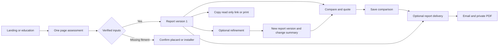

# Final product design

**Implementation order:** the [construction gates](04-implementation-plan.md#build-stages-and-exit-gates) require database, data-access/entity, business-service and API acceptance before product frontend code. UX specification and content research may proceed earlier. The [PostgreSQL consolidation](11-postgresql-and-build-order.md) changes infrastructure and sequence, while preserving the product journeys and consent requirements below.

**Baseline 1.0 · October 22, 2026**

Tires & Tread is an independent tire-selection and education service. A driver enters their vehicle and conditions, receives suitable options with evidence and estimated installed costs, compares a shop quote, and leaves with practical questions for an installer. The site must explain uncertainty as clearly as it explains recommendations.

This specification establishes the target experience. The [source review](00-source-review.md) records changes from the supplied drafts; the [architecture](02-technical-architecture.md) and [delivery specification](03-delivery-and-privacy.md) define behavior below the UI.

## Design acceptance and testable use cases

Each feature starts with an actor, preconditions, normal outcome, alternate/denied outcomes, and observable acceptance examples before implementation. The [UC01–UC12 catalogue](08-test-driven-development.md#use-case-catalogue) maps the journeys below to application, functional API/UI, and end-to-end tests. Examples must cover empty/unknown data, permission denial, failure/retry, relevant concurrent actions, and accessible interaction. Product/domain reviewers approve the expected behavior; passing tests against invented tire facts do not establish correctness.

Use the [test-driven cycle](08-test-driven-development.md#required-development-cycle) for behavioral increments. Web, staff, future mobile, and MCP interfaces use the same application/domain services and versioned contracts under the [coding standards](10-coding-standards.md). A screen is complete only when the real backing behavior, adverse paths, and applicable accessibility/performance checks pass. This engineering addition preserves the release scope and visual design below.

## Release boundaries

| Release | User outcome | Included |
| --- | --- | --- |
| R0 Foundation | Validate the product can make trustworthy recommendations | Licensed data evaluation, score methodology, vendor/auth/CMS spikes, content review, design primitives |
| R1 US web launch | Choose, understand, compare, save, and optionally email | US English, about 100 explicitly selected vehicle configurations and about 50 tire models with size-level coverage; all core form/results/refine/compare flows; HTML/text email and linked PDF; 25 reviewed glossary pages; decoder and checklist; admin core; privacy/consent; affiliate links and guarded ads; PWA manifest |
| R2 Reseller pilot | Receive useful sponsored discounts without changing recommendations | 5–10 verified pilot resellers; free-credit offers, moderation, coupon pools, report-email matching, email operations, consented visitor explorer; internal aggregate insights |
| R3 Expansion | Return for ownership support and use new acquisition channels | UK/IE/AU only after market review; lifecycle email; reseller billing/API; advanced SEO; public MCP then authenticated tools; Expo app; direct sponsorship; Tier A sales and separately gated Tier B evaluation |
| R4 Optional growth | Expand languages and separately approved commercial capabilities | Tier C leads, onsite offers, redemption integrations, non-English locales, paid connector plans, optional app ads; later markets assessed separately |

R3 is a set of independently gated workstreams, not a single release train. No tire checkout, inventory, physical tire testing, scraping of proprietary test results, or consumer login is required for R1. Revenue starts with retailer referrals and compliant display ads. Audience sales are not a dependency of the core product.

## Experience principles

1. Verify fit and eligibility before comparing benefits or cost. Missing safety-critical data produces a clear limitation, not a guessed recommendation.
2. Keep the initial task short. Refinement, explanation, comparison, and email are optional layers after the first useful result.
3. Explain the three most influential reasons, the cost basis, and where the evidence is incomplete.
4. Keep money separate from tire ranking. Retailer links, sponsored offers, and ads attach only after the engine result is frozen.
5. Keep consent specific. Reading, sharing, and printing require no email or marketing permission.
6. Preserve the same facts across the website, email, PDF, future app, and connector.

## Information architecture

| Route or surface | Purpose | Indexing and access |
| --- | --- | --- |
| `/en-us/` | Landing page with complete assessment | Public, indexable, ad-free |
| `/en-us/find-tires` | Focused assessment with same component | Public; canonical strategy avoids duplicate landing content; ad-free |
| `/en-us/report/{publicId}` | Owner's report, refinement, delivery | Owner capability/session; private, noindex, no public cache |
| `/en-us/r/{shareToken}` | Explicitly shared read-only report | Bearer view capability; redacted, noindex; “Make my own assessment” forks |
| `/en-us/report/{publicId}/compare` | Comparison tab/view | Owner capability; included in shared snapshot only when chosen |
| `/en-us/tire-basics` and `/en-us/learn/{slug}` | Education hub and term/guide template | Public, reviewed, indexable |
| `/en-us/tools/size-decoder` | Sidewall explanation, not fitment approval | Public, indexable |
| `/en-us/before-you-buy` | Questions, printable checklist, local scorecard | Public, indexable |
| `/en-us/how-we-choose`, `/about`, `/contact` under locale | Trust, methodology, support | Public, indexable |
| `/en-us/privacy`, `/cookies`, `/terms`, `/affiliate-disclosure`, `/privacy-centre` | Policies and rights | Public; rights forms noindex; no ads |
| `/preferences/{token}` | Email preferences and withdrawal | Purpose-limited token; private, noindex |
| `/admin`, `/cms` | Staff operations and publishing | Staff identity, MFA, server authorization |
| `partners.[domain]` | Reseller organization area from R2 | Separate realm, tenant isolation, noindex |
| `mcp.[domain]/mcp`, `/en-us/developers` | R3 connector and public documentation | Controlled API; public developer content |

Market, language, and formatting are separate concepts even though the route combines them. `/en-us/` maps to language `en`, market `US`, and locale `en-US`. An unsupported country sees a scope notice and education, not US-specific fitment or legal claims silently relabeled for that country.

## Visual system

Retain the supplied visual character: charcoal masthead/footer, white content cards, light gray page background, a yellow tire-ring motif, blue primary actions, and compact editorial headings. The supplied images establish direction, not measured production tokens. The following values are the final implementation baseline and are also stored in [design-tokens.json](design-tokens.json).

| Element | Specification |
| --- | --- |
| Brand ink | `#1C2023`; primary text and dark header |
| Page / surface | `#F3F4F4` / `#FFFFFF` |
| Secondary text | `#52606D`; avoid pale gray for required content |
| Primary action | `#1D4E9E`, white label; hover `#153B79` |
| Accent | `#F5C928`; use dark text, not white text on yellow |
| Border / control border | `#D8DEE3` / `#7B8794`; subtle dividers are not the only input boundary |
| Semantic colors | Success `#166534`, warning `#92400E`, danger `#B42318`; pair with words/icons |
| Headings | Self-hosted Barlow Condensed, weights 600/700; fallback system sans-serif; confirm font license at bootstrap |
| Body and controls | System UI stack, 16px/1.5 default; supporting text 14px/1.45; numeric costs use tabular numerals |
| Type scale | Hero 48/52 desktop, 36/40 mobile; page heading 32/36; section 24/28; card title 22/26 |
| Spacing | 4, 8, 12, 16, 24, 32, 48, 64px; no arbitrary negative overlap |
| Radius | Inputs 6px, cards 8px, chips 999px; no deep card shadows |
| Controls | Minimum 44px target; 48px primary button/input height; visible 2px blue focus ring plus white offset |
| Container | Max 1200px; 24px desktop gutter, 16px mobile; main prose max 72ch |
| Breakpoints | Below 640px phone; 640–1023px tablet; 1024px+ desktop; test 320px minimum |
| Motion | 120–180ms state changes; reduced motion disables spinner rotation and sliding transitions |

Use a simple original SVG tire/sidewall illustration with live text labels. Do not bake glossary text into raster assets. The logo can use the yellow ring and wordmark during implementation; final trademark and font checks remain G0 tasks. No product imagery implies a brand endorsement or measured performance.

## Assessment screen

Desktop: 64px header, hero copy/sidewall illustration in two columns, then an 8-column form with a 4-column “What you get / How we stay independent” panel. Mobile: 56px header, shorter introduction, then a single form column. Navigation exposes Find tires, Tire basics, Size decoder, Before you buy, and How we choose. Mobile menu returns focus to its trigger on close.

### Inputs and validation

| Input | Interaction and validation | Special behavior |
| --- | --- | --- |
| Vehicle or known size | Explicit mode switch; cascading year/make/model/trim; searchable accessible comboboxes | Changing a parent clears descendants and announces it. Preserve entered values when a lookup fails. |
| Wheel package and axle sizes | Ask when multiple fitments exist; show front/rear and wheel diameter | No default package guessed from model alone; nonstandard wheels require confirmed fitment data. |
| Known size | Parse size and optional service description; show highlighted decoder | Size alone is not vehicle fitment verification. Ask load/speed, construction and use constraints; return limited size candidates until verified. |
| Location | US ZIP or supported city lookup; optional browser location button | Permission requested on click. Convert coordinates to locality then discard precise coordinates. Edge country is only a suggestion. |
| Roads | All six source options, multi-select, at least one | Optional “mostly” designation; towing reveals a note and later detail. |
| Priorities | All six source choices, choose one or two | Third choice announces limit and lets the user deselect; climate suggestions are visible and editable. |
| Annual distance | Under 8k, 8–12k, 12–18k, 18k+ miles | Estimates disclose the representative mileage assumption; exact mileage can refine economic estimates. |
| Replacement quantity | Four, two, one; default four | Partial replacement can require matching current tires, tread depth, and manufacturer AWD rules before recommendation. |
| Seasonal setup | One set / willing to use separate winter set | Shown for winter climates; affects eligibility and scenario view, not a cosmetic badge. |

No email field appears here. Show the short collection notice beside submit, with a policy link. Submit reads **Find my tires**, with helper “No account needed.” Validation appears after blur or submit, not on every keystroke. On submit, focus the first invalid field and provide a linked error summary. The server applies the same schema independently.

Allow manual location entry when permissions are denied. Unsupported ZIP, unavailable trim, incompatible mixed sizes, provider outage, and unsupported vehicle each have a separate message and recovery action. Never erase a completed form after a transient error. Store only the draft needed for the active session; persistent preference storage follows consent.

### Matching state

Use the dark reference screen and yellow ring. Show real milestones: input validation, fitment verification, eligibility, scoring, and price assembly. Do not claim a check finished before the service completes it or impose an artificial animation delay. After 5 seconds show “This is taking longer than usual”; after the request timeout offer Retry and Edit details. Retries use the same submission key. Remove “Skip to results (prototype).” Announce progress politely; respect reduced motion.

## Results and saved reports

The title uses the returned count, vehicle context, and strategy: **“4 options for your CR-V and winter driving”**. The subtitle summarizes locality, roads, priorities, mileage, and report date. An evidence limitation banner appears before cards when fitment or scoring coverage is incomplete. A summary explains that match scores express preference fit, not safety certification.

Desktop layout: 280px sticky conditions/size rail with remaining width for cards. Mobile: conditions summary above the first card with expandable details, followed by all options; the first card opens by default and others can expand. “See all options” reveals any compact remainder, while the total count remains visible. Avoid hiding a safety warning inside a collapsed section.

The header offers **Edit details**, **Get this report**, **Copy link**, and **Print / PDF**. Copy link creates or reuses a separate view-only capability and explains “Anyone with this link can view this report.” Owner controls include Revoke shared link and Delete report. Shared recipients never see a prefilled email, saved consent, owner edit token, or private shop notes.

### Recommendation card contract

1. Tier, strategy/category, exact axle size/service description, verified-fit status, and model name.
2. Match score or an evidence-limited label with its meaning. Include “How this was assessed.”
3. Installed estimate as the main cost; per-tire/set amounts and cost basis immediately below.
4. Expandable itemized costs, price date, quantity, tax locality, and known exclusions. Alignment is a separate optional estimate unless included in the quote basis.
5. Weather/comfort/efficiency rows only where supported. Use text values and source tooltips; “Not measured” is a legitimate value. No star rating masquerading as customer reviews.
6. Up to three ranked reasons with evidence links and one material tradeoff. Relative bars represent model factors, not measured braking distance.
7. Mileage warranty distinct from modeled economic life; only show cost per 1,000 miles when the assumptions are sufficient.
8. Retailer actions, size-specific destination, visible affiliate disclosure, and Compare checkbox.

Retailer order is based on comparable price, availability, delivery/installation relevance, and a stable tie-break. Commission never controls tire or retailer order. If no approved affiliate exists, allow a verified non-affiliate retailer/manufacturer link. If no price exists, show “Price unavailable”; do not invent a range.

### Lower results modules

Order: all recommendations → Refine and compare → saved comparison summary → Get this report → first optional ad → Poor fits for your conditions → seasonal scenario → maintenance → six shop questions → education → second optional ad → footer.

“Poor fits” describes the reason, its evidence, and severity: incompatible fitment, unsuitable strategy, unverified data, or preference mismatch. A safety-ineligible item may appear in compare for explanation, but never has a buy CTA or a misleading “best” highlight. An avoid category is not presented as a specific catalog SKU.

Maintenance is manufacturer- and market-aware: pressure source, rotation eligibility, inspection triggers, tread/age guidance, and review date. Staggered/directional sets may have different rotation options. A questionnaire cannot establish that a damaged or aging tire is safe for a future period. Use “Arrange inspection” where the answer requires one.

## Refinement and versioning

The **Refine your results, about 2 minutes** panel contains optional current tire, DOT week/year or age, tread measurement and method, budget/basis, ownership horizon, noise sensitivity, towing band, approved winter wheel package, run-flat/TPMS, and purchase timeframe. Every question has a brief “This changes…” hint.

Budget is an amount plus a basis: per tire, selected set before installation, or installed total. The default follows the chosen replacement quantity, not always four. A slider has a numeric input alternative. A tire over budget can only appear in a separate, labeled “Above your budget” suggestion group; it never displaces the meaning of the hard filter.

Debounced saves persist an owner-only draft with “Saving / Saved / Retry” states. **Update my results** creates a new immutable version; it does not mutate the old report. Compare the same scoring version and explain added/removed/reranked options. Changes caused by catalog/recall updates are distinguished from changes caused by answers. Keep a version selector and a warning that old availability or recall information may be stale.

If a second tab submits from an outdated version, show “This report changed elsewhere” with Review changes or Start a new version. Never silently replace newer data. Incompatible saved compare items remain visible as “Not eligible in this version” until explicitly removed.

## Four-item compare and shop quote

Desktop uses a semantic table, sticky row labels, and item headers. Phone uses a keyboard-scrollable region with sticky row labels, visible column position, Previous/Next controls, and a stacked comparison alternative. Do not require swipe gestures. A persistent count announces “3 of 4 selected”; removing an item restores focus predictably.

Sources: recommended SKU, compatible catalog SKU, evidenced excluded SKU, or shop quote. Each header carries its provenance. A free-text unknown quote is **Unverified** and never receives a fabricated score. Show these rows: strategy/category; exact size/axle; OE load/speed/fit status; 3PMSF and M+S; available performance evidence; price/quantity/basis; installed estimate; model life assumption; cost per distance; warranty; EV evidence; match score.

**Show only differences** retains safety status, row labels, and unknown values. Highlight a best value only among eligible items with comparable units, methods, currency, quantity, price freshness, and inclusions. Missing data never wins a row. For scores where higher/lower is not universally better, omit the highlight.

Quote input requires product or free text, size where known, amount, currency, quantity, price basis, included services/tax, and date. Shop name is optional, private, and excluded from telemetry. The verdict separates **Fit**, **Climate strategy**, **Price comparison**, and **Evidence missing**. “Above our observed range” replaces an unsupported claim that a shop price is unfair. Unknown inclusions produce “Not directly comparable” rather than an apparent saving.

The plain-English summary is generated from approved templates and supported deltas. It can say “The quoted set is $80 above this observed range” on a comparable basis; it cannot say one tire stops shorter without licensed comparable braking data.

Scenario tabs: one year-round set versus two-set winter strategy; budget versus premium over an editable ownership horizon; two versus four replacements only when supported by vehicle rules. Show annual mileage, winter share, tire life range, wheels, swaps, storage, taxes/fees, and residual-value assumption. Missing assumptions are editable, clearly marked, and not quietly treated as zero.

**Add to my report** saves a comparison against a fixed report version. Unsaved comparison changes are announced before sending or leaving. Copying a comparison link shares only the chosen snapshot.

## Get this report and communication design

Use a white panel with native checkboxes and one primary button. In order: Email me this report; offer subscription when enabled; future identity sharing only when enabled; 18+ attestation only for offers/sharing. Report and offers are independent; selecting either reveals the email field. No report selection is required to subscribe to offers, and no offers selection is required for the report.

Offer copy at launch: **“Email me tire offers when available, up to 4 per month.”** Explain paid placements and confirmation. Later active-program copy can say “Offers matched to your tire size and area.” No pending subscription is marketed as a live coupon program. The user must explicitly confirm offers; the report is not delayed for that confirmation. Keep lifecycle reminders separate from offers.

Button states: **Send my report** for a report request; **Save my choices** for preferences only; disabled until an actionable valid choice exists. Suggestions for address typos require a click and never rewrite the address automatically. Generic response messages prevent contact-existence discovery.

After submission show **“Scheduled for p•••@example.com. Cancel or correct within 60 seconds.”** The countdown comes from the server's `send_after`. After provider acceptance show Sent; while pending show Queued; after cancellation show Cancelled; after a definite failure give a retry that preserves idempotency. Avoid promising inbox arrival.

### Email layout

600px maximum width, one column, 16px body, 14px minimum supporting copy, system fonts, semantic content tables and layout tables marked presentational. Header → report/vehicle/conditions summary → compact picks → saved comparison summary → poor-fit summary → decoder → 3–6 relevant learning links → maintenance → questions → optional sponsored offers → helpfulness → compliance/preferences footer. Plain text carries the same facts and links.

Keep rendered HTML under 100KB. Summaries may link to detailed hosted sections; never truncate safety qualifications, disclosures, or unsubscribe controls. Mobile actions are full width. Images have alt text, dimensions, and absolute HTTPS URLs. Dark-mode contrast and images-off rendering must remain usable. See [delivery operations](03-delivery-and-privacy.md) for exact sending and consent rules.

### PDF and print layout

Offer browser print plus a separately rendered accessible report PDF. Use US Letter in R1 and A4 for relevant later markets, 36pt margins, 11pt body minimum, repeating report/version/date header and page numbers. Recommended section flow: summary/assumptions, picks with cost details, comparison in a dedicated landscape section if needed, exclusions and strategy, maintenance/checklist, evidence/disclosures. Never force a fixed page count by shrinking text.

Avoid splitting a recommendation card; repeat table headers and carry-over labels across pages. Exclude web ads, live preference controls, contact address, owner tokens, and private quote text from the shareable export. PDF generation pins the report and comparison versions; a current recall notice can accompany the download without silently rewriting history. Expose a web-accessible equivalent for assistive technologies and test PDF reading order. Private cache and download expiry are separate controls.

## Education and trust pages

The hub uses five groups: Reading the sidewall, Ratings and labels, Tire types, Maintenance, and Buying. Each article has a plain definition, original annotated SVG, relevance to the driver, regional context, misconceptions, related content, FAQ where useful, reviewer/source details, and a Find tires CTA. Structured data reflects visible content; no promise of a rich-result appearance.

R1's 25 reviewed topics: tire size; aspect ratio; wheel diameter and radial construction; load index; speed rating; XL and load range; P-metric versus LT; UTQG treadwear; UTQG traction; temperature grade; M+S; 3PMSF; all-season; all-weather; winter tires; summer tires; DOT date; tread depth; cold pressure and TPMS; rotation; alignment; AWD and matching tires; run-flat tires; EV considerations; installed cost and warranties. Before you buy and How we choose are additional cornerstone pages.

The size decoder explains a syntactically valid size/service description but does not approve alternate fitments. The checklist provides 14 source questions with Good answer / Ask for clarification, printable checkboxes, and a scorecard saved locally with permission. A scorecard summarizes unanswered or concerning items; it does not certify a shop's competence.

Later programmatic vehicle/size pages stay noindex until unique data and editor review pass. Legal and technical claims have a source and review deadline; stale claims can be withdrawn independently of the whole article.

## Admin product design

Use a consistent shell: left navigation grouped as Overview, Audience, Partners, Content, Communications, Data operations, Privacy, and Settings. Show date range, market, source, and freshness on every metric. Empty integrations read “Not connected,” not zero revenue. Every mutation shows success/failure and writes an audit event. Restricted contact data is revealed only by Owner/Privacy officer with a logged access reason.

| Module | R1 behavior | Later completion |
| --- | --- | --- |
| 1 Overview | Sessions where measurable, assessment funnel, reports, sends, affiliate clicks, freshness | Reconciled earnings, changes, weekly digest |
| 2 Traffic/content | Consented aggregate pages/channels, review dates | Search Console and decay analysis |
| 3 Engagement | Form completion, compare, explanations, tools; no field text | Consented recordings and experiments only in later scoped rollout |
| 4 Affiliates | Directory, applications, restrictions, approved destinations, link health | Network imports, reconciliation, payouts |
| 5 Ad revenue | Slot configuration and measurement status | Earnings imports and RPM |
| 6 Marketing | Content workflow and consent counts | Campaigns, lifecycle composer, UTM, outreach, experiments |
| 7 Data | Imports, provenance, freshness, coverage, recall status, engine preview | Expanded markets and historical analysis |
| 8 Resellers/offers | Navigation absent | R2 verification, moderation, simulation, code pools; R3 billing |
| 9 Email | Send status, retry/unknown queue, suppression, template version | R2 topic analytics, domain health, feedback |
| 10 SEO | Metadata, safe templates, redirects, canonical/sitemap/robots preview | Strategic pages, search data, audits |
| 11 Privacy | Consent policies, request queue, deadlines, fulfillments, cookie registry | Buyer acknowledgements and assessments |
| 12 Audience/data | Aggregate dashboards; exports disabled | R2 consented explorer; R3/4 separately approved products |
| 13 Ad operations | ads.txt, slots, house ads, labels, blocks, synthetic exclusions | Sponsorship scheduler and revenue reconciliation |
| 14 App | Navigation absent | R3 reminders/push, versions, crashes, disclosures, kill switches |
| 15 Connector | Navigation absent | R3 usage, quotas, tool versions, directory status |

High-impact controls such as scoring weights, redirect regexes, data exports, and targeted campaign sends have preview/dry-run states, role restrictions, and an explicit publish action. An analyst can export aggregate reports only; that permission never implies contact export access.

## Reseller portal from R2

Onboarding is a stepper: verify email and MFA → business/location details → agreements → domain verification → submitted review. Status page explains pending information, rejection reasons, or suspension. An unverified organization can draft offers but cannot publish them.

Dashboard shows aggregate delivery, eligible clicks, issued codes, reported redemptions, freshness, and pilot credit status. Offer editor groups Content, Applicability, Locations, Dates/caps, Redemption, and Preview. Save draft never publishes; submit creates a review version. Edits to live offers keep the approved version serving until replacement approval. Trusted date/code edits still pass validity, budget, and audit checks.

Code upload provides column preview, invalid/duplicate counts, atomic final import, and a downloadable error report. Unique codes are concealed from analyst users and public listings. Redemption correction appends an adjustment, not an overwrite. Team, agreements, and audit history are available to the organization owner. R3 adds a clear prepaid ledger, invoices, auto-top-up control, and scoped API keys; no tire consumer payments.

## Native app and connector from R3

App navigation: Garage, Assess, Learn, Offers, Settings. Garage cards show installed set, next action, and confidence/freshness. A first-run guest can use assessments and local records; sign-in is offered when requesting sync. Camera/VIN flow is Capture → Recognized fields → Confirm → Save, with manual fallback and no automatic fitment approval from OCR. Store photos only when deliberately saved, with metadata removed.

Tire-log entries are dated events; reminders show their rule and can be paused. Ask for push permission after creating a reminder. Wallet shows expiry/timezone, seller, terms, code/barcode, and an offline freshness warning. Offline redemption is never guaranteed. Cache the last five reports and chosen content; online recall checks remain visibly separate from cached results. Account deletion is available in Settings. Marketing push has distinct consent and a four-per-month cap with quiet hours.

The public MCP connector exposes the seven source tools using the same fitment, eligibility, pricing, and comparison services. Every result returns provenance, uncertainties, engine version, market/units, and attributed links. Public offers are clearly sponsored and contain no assigned unique codes. Tools do not trigger email or save personal data without an authenticated, purpose-specific user confirmation flow. The developer page includes schemas, examples, rate limits, data-use terms, and version/deprecation policy.

## Accessibility and state coverage

Meet WCAG 2.2 AA across public pages, dialogs, forms, compare, admin, partner portal, and consent. Validate keyboard-only navigation, screen-reader names/status, 200% zoom, reflow at 320px, 44px product target size, visible focus, reduced motion, and contrast. Sticky bottom actions reserve space plus safe-area inset and never cover errors, the consent panel, or focused controls. Banner focus behavior must fit its actual modal/nonmodal semantics; no nonmodal focus trap.

| State | Required experience |
| --- | --- |
| No eligible tires | Explain the limiting constraint, preserve inputs, offer compatible edits or installer verification; never soften safety filters |
| Partial evidence | Show supported fields and specific unknowns; no fake precision |
| Stale prices | Display as-of date and unavailable-current-price state; never “checked today” without a timestamp |
| Recall feed outage | Mark freshness, apply last trusted recalls; block verified recommendation output when the safety freshness gate fails |
| Report expired/revoked/deleted | Generic unavailable message, new assessment CTA; no contact existence disclosure |
| PDF generation pending/failed | Accessible status and retry; web report remains available |
| Consent denied or CMP unavailable | Core assessment remains usable, nonessential scripts remain off |
| Email suppressed | Generic safe response; no provider retries that bypass suppression |
| Offline | Explain connectivity, keep current draft, retry explicitly; never present cached data as current |
| Ads blocked/unfilled | Reserved house promotion only where slots are allowed; never shift cards or bypass consent |

## Product success measures

R1 targets from the source: assessment completion at least 70%, median completion at most 75 seconds, explanation engagement at least 25%, affiliate CTR at least 8% of results viewers, and report email request rate at least 35%. Offers opt-in target is 15% of report requesters, tracked separately from confirmed subscriptions. These are hypotheses to evaluate after launch, not facts or release blockers.

Use completed server-created reports for report counts; deduplicate repeat submissions. Completion denominator is valid form starts in the measured cohort, with staff/bots excluded. Explain analytics consent coverage on dashboards so observed sessions are not represented as all visitors. Diagnose friction before optimizing revenue; never test weaker safety filters or preselected consent.
