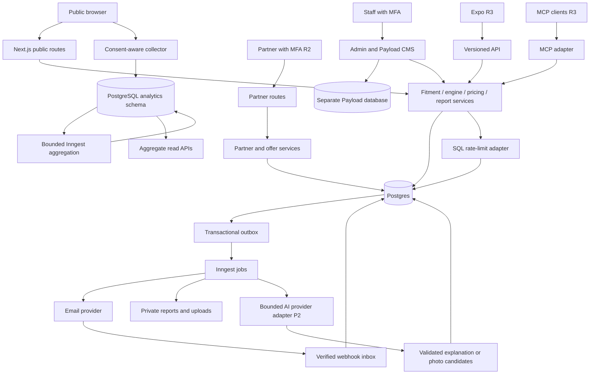
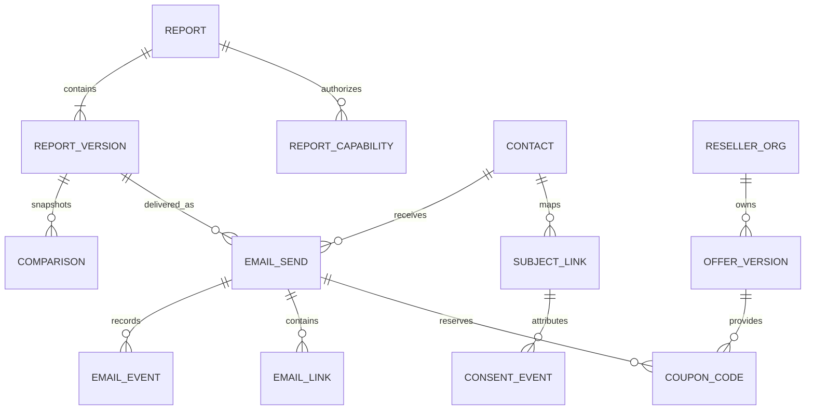

# Technical architecture

**Baseline 1.5 (option-C deployment approved October 23, 2026).** This is the implementation target, not an assertion that services or infrastructure already exist.

**Architecture history and current amendment:** the user approved AS01–AS07 on October 22, 2026. The [signoff record](07-stack-and-layer-signoff.md) preserves that reviewed baseline. The subsequent [PostgreSQL and build-order amendment](11-postgresql-and-build-order.md) changes AS02/AS07 implementation selections and requires database → data access/models → business services → APIs → frontends. Separate CMS ownership and the seven logical layers remain. The [DP01–DP08 approval](16-deployment-and-local-environments.md#approval-record) selects app + PostgreSQL outside Vercel and supersedes the former Vercel/Neon default. R0 and release evidence are still required.

Build a modular Next.js application with a pure, versioned recommendation package. Public UI, staff operations, CMS, and later partner routes share domain services but not authorization privileges. Durable jobs handle external side effects. PostgreSQL is authoritative for reports, permissions, delivery, and money; analytics is a downstream projection.

## Engineering process and separation of concerns

Follow [S0–S6 construction gates](04-implementation-plan.md#build-stages-and-exit-gates). Complete R1 schema/constraint tests at S1, models/mappers/repositories at S2, pure rules and application services at S3, and headless API acceptance at S4 before product UI or template implementation at S5. Build order does not reverse code dependency direction: domain entities and repository ports remain ORM-independent.

The user's engineering expansion is specified in [test-driven development](08-test-driven-development.md), [database design](09-database-design.md), and [coding standards](10-coding-standards.md). Every behavioral increment begins with failing acceptance/unit/use-case examples, implements the smallest coherent behavior, refactors, then verifies the affected real API/database/provider boundaries. Unit, functional and use-case coverage belongs throughout E02–E20; E19 performs integrated hardening rather than starting the test effort.

The business logic layer comprises framework-independent domain rules plus application use cases. UI and HTTP/MCP/job adapters translate inputs and actors; application services enforce object/purpose policy and orchestrate transactions; repositories/provider adapters implement narrow ports. All channels reuse those services. Read models may optimize a screen's data shape without duplicating permission, ranking, pricing, or delivery rules. CI enforces import direction and server/browser boundaries.

Use explicit commands, immutable snapshots/value objects, state machines, narrow repositories/unit-of-work, and transactional outbox/inbox where needed. Compose dependencies at entry points; avoid deep inheritance, global mutable actor context, generic CRUD controllers, and hidden I/O in domain objects. Measure hot paths and query plans before optimizing; all optimizations must preserve golden outputs and authorization behavior.

## Stack and boundaries

| Concern | Selected direction | Implementation constraint |
| --- | --- | --- |
| Web | Next.js App Router, strict TypeScript, React | Pin mutually compatible stable Next/React/Payload versions at R0; do not infer versions from this plan |
| Forms and contracts | React Hook Form, Zod | Shared client/server validation; server remains authoritative |
| Styling and locale | Tailwind, Radix UI primitives, next-intl/Intl | Use design tokens; keep engine reason codes language-neutral |
| Hosting | Portable Linux Node.js 24 app containers outside Vercel; reverse proxy/public CDN | Match runtime in dev/stage/CI; select final host before hosted integration under the [P1 decision triggers](implementation/P1-PR-001-launch-baseline.md#deferred-decision-register); co-locate app and DB; private responses never enter shared caches |
| Operational data | Standard PostgreSQL outside Vercel, Drizzle + `pg` | Managed or self-operated production DB chosen before hosted integration; bounded runtime pools, separate app/CMS databases and migration credentials |
| CMS | Embedded Payload with `@payloadcms/db-postgres`, separate logical database | Payload owns CMS database/migrations; prove grants, recovery isolation, and Clerk integration at R0 |
| Auth | Clerk staff and organization identities | Mandatory MFA, separate staff/reseller audiences, explicit server role checks; consumer realm added R3 |
| Workflows | Inngest | Email, PDF, imports, privacy jobs, future reminders; persisted state and retriable steps |
| Events and analytics | Application PostgreSQL `analytics` schema + scheduled Inngest aggregation | Acknowledge after event/invalidation commit; idempotent bounded generation rebuilds, privacy invalidation and aggregate read views |
| Limits and reusable reads | PostgreSQL atomic rate buckets, indexed queries, public CDN caches; optional bounded SQL computation cache | Required limits fail closed; no cached permission decisions; optional pure computation cache introduced only with measured benefit; required P2 AI artifacts are separate |
| Email | Resend + React Email | Verify domain, idempotency, webhooks and policy before first real send; separate commercial stream/subdomain |
| PDF | `@react-pdf/renderer` | Render from versioned report DTO; verify fonts, tables, links, reading order |
| Assets | Private S3 object storage, public reviewed-media bucket/CDN | Use managed encryption and scoped URLs; direct private uploads for large CSVs, no public export bucket |
| Sensitive fields | Managed envelope encryption, AWS KMS for data-encryption keys | Signing-only key products do not replace data encryption; purpose-specific HMAC lookup keys |
| Content routing | Portable public-config adapter over SQL publication history and versioned S3 snapshots | Bounded validated reads, expiry and cross-replica invalidation; CMS propagation <60s; no PII or secrets |
| Instrumentation | R1 first-party PostgreSQL events/aggregates + Datadog operational metrics | GA4/PostHog stay disabled until a specific measurement need, consent mapping, and cost case are approved; no R1 session replay |
| Bot control | Turnstile plus server rate limits | Sitekey/action/hostname verification; fail safely if token invalid |
| Tooling and delivery | pnpm workspaces, ESLint, Prettier, GitHub Actions, Docker dev/stage and protected container previews | Local pre-push checks, frozen installs, import boundaries, reviewed migrations and immutable image promotion |
| Verification | Vitest, Playwright, axe-core, real PostgreSQL integration tests | Engine/property, transaction/race, browser and accessibility checks; manual assistive-technology/email/PDF review |
| AI assistance and extraction | P2 official OpenAI SDK/Responses adapter; PostgreSQL artifacts, Inngest jobs and private S3 images | Pin/evaluate model, schema and prompt; exact authorized reuse and user-confirmed photo fields; no provider SDK inside domain logic |
| Domain reference data | NHTSA official APIs/bulk files plus licensed/reviewed providers | P1 scripts and P2 admin CSV use shared staging/validation/publication services; see docs/13 |
| Later billing/mobile/MCP | Stripe; Expo; official MCP TypeScript SDK | Each independently gated; shared contracts and domain engine, no copied ranking logic |

These extend the source's preferred stack. R0 checks current integrations and costs before provisioning. There is no reason to introduce microservices, Kubernetes, a vector database, or a separate general-purpose API framework for R1. Use the provider's supported SDK only after verifying the selected integration and environment setup. P2 adds the bounded OpenAI API adapter specified in [AI analysis/photos](14-ai-analysis-and-photo-design.md); it explains deterministic results and cannot decide fitment, ranks or safety.

Use a separate logical PostgreSQL database for Payload from the outset, with separate credentials and migrations. The [Payload documentation](https://payloadcms.com/docs/database/postgres) marks custom schema selection experimental at review time; it is not a launch dependency. Application and CMS databases may share a PostgreSQL cluster only after grants and recovery boundaries are proven; sharing retains a common compute/failure and physical-recovery boundary. Bridge published content by stable IDs and revision DTOs, with durable publication work and retryable cache/config propagation; do not assume cross-database transactions.



## Planned repository structure

The directories below are an implementation plan; only `docs/` exists today.

```text
apps/web/                 Next routes, public UI, admin, partner UI, Payload config
apps/mobile/              Expo application, introduced in R3
packages/contracts/       Zod request/response/event schemas and generated API types
packages/engine/          Pure deterministic filtering, scoring and explanation codes
packages/domain/          Pure entity/value interfaces, report, consent, pricing and offer rules
packages/application/     Use cases, authorization, transaction orchestration and ports
packages/integrations/    Provider adapters and external-service wiring
packages/db/              Schema/migrations, typed storage models, mappers, repositories, unit-of-work
packages/content/         CMS adapter, taxonomy and published-content read model
packages/email/           Locale-aware React Email and text templates
packages/pdf/             Report rendering templates and fonts
packages/ui/              Tokens and web components; no forced sharing with native UI
packages/i18n/            Locale messages, reason text and formatting adapters
scripts/data/             Planned operator CLI over shared ingestion use cases
jobs/                     Workflow handlers, scheduled imports, AI refresh, retention, reconciliation
tests/fixtures/           Synthetic licensed-schema fixtures, golden scenarios
tests/usecases/           Actor-driven application acceptance scenarios
tests/integration/        Real PostgreSQL constraints, roles, migrations and races
tests/contracts/          API and provider-adapter compatibility fixtures
tests/functional/         Running HTTP and focused UI feature verification
tests/e2e/                Browser, permissions, privacy, email and partner flows
docs/                     Design, decisions, runbooks, coverage and release evidence
```

Use pnpm workspaces. Do not create an empty mobile application until its workstream starts. Keep server-only credentials and packages outside browser imports. Engine imports must never depend on affiliate, advertising, offers, consent, analytics, or UI packages.

## Recommendation engine

[P1-PR-017](implementation/P1-PR-017-eligibility-recommendations.md) implements the pure rules and shared application-service entry point. The 98-case synthetic specialist packet is pending actual review; production source assembly, report integration and G1 acceptance are still open.

[P1-PR-019](implementation/P1-PR-019-report-services.md) implements the repository-backed resolver and technical report/refine/compare/access workflows, explicit regional policy heads, scoped shares and safe exact-version command receipts. Current recall overlays remain separate from immutable report output. The resolver requires current rights and approved regional/source evidence; absent recall mappings do not establish clearance. Source contracts, positive clearance/inspection coverage, specialist acceptance and production issuance remain pending. A dedicated source-metadata role avoids ingestion credentials in the report process.

### Input normalization and evidence

Represent wheel/axle configurations explicitly: fitment ID, front/rear size, quantity per axle, construction, load index/range, speed rating, XL, run-flat and approved options. Vehicle year/model alone is insufficient. Size-only input produces `verificationStatus: limited` unless required vehicle constraints are independently confirmed.

Every catalog fact has source/provider ID, source record ID, market, applicable SKU/model, unit, method, license scope, effective date, imported/reviewed time, and confidence classification. Keep manufacturer claims, labels, licensed measurements, and derived model features separate. Tire model family scores do not automatically transfer to all sizes or constructions. Unknown fields remain null with reason codes, not zero.

### Deterministic pipeline

1. Validate and normalize units, location, quantities, wheel package, and seasonal strategy.
2. Resolve verified fitment and OE constraints. If required constraints are unknown, return an incomplete result with next actions.
3. Filter by exact axle size(s), manufacturer load/speed and construction requirements, market availability, and relevant recall eligibility. A recall matching unresolved DOT ranges can yield a conditional warning or block pending verification; do not claim all units recalled or cleared without evidence.
4. Apply climate and usage strategy rules. Dedicated winter tires belong in a winter-set plan. Towing bands do not independently justify adding load capacity beyond approved fitment.
5. Apply the user's budget using its explicit basis. If installed costs are unknown, do not claim compliance with an installed-price ceiling.
6. Compute evidence-backed preference suitability and select up to five eligible options with tier diversity where possible.
7. Compute exclusions, reason codes, confidence, limitations, and price/life/scenario estimates.
8. Freeze the result and data versions; attach retailer destinations and later sponsored offers in separate services.

Ranking defaults are a proposed calibration baseline: wet 0.25, longevity 0.20, comfort 0.15, dry 0.10, value 0.10, noise 0.10, efficiency 0.05, snow 0.05, ice 0.00. Climate/strategy supplies a reviewed base vector; declared priorities apply documented multipliers (initially 2× selected dimensions), followed by normalization. Winter strategy must introduce reviewed snow/ice weights and eligibility rules before production. No business user can publish weights directly without golden-scenario preview and a reviewed version.

For each context, define the set of usable comparable metrics before ranking. A numeric score is allowed only when the same required evidence dimensions exist across candidates. Below that evidence threshold use a coarser rule-derived suitability band and stable ordering, with no fake 94/100 precision. A missing score never means poor performance. Tie-break on evidence confidence, comparable installed midpoint, then stable SKU/configuration ID. Explain tier diversity if it changes the displayed shortlist relative to raw score order.

Return structured reasons such as `FITMENT_VERIFIED`, `FITMENT_UNCONFIRMED`, `CLIMATE_WINTER_STRATEGY`, `INSUFFICIENT_LOAD`, `PRICE_STALE`, `RECALL_REVIEW_REQUIRED`, and `EVIDENCE_MISSING`. Reason templates are reviewed content, not generative text. Version the engine, scoring rules, fitment dataset, catalog, climate dataset, legal guidance, price snapshot, and presentation schema with each report.

### Cost mathematics

The [018 implementation contract](implementation/P1-PR-018-pricing-comparison.md) specifies versioned exact USD arithmetic, coherent source/owner-quote snapshots, explicit tax/fee dependencies and rounding, freshness, independent quote verdicts and one/two-set ownership scenarios. Its conservative bridge attaches only current exact installed totals to 017's point-cost budget contract; range midpoints cannot prove a hard budget. The 019 trusted resolver must authorize private quotes and bind actual published sources and assumptions. Licensed coverage and specialist acceptance remain pending.

All money uses integer minor units and ISO currency. Quantities are explicit; staggered sets sum each axle's SKU/quantity. Never add per-tire and per-axle fees without units.

```text
merchandise = sum(quantity_by_sku * unit_price_by_sku)
required_services = mounting + balancing + documented TPMS/valve + disposal
installed_estimate = merchandise + required_services + estimated_applicable_tax
optional_alignment = separately displayed scenario input unless explicitly included
cost_per_1000_distance = 1000 * installed_estimate / modeled_distance
```

Compute range bounds from consistent low/high scenarios rather than mixing incompatible retailers, markets, tax bases, or price dates. Example purely for arithmetic QA: 4 × $150 + $100 services + $49 estimated tax = $749; at an explicitly assumed 50,000 miles, $14.98/1,000 miles. This is a synthetic fixture, not a market quote.

Mileage warranty is a contractual specification, not promised achieved life. Economic life uses an approved model and uncertainty range. If adequate evidence is absent, show warranty only and suppress numeric cost-per-distance. Age constraints come from source-reviewed manufacturer guidance; no inferred “safe until” date. Open-ended annual mileage bands require an explicit displayed assumption or exact input before a detailed forecast.

Two-set cost modeling allocates annual miles by season to each set; includes initial tires/wheels, replacements when modeled life is exhausted, installation, swaps, storage, tax, and a declared residual-value policy. It must not double-count annual mileage across both sets. Run all options on the same horizon and fee assumptions. No discounting or inflation by default; show that assumption and add sensitivity controls later.

### Freshness and graceful failure

Proposed launch thresholds: prices refresh daily, mark stale after 48 hours, hide a current-price claim after 7 days; recall sync daily with alert after 24 hours and block verified recommendation issuance after 48 hours of failed refresh; manufacturer/fitment changes versioned with provider-specific SLA. A successful “no changes” sync counts as fresh. A qualified tire reviewer can adjust thresholds before launch with evidence, not a silent admin override.

Cached historical reports remain historical and show a live safety overlay. Rechecking creates a new report version. Querying old results must not silently recompute scores using current data and pretend the version is unchanged.

## Data model and constraints

The detailed contract includes [domain/reference/import tables](13-domain-data-and-imports.md) and [AI artifact/reuse/photo tables](14-ai-analysis-and-photo-design.md). PostgreSQL remains the single application state store; S3 holds file bytes, and Payload remains a separate logical database. AI artifacts are required P2 business records, distinct from optional computation caching.

The [database design](09-database-design.md) is the detailed relational contract, including typed columns/nullability, PK/FK/unique/check constraints, indexes, DB01–DB28 concurrency invariants, roles, lifecycle, and migration order. The table below remains a domain overview. Use UUID identifiers, composite keys where required by invariants, and UTC `timestamptz`. Store external IDs separately. JSON is suitable for immutable engine snapshots and typed rule inputs; critical constraints, statuses, tenancy, money, and relationships belong in relational columns.

| Domain | Entities and critical constraints |
| --- | --- |
| Catalog `app` | `vehicles`, `fitment_configurations`, `fitment_axles`, `tire_models`, `tire_skus`, `market_availability`, `evidence`, `scores`, `prices`, `climate_profiles`, `market_rules`, `recalls`, `dataset_versions`; unique provider/source-version keys; unit checks; effective-date indexes |
| Reports `app` | `reports(id, owner_subject_id, current_version, locale, market, expires_at)`; `report_versions` keyed by `(report_id, version)`, pinned bundle/rules/engine and immutable snapshots; deferred composite current-version FK; drafts with optimistic revision |
| Sharing `app` | `report_capabilities(token_hash, report_id, scope, version_scope, expires_at, revoked_at)`; read and owner scopes never interchangeable |
| Compare `app` | Immutable `comparisons(report_id, report_version, revision)` and `comparison_items` with unique slots 1–4; `shop_quotes` with money/basis/quantity/date and separately encrypted private notes; delivery pins comparison revision |
| Contacts `privacy` | Encrypted `contacts` plus `contact_lookups(key_version, email_hmac, contact_id)` for unique lookup/key rotation; cautious normalization, no provider-specific dot/plus stripping; verification separate from consent |
| Permissions `privacy` | Immutable `consent_events`, erasable `subject_links`, versioned `notices`, current consent projection, `suppressions`, `cookie_consents`, `privacy_requests`, `fulfillment_steps`, `cookie_registry`; consent grant/withdraw/confirm are distinct events |
| Delivery `email` | `email_sends`, `send_attempts`, `email_links`, `email_events`, `email_feedback`, `template_versions`, `education_topic_map`; unique durable send key and `(provider, provider_event_id)` |
| Analytics `analytics` | Permitted events, revisioned dirty days and daily metrics; transactional receipt/dedupe, subject erasure, restricted aggregate views |
| Limits/cache `app` | Fixed-window rate buckets with atomic caps and short expiry; optional versioned non-identifying computation cache with measured bounds |
| Work reliability `app` | `outbox`, `webhook_inbox`, `idempotency_requests`, `job_runs`; unique event IDs, body hash for duplicate requests, retry state and terminal reason |
| CMS separate logical DB | Payload-owned content, media, SEO, redirects, content versions, review status and durable publication work; stable public read DTO; drafts inaccessible to public routes |
| Partner operations `partners` | Organizations, memberships, agreements, verification evidence, locations, offer versions, targeting, code pools/codes, decisions/events, API credentials, webhook destinations; `org_id` on every owned row |
| Money `partners` from R4 | Append-only balance ledger, reservations, billable event keys, invoices, payment events; currency consistency, no float balances; Stripe event IDs unique |
| Administration `admin` | Staff role mappings, audit events, affiliate directories/applications/links, ads.txt, slots, brand blocks, feature configurations and publication history |
| Audience internal R2 / optional R4 | Visitors/profiles/segments/buyers/products/exports/deletion notices; purpose and region provenance, current suppression required; no activation in R1 |
| App and MCP from R3 | Consumer/device subjects, garage/tire-set/check/reminder logs, saved offers, API clients, tool schema versions, directory listings; subject ownership explicit |



Foreign keys on comparisons and sends reference the exact report version. Codes are unique per pool and have a unique reservation/send association. Email links have fixed approved destinations; they do not accept a caller-supplied redirect URL. Outbox rows commit with the operation they describe so a database success cannot lose its job trigger.

## API contract

Use `/api/v1` from the start for browser, future mobile, and non-MCP integration. Route handlers adapt to the same application services rather than duplicating them. Establish OpenAPI generation at E02 and complete the R1 contract artifact and running acceptance tests at E34/S4, before frontend implementation. Server-rendered pages may call those authenticated services directly without an HTTP loopback; the same authorization applies. Request mutations use `Idempotency-Key`; repeat key with different body returns 409. Retain completed request records long enough for client retry/reconciliation; minimum 7 days for report and delivery actions. Return `requestId` in all errors; never stack traces.

```json
{
  "error": {
    "code": "FITMENT_CONFIRMATION_REQUIRED",
    "messageKey": "errors.fitmentConfirmation",
    "fieldErrors": {"fitmentId": "Choose a verified wheel package"},
    "retryable": false,
    "requestId": "opaque-id"
  }
}
```

| Method and path | Result | Authorization and important failure cases |
| --- | --- | --- |
| `POST /api/v1/owner-sessions` | Establish stable anonymous actor and scoped owner cookie before report commands | Bounded abuse controls; no analytics permission implied; subsequent report idempotency uses this actor |
| `GET /api/v1/vehicles` and `/fitments` | Typed picker options with dataset version | Public bounded queries; 429 on abuse; no email/PII |
| `POST /api/v1/reports` | 201 report ID, version, output, owner cookie; incomplete result when appropriate | Turnstile, limits; 422 invalid inputs, 503 safety data unavailable; no share capability unless requested |
| `GET /api/v1/reports/{id}` | Owner DTO, requested version, evidence freshness | Owner capability/session; 404 generic for inaccessible IDs |
| `PATCH /api/v1/reports/{id}/draft` | Saved draft revision | Owner + `If-Match`; 409 stale revision |
| `POST /api/v1/reports/{id}/versions` | 201 immutable rerun, diff and new version | Owner + expected base version; idempotent |
| `PUT /api/v1/reports/{id}/versions/{v}/comparison` | Saved comparison revision | Owner + `If-Match`; 422 fifth item or incomparable invalid input |
| `POST /api/v1/reports/{id}/quote-check` | Fit, strategy, price and evidence verdicts | Owner; sanitize free text; no arbitrary URL fetch |
| `POST /api/v1/reports/{id}/shares` | View capability for selected version or explicit latest scope | Owner; revocable; never reuses owner token |
| `DELETE /api/v1/reports/{id}/shares/{shareId}` | 204 revoke | Owner; invalidate derived download grants |
| `GET /api/v1/shared-reports/{token}` | Redacted view-only DTO | Capability; no contacts, owner secrets, or edit actions |
| `POST /api/v1/reports/{id}/deliver` | 202 send ID, `sendAfter`, cancel deadline | Owner plus Turnstile; fixed version/template, independent purposes; 429 limits |
| `POST /api/v1/sends/{id}/cancel` | 200 cancelled or 409 handoff already claimed | Owner send capability; compare-and-set against dispatch state |
| `GET /api/v1/sends/{id}` | Safe delivery state | Same scope; never expose provider payloads |
| `POST /api/v1/reports/{id}/pdf` | 202 generation or authorized short-lived download | Owner/view capability over allowed fields only; pinned version |
| `POST /api/v1/collect` | 202 after SQL event/invalidation commit, or 204 dropped by consent | Current signed subject/purpose state; dedupe/digest check; 422 invalid, 409 conflicting ID, 429 admission limit, 503 unavailable; no client-forged grants |
| `POST /api/v1/webhooks/{provider}` | Fast verified durable receipt | Raw-body signature; duplicate 2xx; unsupported provider 404 |
| `GET /e/c/{token}` | Fixed-destination 302 | Purpose-scoped link token; log failure does not block valid redirect |
| `GET /go/{linkId}` | Approved retailer redirect | Opaque attribution; safe URL allowlist; unavailable destination uses error page |
| `GET/POST /preferences/{token}` | Read/update purpose preferences | Purpose-scoped token; GET never mutates |
| `POST /api/v1/unsubscribe/{token}` | Idempotent immediate marketing suppression | RFC 8058 payload; no login/challenge |
| `POST /api/v1/privacy/requests` | Generic accepted response and verification step | Email/browser scope or authorized agent workflow; no forced account |
| `GET /api/v1/content` and `/content/{key}` | Bounded published education DTOs with revision/locale | Public; no drafts or unrestricted CMS documents |
| `POST /api/v1/tools/size-decode` | Validated unit-bearing tire-size interpretation | Public bounded input; shares pure parser/policies; no inferred verified fitment |
| `/api/v1/reference/*` | Published manufacturer/vehicle/tire/recall/advice DTOs | P1; bounded, versioned, licensed public fields; unknown coverage explicit |
| `/api/v1/admin/imports/*` | Stage/validate/diff/publish/rollback and job state | P1 operator APIs, P2 UI; staff/MFA, expected head and audit; no generic SQL |
| `/api/v1/reports/{id}/analyses` and `/api/v1/analyses/{id}` | Request/status for versioned assistance | P2 owner scope, explicit processing action, quotas and idempotency; share token denied |
| `/api/v1/tire-photos/*` | Upload intent/finalize/extract/confirm/delete | P2 owner scope; quarantined private files; field confirmation; P3 same API |
| `/admin/api/*` and `/partners/api/v1/*` | Domain-specific staff/partner DTOs | Explicit role/org, MFA, audit; object-level authorization on every access |

At E34 maintain an endpoint-to-service/UC/role inventory for the full launch API: catalog/fitment, report/refine/compare/quote/share, contact/consent/preferences, delivery/PDF/status, privacy requests, content/public tools, events/metrics, staff operational queries/commands, commercial configuration and provider callbacks. Staff actions use domain commands with audit, not generic table CRUD. Export reviewed schemas, safe examples, errors, auth scopes, pagination and idempotency rules; prove the headless journey against real repositories before S4 passes. Email/PDF visual templates and product screens follow at S5, with render-port fixtures labeled as such during S4.

Browser owner capability is a high-entropy random secret stored hashed server-side and issued in a Secure, HttpOnly, SameSite cookie. A server-side owner session can cover multiple reports so the cookie remains small. For a new browser, email recovery requires verifying the contact's authority; a forwarded report link does not establish ownership. Mutations also validate Origin and CSRF state. Token expiry/rotation are configurable and logged.

Initial fixed UTC-window limits, combined with separately configured short burst limits and tuned from beta use (adjacent windows can burst; strict rolling offer caps are separate): assessment 10/hour per pseudonymous IP key and 30/day per owner session; email 3/address/hour and 10/address/day plus 10/IP/hour; event batch at most 50 events or 64KB, accepted names and bounded fields; quote text 200 characters. All endpoints enforce request/body/timeout bounds. Do not let NAT-based limits become the only user identity or the only abuse control.

## Security model

| Actor | Allowed | Never implied |
| --- | --- | --- |
| Anonymous visitor | Public content, own active assessment, explicit share view | Contact lookup, report edit from share link, raw analytics |
| Owner capability | Edit own draft, version report, request delivery, revoke own shares | Change another contact's permissions or access other reports |
| Content/SEO editor | Draft content and permitted metadata | Publish scoring rules, read contacts, export audience data |
| Marketing/partner/ad staff | Assigned module, masked metrics and previews | Contact-level access or arbitrary campaign recipients |
| Privacy officer / Owner | Verified rights fulfillment, separately logged contact reveal | Unreviewed personal-data export; two-person approvals remain distinct people |
| Reseller Owner/Manager/Analyst | Own org data within role | Other tenants, email recipient identity, assigned codes outside authorized operations |
| Jobs | One narrowly scoped purpose and DB role | Blanket runtime superuser or unlogged bypass |

Implement deny-by-default route and object checks in services as well as UI. Staff SSO requires MFA evidence, a 12-hour absolute session maximum and 30-minute idle timeout for privileged screens; revoke on role removal. Payload routes must honor the same identities and roles, including direct CMS APIs. Do not leave a local admin/password bypass enabled.

For reseller RLS use a runtime role that neither owns tables nor has BYPASSRLS. Set organization context transaction-locally on pooled connections; empty/missing context denies access. Add composite tenant keys/FKs to prevent cross-org child relationships. Prove isolation with real SQL roles, including exports and jobs. PostgreSQL's [RLS rules](https://www.postgresql.org/docs/current/ddl-rowsecurity.html) make ownership and bypass privileges material to correctness.

Report/share/download/one-click tokens have different audiences and keys. Use at least 128 bits of random entropy; prefer 256-bit random capability tokens, keyed hash lookup, explicit scope and expiry. Suppress tokens and PII in request logs, error tools, query analytics, and third-party referrers. Private responses set `Cache-Control: private, no-store`, `X-Robots-Tag: noindex, nofollow`, and `Referrer-Policy: no-referrer`. A robots rule is not authorization.

Private reports may display the two approved ad slots only through a sanitized, token-free placement shell with no report referrer, URL, inputs, or identifiers sent to the network; if this isolation or network permission cannot be demonstrated, use house content or omit external ads there. This launch gate takes precedence over ad revenue. Email, privacy, partner and admin pages never load ad tags.

Sanitize CMS HTML and quote text; enforce CSP; allow only reviewed link origins and HTTPS. Partner logo/CSV uploads use file-size/type limits, private quarantine, scanning, metadata removal, and staff review. CSV downloads neutralize formula-leading cells. Remote URL checks block internal/link-local IP ranges, revalidate DNS and redirects, and do not trust reseller-supplied URLs as fetch instructions.

## Caching and deployment

**Approved deployment direction:** [Option C](16-deployment-and-local-environments.md) runs portable app containers and PostgreSQL outside Vercel, with isolated Docker dev/test/stage and checks before GitHub push. The final vendor, region and DB operating model require S0 networking, cost, operations and recovery evidence. The [release procedure](16-deployment-and-local-environments.md#migration-and-release-order) requires serialized migrations and protected promotion of a tested immutable image without changing layer or live-phase gates.

P2 [AI reuse](14-ai-analysis-and-photo-design.md#persistent-reuse-and-refresh) is required persisted business output with exact canonical input/source/model/prompt/policy keys, owner/shared scope isolation, ≤7-day validity and authoritative invalidation checks. It is separate from the conditional ≤24-hour computation cache below. Photo extraction cannot enter shared reuse. Database-first gates repeat per live phase; compatible migrations keep previous phases usable.

Begin with indexed catalog/fitment reads and public CDN/framework caching by market/dataset version. Add an optional bounded PostgreSQL computation cache only after profiling repeated expensive pure calculations; keys include normalized non-identifying input and all relevant versions. Check expiry on reads, cap rows/bytes and clean up through scheduled jobs. Never cache contact/permission/offer decisions in that object. Avoid full ZIP in cache keys sent to external observability. Public articles use CMS-driven invalidation. Redirect snapshots validate loops, domains, bounded regexes and precedence before publication. Protect `/admin`, `/cms`, auth, privacy, API, and well-known routes from editorial redirects.

Use PostgreSQL analytics with capped intake, restricted pools, short query/lock deadlines and bounded aggregation/purge jobs. Separate schemas do not isolate compute. Prove report p95 <2s under concurrent ingestion, limits and dashboard load; aggregate freshness ≤5 minutes and dashboard p95 <2s are initial validation targets. Optional collection degrades with explicit 429/503 and stale metrics; it cannot share a synchronous dependency with report submission. See [capacity and reconsideration](11-postgresql-and-build-order.md#capacity-failure-and-reconsideration).

Environments: local with synthetic fixtures; isolated preview branch/database/storage prefix; staging with test email allowlist and no real ads/billing; production with least-privilege credentials. No production contacts in previews. Staging/preview protection uses authentication plus noindex; robots alone is insufficient. Each environment gets distinct webhook keys, cookie scopes, callback URLs, and job event namespaces.

Migration procedure: review SQL and data backfill; run on a disposable PostgreSQL database/cluster with synthetic or rights-approved sanitized fixtures; prove current and next app compatibility; back up; apply expand migration; deploy; verify; backfill with checkpointing; remove old columns only in a later release. Payload migrations run only against its owned tables. Roll back application code by version; restore data only under incident procedures, not as a casual down migration.

Migration and database tests precede dependent implementation. Prove empty-database and previous-release upgrades using real PostgreSQL/runtime roles; use separate committed connections for concurrency tests. Do not substitute SQLite or mocks for RLS, composite FKs, locks, or unique constraints. Production schema push remains prohibited; reference diagrams and table definitions are not executable migration evidence.

Feature gates: offers serving, marketing dispatch, external ads, market availability, data exports, public MCP, app features. Safety or privacy kill switches default off/denied on unknown configuration. Static public content should remain available when optional analytics or email providers fail.

## Reliability and operational targets

AI/image jobs, import streams, SEO crawls and ad-report aggregation have bounded worker pools and quotas separate from report transactions. AI timeout, rejected output or budget exhaustion returns deterministic advice without assistance. P2 measures validated inference cost/latency/reuse, source invalidation and photo correction; the core report SLO is unchanged. P1 tests crawlability and ad script/layout budgets in consented and denied states.

| Measure | Target and interpretation |
| --- | --- |
| Public form | Mobile p75 LCP under 2.0s; initial form JS under 120KB gzip including CMP/event SDK; measure agreed device/network profile |
| Interaction stability | CLS at most 0.1; INP at most 200ms on key routes; ads cannot override layout budgets |
| Report API | Proposed p95 under 2s for cached provider data; no live third-party lookup dependency on submit where avoidable |
| Public availability | 99.9% monthly for assessment/report service; optional vendor failures reported separately |
| Event collector | 99.9% target, 10× measured/forecast peak acceptance test with bounded SQL receipt/admission; report path does not wait for event ingestion or aggregation |
| Analytics reads | Initial dashboard p95 <2s for allowed bounded queries; steady-state freshness ≤5min; privacy-invalidated aggregates hidden until rebuilt |
| Email | p95 ESP acceptance within 60s after 60s undo window; measure provider delivery separately |
| Click redirect | Under 100ms internal resolution target; external network RTT reported separately; safe redirect survives log outage |
| CMS publish | Visible cache/revalidation change under 60s, with propagation status and retry |
| MCP from R3 | p95 under 800ms uncached, under 150ms cached; define region/load before claiming SLO |
| Recovery | Proposed RPO at most 24h using separate daily backup; target 15min when proven PITR coverage exists; RTO 4h after drill |

Keep 7+ days PITR when the selected plan supports it, plus encrypted daily backups in separate storage and a quarterly restore drill. Alert on safety-data staleness, dead-letter jobs, email uncertain sends, bounce/complaint thresholds, queue lag, privacy deadlines, tenant failures, and cost anomalies. Metrics include engine/data/template versions and opaque request IDs, not personal text.

[P1-PR-020](implementation/P1-PR-020-contact-consent.md) implements owner-bound contact requests, purpose-scoped inbox proofs, independent consent projections, restrictive browser/GPC policy and retained suppression rechecks. Worker-only address/token preparation and provider suppression methods must not become public controllers. It composes PostgreSQL repositories and existing encryption/durable command ports; product HTTP and actual delivery retain later gates.

[P1-PR-021](implementation/P1-PR-021-content-seo.md) implements reviewed CMS-to-app publication with fenced recovery, immutable origin/route binding and notification intents; SQL/S3 public configuration and safe redirects; metadata/sitemap/private-route policy; glossary/education/checklist/decoder contracts; and bounded crawl/search adapters. Separate app/public/CMS credentials and current staff capabilities protect effects. Source snapshots, provider activation and actual worker/CDN/browser acceptance retain their explicit later gates.
