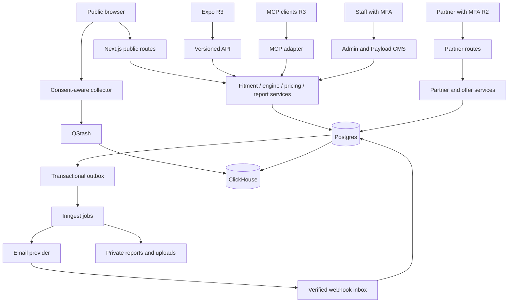
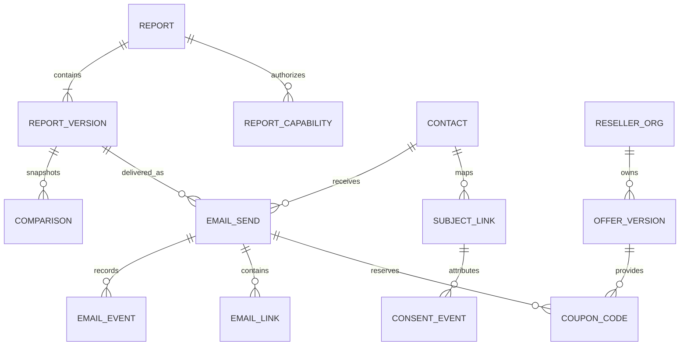

# Technical architecture

**Baseline 1.0 · October 22, 2026.** This is the implementation target, not an assertion that services or infrastructure already exist.

Build a modular Next.js application with a pure, versioned recommendation package. Public UI, staff operations, CMS, and later partner routes share domain services but not authorization privileges. Durable jobs handle external side effects. PostgreSQL is authoritative for reports, permissions, delivery, and money; analytics is a downstream projection.

## Stack and boundaries

| Concern | Selected direction | Implementation constraint |
| --- | --- | --- |
| Web | Next.js App Router, TypeScript, React | Pin mutually compatible stable Next/React/Payload versions at R0; do not infer versions from this plan |
| Forms and contracts | React Hook Form, Zod | Shared client/server validation; server remains authoritative |
| Styling and locale | Tailwind, small accessible component set, next-intl/Intl | Use design tokens; keep engine reason codes language-neutral |
| Hosting | Vercel, Node.js functions, public CDN | Co-locate database and core functions; private responses never enter shared caches |
| Operational data | Neon PostgreSQL, Drizzle | One migration owner per table; pooled runtime connections, separate migration credentials |
| CMS | Embedded Payload with Postgres adapter | Payload owns CMS schema/migrations only; isolation and SSO integration spike before adoption |
| Auth | Clerk staff and organization identities | Mandatory MFA, separate staff/reseller audiences, explicit server role checks; consumer realm added R3 |
| Workflows | Inngest | Email, PDF, imports, privacy jobs, future reminders; persisted state and retriable steps |
| Events | QStash durable buffer → ClickHouse Cloud | Collector acknowledges only after durable enqueue; no requirement for an always-running process |
| Redis | Upstash Redis | Rate limits and ephemeral caches; never sole source for consent or durable idempotency |
| Email | Resend + React Email | Verify domain, idempotency, webhooks and policy before first real send; separate commercial stream/subdomain |
| PDF | React-PDF | Render from versioned report DTO; verify fonts, tables, links, reading order |
| Assets | Private S3 object storage, public reviewed-media bucket/CDN | Use managed encryption and scoped URLs; direct private uploads for large CSVs, no public export bucket |
| Sensitive fields | Managed envelope encryption, AWS KMS for data-encryption keys | Signing-only key products do not replace data encryption; purpose-specific HMAC lookup keys |
| Content routing | Global Config public redirect snapshots | Size-bounded, versioned, signed publication; no PII or secrets |
| Instrumentation | First-party events + Datadog operational metrics; consent-gated GA4/PostHog | Avoid duplicate collection; disable session replay in R1 |
| Bot control | Turnstile plus server rate limits | Sitekey/action/hostname verification; fail safely if token invalid |
| Later billing/mobile/MCP | Stripe; Expo; official MCP TypeScript SDK | Each independently gated; shared contracts and domain engine, no copied ranking logic |

These extend the source's preferred stack. R0 checks current integrations and costs before provisioning. There is no reason to introduce microservices, Kubernetes, a vector database, an LLM, or a separate general-purpose API framework for R1. Use the provider's supported SDK only after verifying the selected integration and environment setup.

The [Payload documentation](https://payloadcms.com/docs/database/postgres) marks custom schema selection experimental at review time. Prove separate schema ownership and migration safety using real disposable branches. If that fails, give Payload a separate database and reference content by stable IDs instead of allowing two migration tools to manage the same tables.



## Proposed repository structure

The directories below are an implementation plan; only `docs/` exists today.

```text
apps/web/                 Next routes, public UI, admin, partner UI, Payload config
apps/mobile/              Expo application, introduced in R3
packages/contracts/       Zod request/response/event schemas and generated API types
packages/engine/          Pure deterministic filtering, scoring and explanation codes
packages/domain/          Report, consent, pricing, offer and privacy services
packages/db/              Application schema, repositories and reviewed migrations
packages/content/         CMS adapter, taxonomy and published-content read model
packages/email/           Locale-aware React Email and text templates
packages/pdf/             Report rendering templates and fonts
packages/ui/              Tokens and web components; no forced sharing with native UI
packages/i18n/            Locale messages, reason text and formatting adapters
jobs/                     Workflow handlers, scheduled imports, retention, reconciliation
tests/fixtures/           Synthetic licensed-schema fixtures, golden scenarios
tests/e2e/                Browser, permissions, privacy, email and partner flows
docs/                     Design, decisions, runbooks, coverage and release evidence
```

Use pnpm workspaces. Do not create an empty mobile application until its workstream starts. Keep server-only credentials and packages outside browser imports. Engine imports must never depend on affiliate, advertising, offers, consent, analytics, or UI packages.

## Recommendation engine

### Input normalization and evidence

Represent wheel/axle configurations explicitly: fitment ID, front/rear size, quantity per axle, construction, load index/range, speed rating, XL, run-flat and approved options. Vehicle year/model alone is insufficient. Size-only input produces `verificationStatus: limited` unless required vehicle constraints are independently confirmed.

Every catalog fact has source/provider ID, source record ID, market, applicable SKU/model, unit, method, license scope, effective date, imported/reviewed time, and confidence classification. Keep manufacturer claims, labels, licensed measurements, and derived model features separate. Tire model family scores do not automatically transfer to all sizes or constructions. Unknown fields remain null with reason codes, not zero.

### Deterministic pipeline

1. Validate and normalize units, location, quantities, wheel package, and seasonal strategy.
2. Resolve verified fitment and OE constraints. If required constraints are unknown, return an incomplete result with next actions.
3. Filter by exact axle size(s), manufacturer load/speed and construction requirements, market availability, and relevant recall eligibility. A recall matching unresolved DOT ranges can yield a conditional warning or block pending verification; do not claim all units recalled or cleared without evidence.
4. Apply climate and usage strategy rules. Dedicated winter tires belong in a winter-set plan. Towing bands do not independently justify adding load capacity beyond approved fitment.
5. Apply the user's budget using its explicit basis. If installed costs are unknown, do not claim compliance with an installed-price ceiling.
6. Compute evidence-backed preference suitability and select up to five eligible options with tier diversity where possible.
7. Compute exclusions, reason codes, confidence, limitations, and price/life/scenario estimates.
8. Freeze the result and data versions; attach retailer destinations and later sponsored offers in separate services.

Ranking defaults are a proposed calibration baseline: wet 0.25, longevity 0.20, comfort 0.15, dry 0.10, value 0.10, noise 0.10, efficiency 0.05, snow 0.05, ice 0.00. Climate/strategy supplies a reviewed base vector; declared priorities apply documented multipliers (initially 2× selected dimensions), followed by normalization. Winter strategy must introduce reviewed snow/ice weights and eligibility rules before production. No business user can publish weights directly without golden-scenario preview and a reviewed version.

For each context, define the set of usable comparable metrics before ranking. A numeric score is allowed only when the same required evidence dimensions exist across candidates. Below that evidence threshold use a coarser rule-derived suitability band and stable ordering, with no fake 94/100 precision. A missing score never means poor performance. Tie-break on evidence confidence, comparable installed midpoint, then stable SKU/configuration ID. Explain tier diversity if it changes the displayed shortlist relative to raw score order.

Return structured reasons such as `FITMENT_VERIFIED`, `FITMENT_UNCONFIRMED`, `CLIMATE_WINTER_STRATEGY`, `INSUFFICIENT_LOAD`, `PRICE_STALE`, `RECALL_REVIEW_REQUIRED`, and `EVIDENCE_MISSING`. Reason templates are reviewed content, not generative text. Version the engine, scoring rules, fitment dataset, catalog, climate dataset, legal guidance, price snapshot, and presentation schema with each report.

### Cost mathematics

All money uses integer minor units and ISO currency. Quantities are explicit; staggered sets sum each axle's SKU/quantity. Never add per-tire and per-axle fees without units.

```text
merchandise = sum(quantity_by_sku * unit_price_by_sku)
required_services = mounting + balancing + documented TPMS/valve + disposal
installed_estimate = merchandise + required_services + estimated_applicable_tax
optional_alignment = separately displayed scenario input unless explicitly included
cost_per_1000_distance = 1000 * installed_estimate / modeled_distance
```

Compute range bounds from consistent low/high scenarios rather than mixing incompatible retailers, markets, tax bases, or price dates. Example purely for arithmetic QA: 4 × $150 + $100 services + $49 estimated tax = $749; at an explicitly assumed 50,000 miles, $14.98/1,000 miles. This is a synthetic fixture, not a market quote.

Mileage warranty is a contractual specification, not promised achieved life. Economic life uses an approved model and uncertainty range. If adequate evidence is absent, show warranty only and suppress numeric cost-per-distance. Age constraints come from source-reviewed manufacturer guidance; no inferred “safe until” date. Open-ended annual mileage bands require an explicit displayed assumption or exact input before a detailed forecast.

Two-set cost modeling allocates annual miles by season to each set; includes initial tires/wheels, replacements when modeled life is exhausted, installation, swaps, storage, tax, and a declared residual-value policy. It must not double-count annual mileage across both sets. Run all options on the same horizon and fee assumptions. No discounting or inflation by default; show that assumption and add sensitivity controls later.

### Freshness and graceful failure

Proposed launch thresholds: prices refresh daily, mark stale after 48 hours, hide a current-price claim after 7 days; recall sync daily with alert after 24 hours and block verified recommendation issuance after 48 hours of failed refresh; manufacturer/fitment changes versioned with provider-specific SLA. A successful “no changes” sync counts as fresh. A qualified tire reviewer can adjust thresholds before launch with evidence, not a silent admin override.

Cached historical reports remain historical and show a live safety overlay. Rechecking creates a new report version. Querying old results must not silently recompute scores using current data and pretend the version is unchanged.

## Data model and constraints

Use UUID primary keys and UTC `timestamptz`. Store external IDs separately. JSON is suitable for immutable engine snapshots and typed rule inputs; critical constraints, statuses, tenancy, money, and relationships belong in relational columns.

| Domain | Entities and critical constraints |
| --- | --- |
| Catalog `app` | `vehicles`, `fitment_configurations`, `fitment_axles`, `tire_models`, `tire_skus`, `market_availability`, `evidence`, `scores`, `prices`, `climate_profiles`, `market_rules`, `recalls`, `dataset_versions`; unique provider/source-version keys; unit checks; effective-date indexes |
| Reports `app` | `reports(id, owner_subject, current_version, locale, market, expires_at)`; `report_versions(report_id, version, input_snapshot, output_snapshot, versions, created_at)` unique `(report_id, version)`; `report_drafts` with optimistic revision; no mutable result JSON on parent |
| Sharing `app` | `report_capabilities(token_hash, report_id, scope, version_scope, expires_at, revoked_at)`; read and owner scopes never interchangeable |
| Compare `app` | `comparisons(report_id, version, revision, items, scenarios)`; max four; `shop_quotes` with money/basis/quantity/date, private text separated; snapshot source IDs at save |
| Contacts `privacy` | `contacts(email_hmac unique, encrypted_email, key_version, status)`; cautious normalization, no provider-specific dot/plus stripping; verified-address timestamp separate from consent |
| Permissions `privacy` | Immutable `consent_events`, erasable `subject_links`, versioned `notices`, current consent projection, `suppressions`, `cookie_consents`, `privacy_requests`, `fulfillment_steps`, `cookie_registry`; consent grant/withdraw/confirm are distinct events |
| Delivery `email` | `email_sends`, `send_attempts`, `email_links`, `email_events`, `email_feedback`, `template_versions`, `education_topic_map`; unique durable send key and `(provider, provider_event_id)` |
| Work reliability `app` | `outbox`, `webhook_inbox`, `idempotency_requests`, `job_runs`; unique event IDs, body hash for duplicate requests, retry state and terminal reason |
| CMS `cms` or separate DB | Payload-owned content, media, SEO, redirects, content versions and review status; stable public read DTO; drafts inaccessible to public routes |
| Partner operations `partners` | Organizations, memberships, agreements, verification evidence, locations, offer versions, targeting, code pools/codes, decisions/events, API credentials, webhook destinations; `org_id` on every owned row |
| Money `partners` from R3 | Append-only balance ledger, reservations, billable event keys, invoices, payment events; currency consistency, no float balances; Stripe event IDs unique |
| Administration `admin` | Staff role mappings, audit events, affiliate directories/applications/links, ads.txt, slots, brand blocks, feature configurations and publication history |
| Audience from R2/R3 | Visitors/profiles/segments/buyers/products/exports/deletion notices; purpose and region provenance, current suppression required; no activation in R1 |
| App and MCP from R3 | Consumer/device subjects, garage/tire-set/check/reminder logs, saved offers, API clients, tool schema versions, directory listings; subject ownership explicit |



Foreign keys on comparisons and sends reference the exact report version. Codes are unique per pool and have a unique reservation/send association. Email links have fixed approved destinations; they do not accept a caller-supplied redirect URL. Outbox rows commit with the operation they describe so a database success cannot lose its job trigger.

## API contract

Use `/api/v1` from the start for browser, future mobile, and non-MCP integration. Route handlers adapt to the same domain services rather than duplicating them. Request mutations use `Idempotency-Key`; repeat key with different body returns 409. Retain completed request records long enough for client retry/reconciliation; minimum 7 days for report and delivery actions. Return `requestId` in all errors; never stack traces.

```json
{
  "error": {
    "code": "FITMENT_CONFIRMATION_REQUIRED",
    "messageKey": "errors.fitmentConfirmation",
    "fieldErrors": {"fitmentId": "Choose a verified wheel package"},
    "retryable": false,
    "requestId": "opaque-id"
  }
}
```

| Method and path | Result | Authorization and important failure cases |
| --- | --- | --- |
| `GET /api/v1/vehicles` and `/fitments` | Typed picker options with dataset version | Public bounded queries; 429 on abuse; no email/PII |
| `POST /api/v1/reports` | 201 report ID, version, output, owner cookie; incomplete result when appropriate | Turnstile, limits; 422 invalid inputs, 503 safety data unavailable; no share capability unless requested |
| `GET /api/v1/reports/{id}` | Owner DTO, requested version, evidence freshness | Owner capability/session; 404 generic for inaccessible IDs |
| `PATCH /api/v1/reports/{id}/draft` | Saved draft revision | Owner + `If-Match`; 409 stale revision |
| `POST /api/v1/reports/{id}/versions` | 201 immutable rerun, diff and new version | Owner + expected base version; idempotent |
| `PUT /api/v1/reports/{id}/versions/{v}/comparison` | Saved comparison revision | Owner + `If-Match`; 422 fifth item or incomparable invalid input |
| `POST /api/v1/reports/{id}/quote-check` | Fit, strategy, price and evidence verdicts | Owner; sanitize free text; no arbitrary URL fetch |
| `POST /api/v1/reports/{id}/shares` | View capability for selected version or explicit latest scope | Owner; revocable; never reuses owner token |
| `DELETE /api/v1/reports/{id}/shares/{shareId}` | 204 revoke | Owner; invalidate derived download grants |
| `GET /api/v1/shared-reports/{token}` | Redacted view-only DTO | Capability; no contacts, owner secrets, or edit actions |
| `POST /api/v1/reports/{id}/deliver` | 202 send ID, `sendAfter`, cancel deadline | Owner plus Turnstile; fixed version/template, independent purposes; 429 limits |
| `POST /api/v1/sends/{id}/cancel` | 200 cancelled or 409 handoff already claimed | Owner send capability; compare-and-set against dispatch state |
| `GET /api/v1/sends/{id}` | Safe delivery state | Same scope; never expose provider payloads |
| `POST /api/v1/reports/{id}/pdf` | 202 generation or authorized short-lived download | Owner/view capability over allowed fields only; pinned version |
| `POST /api/v1/collect` | 202 queued, or 204 dropped by consent | Signed consent state, event schema, batch limits; no trust in client `sale_allowed` |
| `POST /api/v1/webhooks/{provider}` | Fast verified durable receipt | Raw-body signature; duplicate 2xx; unsupported provider 404 |
| `GET /e/c/{token}` | Fixed-destination 302 | Purpose-scoped link token; log failure does not block valid redirect |
| `GET /go/{linkId}` | Approved retailer redirect | Opaque attribution; safe URL allowlist; unavailable destination uses error page |
| `GET/POST /preferences/{token}` | Read/update purpose preferences | Purpose-scoped token; GET never mutates |
| `POST /api/v1/unsubscribe/{token}` | Idempotent immediate marketing suppression | RFC 8058 payload; no login/challenge |
| `POST /api/v1/privacy/requests` | Generic accepted response and verification step | Email/browser scope or authorized agent workflow; no forced account |
| `/admin/api/*` and `/partners/api/v1/*` | Domain-specific staff/partner DTOs | Explicit role/org, MFA, audit; object-level authorization on every access |

Browser owner capability is a high-entropy random secret stored hashed server-side and issued in a Secure, HttpOnly, SameSite cookie. A server-side owner session can cover multiple reports so the cookie remains small. For a new browser, email recovery requires verifying the contact's authority; a forwarded report link does not establish ownership. Mutations also validate Origin and CSRF state. Token expiry/rotation are configurable and logged.

Initial limits, to tune from measured beta use: assessment 10/hour per pseudonymous IP key and 30/day per owner session; email 3/address/hour and 10/address/day plus 10/IP/hour; event batch at most 50 events or 64KB, accepted names and bounded fields; quote text 200 characters. All endpoints enforce request/body/timeout bounds. Do not let NAT-based limits become the only user identity or the only abuse control.

## Security model

| Actor | Allowed | Never implied |
| --- | --- | --- |
| Anonymous visitor | Public content, own active assessment, explicit share view | Contact lookup, report edit from share link, raw analytics |
| Owner capability | Edit own draft, version report, request delivery, revoke own shares | Change another contact's permissions or access other reports |
| Content/SEO editor | Draft content and permitted metadata | Publish scoring rules, read contacts, export audience data |
| Marketing/partner/ad staff | Assigned module, masked metrics and previews | Contact-level access or arbitrary campaign recipients |
| Privacy officer / Owner | Verified rights fulfillment, separately logged contact reveal | Unreviewed personal-data export; two-person approvals remain distinct people |
| Reseller Owner/Manager/Analyst | Own org data within role | Other tenants, email recipient identity, assigned codes outside authorized operations |
| Jobs | One narrowly scoped purpose and DB role | Blanket runtime superuser or unlogged bypass |

Implement deny-by-default route and object checks in services as well as UI. Staff SSO requires MFA evidence, a 12-hour absolute session maximum and 30-minute idle timeout for privileged screens; revoke on role removal. Payload routes must honor the same identities and roles, including direct CMS APIs. Do not leave a local admin/password bypass enabled.

For reseller RLS use a runtime role that neither owns tables nor has BYPASSRLS. Set organization context transaction-locally on pooled connections; empty/missing context denies access. Add composite tenant keys/FKs to prevent cross-org child relationships. Prove isolation with real SQL roles, including exports and jobs. PostgreSQL's [RLS rules](https://www.postgresql.org/docs/current/ddl-rowsecurity.html) make ownership and bypass privileges material to correctness.

Report/share/download/one-click tokens have different audiences and keys. Use at least 128 bits of random entropy; prefer 256-bit random capability tokens, keyed hash lookup, explicit scope and expiry. Suppress tokens and PII in request logs, error tools, query analytics, and third-party referrers. Private responses set `Cache-Control: private, no-store`, `X-Robots-Tag: noindex, nofollow`, and `Referrer-Policy: no-referrer`. A robots rule is not authorization.

Private reports may display the two approved ad slots only through a sanitized, token-free placement shell with no report referrer, URL, inputs, or identifiers sent to the network; if this isolation or network permission cannot be demonstrated, use house content or omit external ads there. This launch gate takes precedence over ad revenue. Email, privacy, partner and admin pages never load ad tags.

Sanitize CMS HTML and quote text; enforce CSP; allow only reviewed link origins and HTTPS. Partner logo/CSV uploads use file-size/type limits, private quarantine, scanning, metadata removal, and staff review. CSV downloads neutralize formula-leading cells. Remote URL checks block internal/link-local IP ranges, revalidate DNS and redirects, and do not trust reseller-supplied URLs as fetch instructions.

## Caching and deployment

Cache public catalog/fitment lookups by market and dataset version. Cache pure engine output by normalized non-identifying input hash and all relevant data versions; never cache contact/permission/offer decisions in that object. Avoid full ZIP in cache keys sent to external observability. Public articles use CMS-driven invalidation. Redirect snapshots validate loops, domains, bounded regexes and precedence before publication. Protect `/admin`, `/cms`, auth, privacy, API, and well-known routes from editorial redirects.

Environments: local with synthetic fixtures; isolated preview branch/database/storage prefix; staging with test email allowlist and no real ads/billing; production with least-privilege credentials. No production contacts in previews. Staging/preview protection uses authentication plus noindex; robots alone is insufficient. Each environment gets distinct webhook keys, cookie scopes, callback URLs, and job event namespaces.

Migration procedure: review SQL and data backfill; run on a disposable Neon branch; prove current and next app compatibility; back up; apply expand migration; deploy; verify; backfill with checkpointing; remove old columns only in a later release. Payload migrations run only against its owned tables. Roll back application code by version; restore data only under incident procedures, not as a casual down migration.

Feature gates: offers serving, marketing dispatch, external ads, market availability, data exports, public MCP, app features. Safety or privacy kill switches default off/denied on unknown configuration. Static public content should remain available when optional analytics or email providers fail.

## Reliability and operational targets

| Measure | Target and interpretation |
| --- | --- |
| Public form | Mobile p75 LCP under 2.0s; initial form JS under 120KB gzip including CMP/event SDK; measure agreed device/network profile |
| Interaction stability | CLS at most 0.1; INP at most 200ms on key routes; ads cannot override layout budgets |
| Report API | Proposed p95 under 2s for cached provider data; no live third-party lookup dependency on submit where avoidable |
| Public availability | 99.9% monthly for assessment/report service; optional vendor failures reported separately |
| Event collector | 99.9%, tolerates 10× measured beta baseline with bounded queue/backpressure; no synchronous analytics dependency |
| Email | p95 ESP acceptance within 60s after 60s undo window; measure provider delivery separately |
| Click redirect | Under 100ms internal resolution target; external network RTT reported separately; safe redirect survives log outage |
| CMS publish | Visible cache/revalidation change under 60s, with propagation status and retry |
| MCP from R3 | p95 under 800ms uncached, under 150ms cached; define region/load before claiming SLO |
| Recovery | Proposed RPO at most 24h using separate daily backup; target 15min when proven PITR coverage exists; RTO 4h after drill |

Keep 7+ days PITR when the selected plan supports it, plus encrypted daily backups in separate storage and a quarterly restore drill. Alert on safety-data staleness, dead-letter jobs, email uncertain sends, bounce/complaint thresholds, queue lag, privacy deadlines, tenant failures, and cost anomalies. Metrics include engine/data/template versions and opaque request IDs, not personal text.
