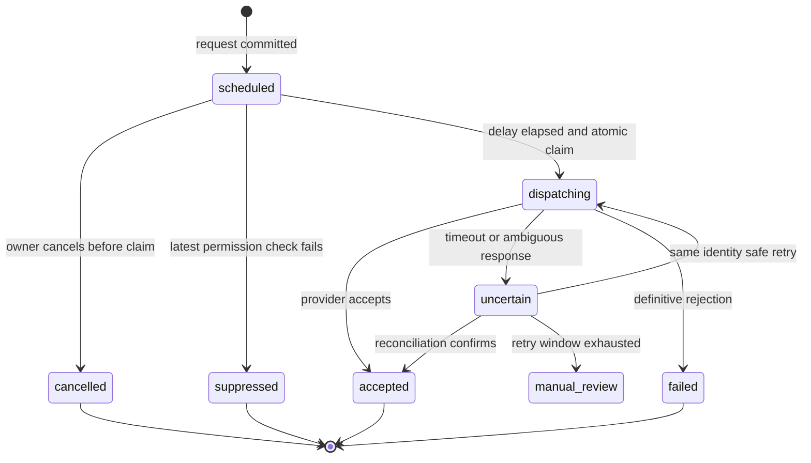

# Delivery and privacy operations

**Baseline 1.1 (capability amendment approved October 23, 2026) · October 22, 2026.** This specification makes reports, email, commercial offers, and visitor data independently permissioned. A contact address is not a general license to track, market, or share. Current legal applicability and market policy must be reviewed before launch; the controls below are product and engineering requirements.

[P1-PR-006](implementation/P1-PR-006-report-consent-delivery-schemas.md) implements the initial persistence constraints for this policy. Durable records are not a working mail, consent or deletion service; dispatch authorization, provider reconciliation, retention jobs and API behavior remain later cards. `email_sends.created_at` is the accepted request timestamp; `accepted_at` records provider acceptance, keeping the two events distinct.

## Report delivery workflow

P2 adds optional AI explanation attachments under [the AI/photo contract](14-ai-analysis-and-photo-design.md). Freeze the accepted attachment revision or explicit fallback alongside report/comparison/template versions before scheduling; email/PDF retries never regenerate analysis and AI completion never auto-resends. AI/photo processing choice is separate from email, ads and marketing permissions.

1. Validate owner authority, report version, comparison revision, email, Turnstile, rate limits, and selected purposes. A report request may use an unverified destination, subject to abuse limits; it cannot modify an existing person's verified preferences.
2. In one database transaction, upsert the encrypted contact lookup, record specific requested actions with notice versions, create a durable send and outbox event, and set `send_after = created_at + 60 seconds`. A repeated idempotency key returns the same result.
3. Build a fixed report DTO and approved learning-link selection. Queue the workflow from the outbox. Delivery uses the exact report version selected, even if the user refines later.
4. During the cancellation interval, the owner may cancel. Correcting an address cancels the original send and creates a new send/request; never edit a queued recipient in place. Pending marketing grants for a wrong address are invalidated; previously verified preferences are untouched.
5. After the durable delay, atomically claim a noncancelled send. Re-read suppression and current purpose consent. If the owner cancelled first, dispatch cannot claim it. If dispatch already claimed it after the deadline, return “Already sending”; do not promise recall.
6. Only with confirmed active offers consent, run matching and reserve codes/budget. Freeze the rendered payload, template, selected links, and provider idempotency key before the provider call.
7. Send with a stable application send ID and provider key. Persist provider acceptance. A crash or timeout transitions to uncertain; reconcile/retry inside the provider's safe dedupe window. Do not make a new send ID to bypass ambiguity.
8. Ingest signed provider events into a durable inbox and derive delivery facts. Suppress on complaint or hard bounce immediately. Log link/feedback activity only within its permitted scope.



Delivery observations (`delivered`, delayed, bounced, complained) and engagement observations (opened, clicked) are separate timestamped events. They may arrive out of order or never arrive. The current UI status is derived with precedence; a click is not authoritative proof of human receipt and cannot clear a suppression.

The source's 60-second undo and sub-60-second request-to-ESP target cannot both hold. The final target is 60 seconds to cancel plus p95 60 seconds for handoff, or p95 120 seconds total. The UI says Scheduled/Queued until acceptance. [Inngest durable sleep](https://www.inngest.com/docs/durable-execution/primitives/step-sleep) supports this delay without keeping a web request alive. [Resend's 24-hour dedupe window](https://resend.com/docs/dashboard/emails/idempotency-keys) does not replace the permanent application record of dispatch identity.

## Email permissions and suppression

| Purpose | Grant | Scope | Withdrawal behavior |
| --- | --- | --- | --- |
| Requested report | Explicit request for this report/version | One requested delivery; no newsletter inference | Cancel while queued; future report sends require a new request |
| Offers email | Unchecked choice plus confirmation link | Up to four marketing emails/month, relevant tire offers | Immediate purpose suppression; remove offers from pending report payload before frozen dispatch |
| Lifecycle reminders | Separate explicit selection for reminder types | Rotation, seasonal, price watch, feedback as enabled | Stop selected reminders; marketing caps still apply where classified commercial |
| Identity sharing | Explicit market-enabled disclosure, 18+, verified contact, current partner scope | Only approved recipients and fields | Stop future delivery and propagate withdrawal/deletion as required |
| Analytics | CMP choice or reviewed market policy; R1 defaults denied | Approved first-party/third-party measurement | Stop further collection and processing; rights pipeline handles stored data |
| Ads and targeted ads | CMP/vendor/purpose policy; GPC checked | Only permitted placements and modes | Disable prohibited tags; contextual fallback only when separately lawful/approved |

Offer confirmation is a product default in all markets. If only offers are requested, send a minimal confirmation message; no report or promotion is added. A requested report may include the confirmation link but no sponsored offers until confirmation. Confirmation links expire after 7 days; pending subscription records expire after 30 days. Reconfirm if a long-dormant prelaunch list cannot be used under the current notice and permission. No assumption that a confirmation grants analytics or identity sharing.

Use distinct suppression scopes: all-email (hard bounce, complaint, deletion), all-marketing, purpose, and reseller. Marketing opt-out does not automatically prevent a later explicitly requested report, but that report must omit commercial extras and be classified appropriately. Contact status cannot be a single `unsubscribed` boolean for all purposes. Global safety suppressions are not lifted by entering the same address on the public form.

Consumer unsubscribe endpoint accepts RFC 8058 POST without login, CAPTCHA, or an extra confirmation. Ordinary GET links open a preference/confirmation page and do not mutate consent, issue coupon codes, redeem offers, or record final feedback. This protects against email scanner side effects. “Helpful: Yes/No” opens a minimal page and records the final action on POST; this deliberately refines the source's direct one-click state mutation.

Every email contains accurate identity, purpose, physical mailing address, preferences/unsubscribe, and a privacy link. Treat affiliate/offer-bearing reports conservatively as commercial unless reviewed otherwise; use the commercial stream and one-click headers. A report with no commercial content may use the report stream. Separate subdomains improve operational control but do not guarantee reputation isolation. Confirm classification with the actual rendered message. See [FTC guidance](https://www.ftc.gov/business-guidance/resources/can-spam-act-compliance-guide-business) and [Gmail sender guidance](https://support.google.com/mail/answer/81126).

Set up aligned SPF/DKIM/DMARC before production, test message authentication, then tighten DMARC after legitimate streams are verified. Keep complaints below the 0.1% internal alert threshold; pause marketing on 0.3% or a material reputation incident, with a minimum-volume/small-sample alert rule. Alert above 2% hard bounce. Use clicks and voluntary return visits as engagement signals; machine-open classification is approximate, not “human” certainty. Pause inactive marketing at 180 days; any repermission message must itself be permitted and within the frequency cap.

## Education selection and report rendering

Input: immutable reason codes, conditions, locale/market, and the reviewed content catalog version. Candidate content must be published, permitted for the recipient market, and reviewer-approved. Score by the source topic mapping weights, freshness factor (1.0 reviewed within 12 months, otherwise 0.7 only if still valid), and novelty (0.3 for a known prior click only when that linkage was permitted). Pick 3–6 links, maximum two per topic, then ensure the shop checklist is included once. Fewer reviewed candidates means fewer links, not irrelevant filler.

Version the topic map and selection result. Store content ID, slot, destination, and decision rationale; UTM values contain no report/email identity. No personalization from past clicks when analytics or identity linking is denied. Expired safety guidance is ineligible regardless of its score.

Render HTML and text from the same DTO; enforce the 100KB HTML budget before accepting a template. Test normal, maximum-content, zero-picks, unknown metrics, four-column compare summary, long names, and three-offer variants. Never trim disclosures to fit. Include browser-view and PDF links with distinct scopes. Browser-view tokens expire after 30 days by default; PDF download grants last 15 minutes; the private generated asset cache is 30 days. The report may outlive a specific token, and authorized users can generate a new download grant.

## Offers and coupon integrity

Offers are a separate ranked list. Eligibility requires an approved live version, active verified reseller, market/location match, product applicability, dates, budget/cap capacity, no reseller suppression, confirmed contact permission, and 18+ attestation. Use the exact selected tire SKU/size/strategy for applicability; do not match only a brand string. Recipients with revoked permission are excluded again immediately before dispatch.

R2 pilot offer score omits paid influence and renormalizes noncommercial weights. P4 default weights: relevance 0.40, estimated user saving 0.25, proximity 0.15, reseller quality 0.10, normalized bid 0.10. All factors are bounded to [0,1]. If a factor does not apply (online-only proximity), use a documented neutral policy across comparable offers; do not treat a missing discount as maximum value. Paid weight cannot exceed 0.10 without a new reviewed design change. Tire engine output is invariant to every offer configuration.

Select at most three offers, one per reseller, with a same-offer 30-day frequency cap and a total four-per-month marketing-email cap. Reserve caps, budget and unique codes in one database transaction using locked/skip-locked available codes and unique reservation keys. Concurrent sends must not overspend or issue the same code twice. Persist an audit of considered/selected offers with bounded retention.

Code lifecycle: available → reserved → issued → redeemed or expired/void. A definitive cancelled/rejected-before-acceptance send can release its reserved code. An uncertain provider outcome quarantines it. An accepted send commits its code even if the recipient never opens it. A public email-link GET may display the already-assigned code but never allocate a new one or mark it redeemed. Redemptions require an authenticated partner action; corrections append reversals. Shared-code analytics do not claim person-level redemption attribution.

No eligible offer means no empty block and no placeholder advertisement. If an offer expires between selection and dispatch, re-evaluate before freezing. Sent emails cannot be recalled; linked landing pages show current terms/status while preserving what was offered in the sent snapshot.

R2 uses explicit pilot credit, no charge collection. P4 bills only versioned, deduplicated eligible events; scanner clicks and uncertain fraud events are not immediately billable. Prepaid authorization and budget reservations are atomic; Stripe webhooks update a durable ledger rather than trusting browser redirects. Corrections use ledger reversals. Reconcile daily and pause offers when authoritative funds or billing state is unavailable.

## Consent enforcement and collection

Store a versioned notice and append-only grant/confirm/withdraw events. Bind signed server-readable CMP state to a subject/session and notice version; a client cannot self-declare permission with `sale_allowed: true`. At ingest, send, profile build, export, and partner delivery, compute allowed purposes using current rules plus original collection permission. A later consent grant does not retroactively legalize earlier forbidden collection.

R1 defaults analytics and ads off until choice in every location; strictly necessary security/session functions remain on. Unknown location and CMP failure use the restrictive default. GPC denies sale/sharing and targeted advertising; a generic Accept all cannot override it silently. Regional settings remain separate from tire-market selection so choosing US tires does not change a user's privacy rights. This is a product policy; [California guidance](https://oag.ca.gov/privacy/ccpa) describes covered-business GPC and request obligations.

Before permission, count only genuinely necessary operational aggregates without a persistent analytics identifier. Do not replace refused analytics with “first-party” behavioral tracking. After permission, collect only registered events and allowlisted fields. Strip email, capability tokens, full URLs/query strings, full ZIP, VIN, coordinates, typed searches, shop names, and free text from telemetry. Store selected structured vehicle/size answers only for declared purposes. Coarse location resolution and short-lived abuse keys are not authorization for profiling.

```text
event_id, schema_version, occurred_at, event_name,
subject_ref (only when permitted), session_ref (only when permitted),
route_template, market, locale, channel, consent_policy_version,
allowed_purposes, engine_version, allowlisted_props, bot_classification
```

First-party ingestion commits permitted events and aggregate invalidation together in PostgreSQL, with event-ID/digest deduplication. Bounded scheduled Inngest jobs rebuild aggregate generations atomically; retries do not add counters twice. Current permission and deletion guards serialize receipt with withdrawal/erasure. Privacy-invalidated aggregates stay hidden until rebuilt; ordinary backlog shows its true freshness. Daily distinct-session counts cannot be summed into a period-wide unique count. See the [analytics database contract](09-database-design.md#8a-analytics-rate-limits-and-optional-cache). Server-side report/send totals remain the operational source of truth. Cohort dashboards state consent coverage, bot exclusions, freshness, and currency. Report/redirect requests do not synchronously wait for optional analytics. Admission limits and separate bounded query pools protect shared SQL capacity; a total application-database outage still prevents new persistent report operations. Collector 202 means durable SQL receipt, while refused or unavailable intake returns 204/429/503 as appropriate. No false success or unbounded browser replay queue.

IP addresses are used transiently for edge routing, coarse geolocation and rate controls. Necessary security logs can retain raw IP for 30 days under restricted access; analytics stores a short-lived purpose-specific HMAC only if justified. Rotate keys and limit linkage periods. Hashing is pseudonymization, not anonymity. Address lookups use secret-key HMAC plus envelope-encrypted originals; keys are versioned and separately controlled.

## Retention and deletion design

The schedule below is a proposed launch policy to validate at G2. Every TTL is an automated job with dry-run counts, error alerts, and deletion evidence. Legal holds are documented and narrowly scoped; they do not silently suspend all deletion.

| Data | Proposed retention | Deletion behavior |
| --- | --- | --- |
| Unsubmitted owner draft | 7 days after activity | Delete draft and temporary capability |
| Anonymous reports/versions/shares | 180 days after last owner activity, capped at 12 months from creation without explicit renewal | Delete snapshots, revoke capabilities, purge private cached assets |
| Quote free text/shop notes | 30 days unless owner deliberately saves with report | Never analytics/export; remove with report |
| AI owner artifacts/attachments | Report retention, or 30 days if unattached; reuse valid at most 7 days/source expiry | Revoke keys, erase outputs/manifests/links and stop in-flight jobs; no cross-owner reuse |
| Shared reviewed generic AI artifacts | 30 days maximum; reuse at most 7 days/source expiry | Source/model/policy invalidation checked on every read; no private prompts/images in shared entries |
| Tire photos/derived candidates | 24 hours; explicitly saved images at most 30 days | Purge originals, sanitized copies, object versions and extraction artifacts; confirmed report fields follow report retention |
| AI attempt records / optional debug packets | Linked attempts 30 days; encrypted debugging at most 7 days | No raw prompts in logs; provider data controls/deletion separately verified; no training or audience reuse |
| Import staging/rejections/diffs | 30 days or shorter source license limit | Purge private originals/staging; published source revisions follow rights and report dependencies |
| PDF bytes | 30 days from generation | Expiry deletes object; report deletion purges sooner |
| Pending offers confirmation | 30 days | Invalidate token and discard unused subscription details |
| Contacts/profiles | 24 months inactivity maximum where continued purpose exists | Erase identifiers and disassociate reports unless independently retained for owner |
| Raw consented analytics and linked sessions | 13 months maximum; earlier subject/purpose erasure | Batched SQL purge, or partition removal only after partitioning is justified; invalidate/rebuild affected projections |
| Email events | 24 months | Remove subject linkage at deletion; retain necessary aggregate totals |
| Raw webhook payload | 30 days, restricted/encrypted | Expire; retain normalized minimum event facts |
| Security logs | 30 days baseline | Restrict, expire; extend only for a documented incident need |
| Consent evidence and audit | Active reliance plus counsel-set limitation period | Erasable identity link; minimal immutable non-identifying event facts |
| Suppression tombstone | As needed to enforce objection, reviewed annually | Restricted keyed hash and reason only; not a marketable profile |
| Irreversibly aggregated metrics | May persist after documented deidentification review | Small-cell suppression and anti-differencing controls; no subject IDs |

An append-only log must not embed copies of addresses in `before/after` JSON. Log field names, opaque subject references and a minimal change digest; store any necessary identifying detail in a separately erasable encrypted mapping. Deletion severs that linkage and writes a new audit fact. A suppression tombstone remains personal/pseudonymous operational data and must be protected, not called anonymous.

Privacy requests support access, correction, deletion, sale/share/targeted-ad opt-out, marketing withdrawal, limitation where applicable, appeal, and authorized-agent workflows. No account is required. Verify access/deletion using email or possession of browser/report authority proportionately; simple opt-outs do not require disproportionate identity proof. Avoid revealing whether an email exists.

Fulfillment is an idempotent job graph across operational and analytics PostgreSQL schemas, objects, ESP, any separately activated analytics vendors, AI requests/artifacts/reuse entries/photo objects and provider files, future app/device stores, and buyers. Each step has status, retries, evidence, deadline, and owner. A request closes only after required acknowledgements or a documented exception. Immediately suppress while deletion completes. A backup restore reapplies the deletion/suppression ledger before public access. Inaccessible backups expire under their retention policy and are not returned to active use without this replay.

Do not hardcode “45 days” globally. Configure jurisdiction, request type, acknowledgement/response clock, allowed extension, appeal and downstream notices with privacy counsel. Internal target: acknowledgement within 2 business days and fulfillment within 14 calendar days where feasible; statutory requirements take precedence. Escalate by remaining time, not only when overdue.

## Audience products from later releases

R1 data-sale/share feature flags are false and export credentials are absent. R2 internal aggregate insights use authorized data only. Tier A sales require minimum cell count 50, complementary suppression, bounded query combinations, repeat-query/differencing review, and contractual use limits; “aggregate” alone does not establish deidentification.

Tier B requires market-specific permission, buyer due diligence, purpose contracts, age eligibility, a clean-room design, and a fresh applicability assessment. Unknown-age, opted-out, GPC, deleted, revoked and AI-connector records are excluded. Tier C additionally requires verified explicit identity-sharing permission for current recipient categories/partners and limited declared fields. No full clickstream, precise location, raw IP, free text, or sensitive inference is exported.

Every export snapshots product/schema, buyer, purpose, query, minimum cell policy, record count, checksum, destination, suppression version and two distinct approvals for B/C. Immediately before delivery re-evaluate current suppression and consent; any change invalidates the approved snapshot and requires rebuilding/reapproval. Maintain buyer acknowledgements and deletion propagation, with the source's proposed 15-day buyer SLA subject to stricter legal requirements. Include [California DROP](https://privacy.ca.gov/drop/) obligations in the assessment rather than assuming direct visitor contact exempts the program.

## AI and photo processing boundary

Use a clear separate notice and explicit request before external processing; manual inputs and deterministic reports remain available. Minimize location/identity fields, sanitize images and strip metadata. Recheck authorization before provider call and publication; withdrawal/deletion fences late jobs. Store only approved typed output, enforce owner-scoped reuse, and exclude private artifacts from ads, analytics and audience exports. Provider `store: false` does not promise zero retention; verify endpoint/model/account policy and document it before P2 activation. See [AI retention and operations](14-ai-analysis-and-photo-design.md#privacy-retention-limits-and-operations).

## Operational ownership

| Incident | Immediate action | Accountable role |
| --- | --- | --- |
| Recall/fitment corruption | Disable affected recommendations, preserve audit/version, investigate all impacted reports | Data lead + tire reviewer |
| Sending complaints or uncertain duplicate | Pause marketing, quarantine uncertain sends/codes, reconcile provider state | Email operator |
| Consent enforcement failure | Disable nonessential collection/sharing/marketing, assess affected flows, repair projections | Privacy lead + backend lead |
| Cross-tenant access | Suspend relevant partner surface, preserve restricted evidence, incident procedure | Security/backend lead |
| AI/source validation failure or photo leak | Disable assistance/upload processing, invalidate affected keys, preserve private incident evidence and maintain deterministic/manual path | Data/privacy/platform leads |
| Queue/data loss | Stop acknowledgements without persistence, replay idempotently, mark metrics incomplete | Backend on-call |
| Overdue rights request | Escalate owner and privacy lead; do not close automatically | Privacy lead |
| Broken affiliate destination | Disable destination, retain report; fix approved template | Partner manager |
| Ad performance/consent regression | Disable slot/network via kill switch, keep primary content | Ad operations + frontend lead |

Daily checks: dataset freshness, send queue/uncertain states, webhook lag, bounces/complaints, privacy deadlines, queue lag, backup status and spend. Weekly: link health, cookie scan, served-ad sample, content review queue, privilege changes. Quarterly: recovery drill, source/market review, access review and retention evidence. Full campaign or export workflows remain disabled until their corresponding authorization and operational gates pass.

**S3 delivery amendment (022):** [P1-PR-022](implementation/P1-PR-022-delivery-orchestration.md) implements atomic request capture, fixed versions, server cancellation deadlines, private file/render ports, leased dispatch and bounded uncertain retry. An explicit one-off report intent can authorize its fixed unverified destination without granting general confirmed permission. Plain report cancellation preserves independent offers; explicit address correction invalidates only unused proofs attached to the wrong request. Current report issuance remains disabled and actual templates/provider/worker/transport acceptance retains its later gates.
