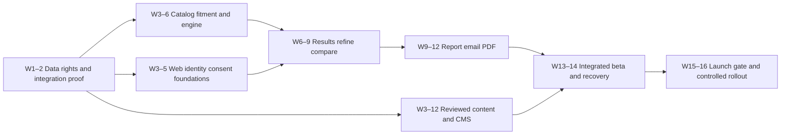

# Implementation plan

**Baseline 1.1 · October 22, 2026.** Deliver the US web experience before expanding into reseller operations, native applications, or audience sales. This plan converts the [product design](01-final-product-design.md), [architecture](02-technical-architecture.md), and [delivery/privacy specification](03-delivery-and-privacy.md) into reviewable work packages. Requirements remain traceable in [the coverage matrix](05-requirements-traceability.md).

**Architecture signoff, October 22, 2026:** [AS01–AS07 are approved](07-stack-and-layer-signoff.md#7-signoff-decisions). R0 must prove the selected stack, separate logical Payload database, and Clerk bridge. E16 delivers first-party QStash/ClickHouse analytics; GA4/PostHog remain disabled until their measurement need, consent mapping, and cost case are approved. Scope, estimates, and release gates remain unchanged.

**Engineering expansion requested after signoff:** implement the [TDD strategy](08-test-driven-development.md), [database contract](09-database-design.md), and [coding standards](10-coding-standards.md) within each work package. Existing estimates remain a planning baseline, not evidence that the expanded detail has been fully estimated. At G0, re-estimate E02/E04 and affected feature/testing work from the first vertical slice, database constraints, test fixtures and integration risks; publish any calendar/effort change instead of assuming it fits unchanged.

## Development process for every work package

1. Establish readiness: requirement/UC/AT IDs, actors, acceptance examples, layer/table ownership, adverse paths, and realistic test data.
2. Write and run the smallest failing unit/application use-case tests for the next behavior. For a database or API invariant, begin with a failing real boundary test as well.
3. Implement the behavior in its owning layer, then refactor with tests passing. Browser, staff, future mobile and MCP adapters share the same application/domain implementation.
4. Complete affected functional API/UI, integration, contract, accessibility, privacy and performance verification. Record first failure and final results in the PR.
5. Update traceability, migrations, contracts and runbooks; review against the coding standards and definition of done before marking the package complete.

Testing and database design are continuous work in the feature estimates. E19 broadens integrated, recovery and release evidence after individual features already have passing tests. Exploratory spikes remain explicitly unshipped until the discovered behavior has contracts and tests.

## Staffing and estimate basis

Planning assumption: three experienced full-time engineers (frontend, backend, data/platform), a half-time product designer, a half-time QA/accessibility specialist from week 5, a tire-data/domain specialist, a content editor with 25 reviewed articles, and privacy/legal support at gates. The owner supplies business decisions, domain access, vendor agreements and payment authority. These are role assignments, not a claim that people have been hired.

Plan **16 weeks from a staffed kickoff**, with data/vendor access resolved by week 2. The source's 12 weeks is an optimistic lower bound that omits several integration and content dependencies. A solo implementation should sequence the same work, not reuse the three-engineer calendar. Vendor contracting, content evidence and legal review are external elapsed time; estimates below exclude those waiting periods.

The R0/R1 work packages total 151–217 engineering days (30–44 person-weeks), leaving limited contingency within 48 gross person-weeks across three engineers for 16 weeks. Rebaseline after R0 using real provider, CMS/auth and engine spikes. Do not trade safety/privacy gates for a calendar deadline.

## Critical path and milestones



| Period | Engineering outputs | Parallel specialist/business work | Exit evidence |
| --- | --- | --- | --- |
| Weeks 1–2 | Data/provider probes, engine contract, auth/CMS isolation proof, performance slice | Domain/name, fitment contract, CMP/ESP evaluation, tire method review | G0 decisions recorded; no unresolved core data-rights gap |
| Weeks 3–4 | Schema/migrations, imports, consent authority, primitives/form | Glossary drafts, reviewed sources, privacy data inventory | Import coverage report; prototype form keyboard walkthrough |
| Weeks 5–6 | Engine/pricing, snapshots/capabilities, form submit | Tire specialist validates cases and claims | G1 golden scenarios and evidence coverage |
| Weeks 7–8 | Results, explanations, refinement, comparison/quote | Content illustrations, usability sessions | Complete owner journey without email |
| Weeks 9–10 | Email/PDF, cancellation, webhooks, privacy jobs, CMS publish | Sending identity checks, email render QA, policy review | Report journey through provider sandbox/test inbox; G2 privacy controls |
| Weeks 11–12 | Admin core, SEO, affiliate redirects, ads controls, collector dashboards | 25 articles approved; applications to networks when site is ready | G3 functional completeness; integration acceptance |
| Weeks 13–14 | Accessibility/performance, failure testing, restore drill, beta fixes | Moderated beta, support runbooks, operating cost review | G4 quality packet; unresolved critical issues zero |
| Weeks 15–16 | Limited public rollout, production checks, measured fixes | Business launch decision and on-call readiness | G5 launch acceptance; feature controls verified |

Content, privacy, and catalog work start early and run alongside engineering. Affiliates and ads may remain disabled if approval is pending; that does not block evidence-backed recommendations. A public launch without licensed fitment or operational deletion is not an acceptable substitution.

## R0 and R1 work packages

Each row is suitable for conversion to an epic with small vertical PRs. Effort is engineering days, not elapsed days. Acceptance is a demonstrated user outcome plus the stated invariants.

| ID | Work package and accountable role | Depends on | Estimate | Acceptance evidence |
| --- | --- | --- | --- | --- |
| E01 | Data/provider and business feasibility, data lead | None | 5–8 | Evaluate at least two fitment candidates; benchmark selected configurations including optional/staggered/AWD/EV/LT; document display/cache/derived/API rights, costs, gaps and refusal path |
| E02 | Bootstrap/integration spikes, platform lead | E01 provider direction | 6–9 | Pin compatible packages; TDD/CI harness, strict types/import boundaries, unit/use-case/functional test commands and isolated real PostgreSQL roles; preview/staging separation; Payload/Clerk, CMP and ESP proofs; first measured performance budgets |
| E03 | Design system and accessible shell, frontend lead | Product spec | 5–7 | Tokens, headings, inputs, chips, dialogs, cards, compare shell at 320/390/768/1280px; contrast/focus/reduced-motion checks |
| E04 | Schema, repositories, migrations and outbox, backend lead | E02 | 7–10 | Implement relevant database catalogue and DB invariants with failing-then-passing constraint/transaction tests; typed repositories and one migration owner; empty/upgrade migrations, runtime-role isolation, restore/deletion replay; no production schema push |
| E05 | Fitment/catalog/climate/recall ingestion, data lead | E01,E04 | 10–14 | Provenance and freshness per fact; repeat imports idempotent; bad data quarantined; coverage report for chosen launch list; stale-recall gate |
| E06 | Engine and pricing/scenario model, data lead | E05 | 10–15 | Deterministic output, strategy separation, safety-before-budget, missing-evidence handling, arithmetic/property tests and specialist-approved golden cases |
| E07 | Assessment and matching flow, frontend lead | E03,E05,E06 | 6–9 | Keyboard/mobile form, size-only limitation, wheel-package choice, lookup outage recovery; submit retry never duplicates report |
| E08 | Report snapshots and capabilities, backend lead | E04,E06 | 6–8 | Owner/edit vs share/view isolation; version reads, revoke/expiry, no cache/referrer leakage, privacy-safe shared DTO |
| E09 | Results and explainability, frontend lead | E07,E08 | 7–10 | Count-aware cards, evidence/unknowns, cost quantity/basis, price date, conditions corrections, exclusions and live safety overlay |
| E10 | Refinement, compare and quote evaluation, frontend + backend leads | E06,E08,E09 | 9–13 | Draft autosave, optimistic conflicts, immutable versions/diff, four-item compare, quote comparability, saved version pinning, accessible mobile view |
| E11 | Contacts, consent and suppression authority, backend lead | E02,E04 | 7–10 | Independent purposes, verified preference changes, restrictive defaults, GPC, recheck-at-use, purpose-specific suppression, no client-forged grants |
| E12 | HTML/text email, PDF and educational selection, backend lead | E08,E10,E11,E15 | 10–14 | Shared snapshot DTO, compact email under 100KB, 60s cancel, deterministic learning links, private PDF, images-off/dark-mode/email-client rendering |
| E13 | ESP events, redirects, preferences and operations, backend lead | E12 | 7–10 | Signed/replayed/delayed webhook cases; stable dedupe, uncertain-send queue, RFC 8058, safe redirects, bot-event classification, status accuracy |
| E14 | Privacy rights and retention jobs, backend lead | E08,E11,E13 | 7–10 | Verified browser/email/agent flows, deadline policy, complete deletion graph, backup replay, tombstone reinsertion prevention, expiring objects |
| E15 | CMS, education, SEO and public tools, frontend + content leads | E02,E03,E04 | 10–14 | 25 reviewed terms, hub/decoder/checklist/trust pages; safe metadata/redirect/robots workflow; sitemap/canonical/structured-data and publish <60s checks |
| E16 | Event pipeline and metrics, platform lead | E04,E11 | 6–9 | Allowed-field schema, consent denial tests, queue failure/replay, deduplicated metrics, bot filtering, consent-coverage/freshness indicators |
| E17 | Staff admin core, frontend lead | E05,E13,E14,E15,E16 | 9–13 | Role matrix, contact reveal audit, operational queues, affiliate applications, content/SEO, send/consent/request views; disabled modules not empty promises |
| E18 | Affiliate and ad operations, frontend + platform leads | E09,E11,E15,E17 | 5–7 | Approved URLs/opaque attribution, disclosure, nightly link checks, ads.txt/slots/blocks/house fallback, no form/compare/privacy ads; report token isolation proof |
| E19 | Integrated hardening and beta, QA + all engineers | E07–E18 | 14–20 | Accumulated unit/functional/UC/golden evidence, targeted critical-rule mutation review, full relevant E2E/accessibility/load/failure suites, restore/deletion drill, beta regression tests and runbooks |
| E20 | Launch and observation, platform lead + owner | E19 and G0–G4 | 5–7 | Production smoke with permitted test addresses; alerts/support ready; staged feature activation; rollback/kill-switch rehearsal; go/no-go record |

Content writing and specialist review effort is additional to engineering estimates. Understaffing those functions directly changes the launch date. E12 can develop render fixtures alongside E15, but it cannot ship personalized learning links until reviewed content is available.

## First implementation sequence

1. Approve the launch vehicle/configuration list and evidence standard in E01. Decide whether the license permits derived report snapshots and future MCP use; future redistribution rights can be purchased later without blocking web rights.
2. Create `codex/` implementation branches and PRs from the main baseline. Keep each PR independently reviewable with a concrete acceptance scenario and source requirement IDs.
3. Discover supported service integrations; link the intended Vercel project; provision only approved environments/resources; pull environment configuration without printing secrets. Do not bootstrap a public deployment or paid account from this planning commit.
4. Pin exact package versions and lockfile after compatibility checks. Establish formatting, strict type/import checks, Vitest unit/use-case tests, real PostgreSQL integration/role tests, functional API checks, Playwright, dependency/secret scanning, and preview protection.
5. Start with failing UC01/UC02 and data-integrity examples, then prove one vertical scenario using approved real schema/data access: vehicle → verified fitment → eligible result → persisted snapshot → private report. Use synthetic fixtures for tests, never to present fictional production recommendations.
6. Expand data coverage and engine cases before polishing every report field. Add quote/refinement, email/privacy, then admin/commercial surfaces.

## Quality strategy

The [test strategy](08-test-driven-development.md) defines the red/green/refactor cycle, unit/application use-case/functional API/UI categories, coverage policies, UC01–UC12, fixtures, and CI gates. Tests target risks and behaviors, not component implementation details. Only required checks run on each change; heavy email/device/load suites run when their affected surfaces change and before a release. Changed shared contracts, permissions, schema, and engine packages expand the dependent test selection.

| Layer | Required tests | Blocking failure |
| --- | --- | --- |
| Engine unit/property | Same normalized inputs/versions give same result; all picks satisfy fitment/climate; budget never overrides safety; rankings unchanged by monetization; money/units/range arithmetic | Any unsafe eligibility or nondeterministic ranking |
| Application use cases | Actor/precondition/action/outcome scenarios through shared use-case interfaces; normal, denied, stale, retry and recovery paths | UI/API/job adapters produce inconsistent business behavior or unauthorized side effects |
| Functional API/UI | Running contract/schema/status/pagination/CSRF tests plus focused accessible UI feature tests | Public contract, object permission or user-visible feature failure |
| Golden scenario suite | At least 50 reviewed cases with expected eligibility, exclusions and explanation codes | Unexplained difference from approved behavior |
| Database integration | Idempotent outbox/inbox, duplicate/different-body keys, version conflicts, pooled-connection tenant context, code/budget races | Duplicate external effect, lost event, cross-tenant read/write |
| Browser E2E | Form → results → refine → compare → share → email → PDF, permission denied, no results, failure recovery | Cannot complete core journey or unsafe degraded state |
| Privacy/security | GPC, denied CMP, withdrawal while queued, share edit denial, token leak checks, deletion across stores, forged webhooks, redirects/SSRF/uploads | Personal-data exposure or unauthorized processing |
| Email/PDF rendering | Gmail web/mobile, Apple Mail, Outlook classic/new, Yahoo; images blocked/dark mode/long copy; PDF page boundaries and reading order | Missing controls, clipped disclosure, wrong report version or inaccessible core facts |
| Accessibility | Automated checks plus keyboard, NVDA/VoiceOver/TalkBack as applicable, zoom/reflow, compare navigation | Critical/serious accessibility issue in required journey |
| Performance/reliability | Agreed mobile lab budget, field vitals when sufficient traffic, 10× baseline ingest, retry/backpressure, failure injection, backup restore | Safety/permission bypass under load; failed recovery objectives |

Golden scenarios should include ordinary US sedan, hot/dry climate, heavy rain, heavy snow with each seasonal choice, EV, XL, LT towing, staggered setup, optional wheel package, unsupported model/trim, known-size-only, missing load/speed, AWD partial replacement, one-tire replacement, run-flat, zero/fewer-than-five eligible products, no budget fit, missing prices, stale recalls, active/conditional recalls, unknown quote, mismatched quantity/currency/services, low tread/old DOT, winter minus-size unapproved/approved, and non-US visitor. Cover boundary values and combinations until at least 50 distinct reviewed cases exist; do not generate 50 identical-shaped snapshots.

## Acceptance scenarios that must be demonstrated

| ID | Given / when | Expected outcome |
| --- | --- | --- |
| AT01 | Driver selects an ambiguous wheel package | No verified-fit recommendation until package resolved |
| AT02 | Budget allows only below-spec products | No unsafe picks; explanation and recovery, no relaxation |
| AT03 | Offer bid, affiliate rate, or ad configuration changes | Byte-equivalent core engine result for identical versions/inputs |
| AT04 | User selects a fifth comparison item | Existing four stay intact; accessible replace/remove prompt |
| AT05 | Unknown tire is quoted with an installed total | Unverified fit and qualified price basis; no invented performance |
| AT06 | Shared recipient calls owner/edit/send endpoint | Denied, no data or side effects; can fork a new report |
| AT07 | User submits report request twice then cancels at 30 seconds | One scheduled identity, no provider send, cancelled UI |
| AT08 | Provider accepts but response times out | Same payload/key reused safely; no second code or unbounded resends |
| AT09 | Two workers claim the last unique coupon | One reservation; other chooses eligible alternative or omits offer |
| AT10 | Offers are withdrawn after scheduling | Recheck removes offers or suppresses marketing before dispatch; report-only intent preserved |
| AT11 | GPC is active and analytics/ad consent absent | Core report works; denied tags/events/sharing remain off |
| AT12 | Delayed signed webhook reports an old occurrence time | Valid delivery verified per provider; duplicate does not double count |
| AT13 | Link scanner performs HEAD/GET on all email links | No opt-in, redemption, code allocation or final feedback mutation |
| AT14 | Delete request completes, then an old batch/backup replays | Tombstone suppresses reintroduction; assets/links remain revoked |
| AT15 | Reseller A guesses Reseller B's ID through API/export/job | RLS and service checks deny all tenant data |
| AT16 | CMS editor publishes redirect/content change | Safe route validation; published version visible in <60s or explicit failed/retry status |
| AT17 | Recall pipeline has failed for 48 hours | Verified recommendation generation stops; old report shows stale safety status |
| AT18 | Four items and long labels on a 320px screen | Usable compare controls, no lost labels/focus or obstructed actions |
| AT19 | Marketing opted out but a new report explicitly requested | Only permitted report content; global hard-bounce/complaint still blocks |
| AT20 | Price assumptions, mileage or winter share are incomplete | Assumptions are explicit or comparison suppressed; no false all-in saving |

## Release gates

| Gate | Required evidence | Decision owner |
| --- | --- | --- |
| G0 Feasible foundation | Data rights, configuration list, reviewed scoring method, vendor budget, domain, CMP/ESP choice, auth/CMS spikes | Owner + technical/data leads |
| G1 Trustworthy engine | Coverage report, provenance, 50 scenarios, freshness, recall and partial-replacement handling, specialist review | Data lead + tire specialist |
| G2 Permission and data safety | Notices, server purpose enforcement, GPC, suppressions, token isolation, privacy deadlines, deletion/recovery, email authentication | Privacy lead + backend lead |
| G3 Complete launch experience | Core screens, 25 articles, CMS/admin, required monitoring, no critical placeholders/fake facts, explicit unavailable integration states | Product/design/content leads |
| G4 Tested operation | Acceptance suite, accessibility/performance, restore test, no critical/high security defects, on-call runbooks | QA + technical lead |
| G5 Public release | Approved policies, support mailbox/address, measured cost envelope, production smoke, rollback/kill switches, owner launch decision | Owner |
| G6 Reseller pilot | Tenant isolation, pen test, verification/moderation, code/budget races, disputes process, pilot agreements | Owner + partner/security leads |
| G7 New market/app/MCP/data product | Separate rights/privacy/provider/store/protocol checklist for the capability being activated | Relevant product lead + owner/privacy lead |

Alpha is internal with synthetic data. Beta uses invited participants with clear notices and limited coverage. Public rollout starts with core assessment and report delivery, then activates approved affiliate/ad modules only after consent/performance checks. Stop rollout on unsafe recommendations, permission leakage, repeat-send defects, or missing deletion controls. Feature kill switches should preserve education and support access.

## R2 reseller pilot

Allow 6–10 elapsed weeks after R1 stability, subject to staffing and partner onboarding. Suggested work packages:

| ID | Scope | Dependencies | Acceptance |
| --- | --- | --- | --- |
| E21 | Organizations, business verification, agreements, roles/MFA and RLS | E04,E11,E17 | Pending/suspended cannot serve; all tenant boundary tests pass |
| E22 | Offer versions, targeting, moderation, uploads and unique pools | E21 | Malformed CSV/unsafe URLs rejected; approved version remains stable during edits; 100k-code import stays off request path |
| E23 | Matching, atomic reservations, send integration and simulation | E12,E13,E22 | Permission recheck, max three/one per seller, frequency cap, no paid term, deterministic audit and AT09 |
| E24 | Aggregate partner dashboards, reported redemption and disputes | E16,E23 | No recipient identity; scanner clicks excluded; correction ledger; explicit pilot credit |
| E25 | Deliverability admin, consented visitor explorer and internal Tier A | E14,E16,E17 | Masked roles, purpose restrictions, anti-small-cell rules and correct freshness |
| E26 | Pen test, operations training and 5–10 reseller rollout | E21–E25 | G6 passed; real moderated pilot offers, documented support and suspension procedure |

No inferred cash charges during a free pilot. Establish CPC economics from measured eligible clicks and merchant feedback before adding the R3 ledger/billing path.

## R3 and R4 workstreams

| Workstream | Earliest trigger | Implementation order | Completion evidence |
| --- | --- | --- | --- |
| E27 Commercial operations | R2 stable and pricing approved | Ledger/reservations → Stripe integration → reconciliation → scoped reseller API/webhooks → sponsorship | Charge/credit/refund tests, idempotent events, terms/approval and performance gates |
| E28 Markets and SEO | Licensed coverage and reviewed market policies | UK/IE/AU separately → units/spelling/legal/retailers → programmatic quality gate → Search Console/audits | Market-specific golden cases, consent/delivery tests and reviewed content; no translation-only market launch |
| E29 Public MCP | Web engine stable and data redistribution permitted | Versioned adapter → seven public tools → schemas/quotas → golden replay → developer page → directory applications → later OAuth/user confirmations | Protocol/client compatibility, invariant rankings, no personal-data export, realistic latency, external listing not assumed |
| E30 Expo app | Evidence of repeat-use/reminder demand, API ready | Guest garage → optional account/merge → tire log → offline sync → reminders/push → OCR/VIN confirm → wallet → store testing | Revocation/deletion/offline conflict tests, crash/startup/accessibility targets, privacy disclosures/store review |
| E31 Lifecycle and marketing | Confirmed consents and stable deliverability | Reminder rules → quiet hours/caps → approved templates → dry run → limited sends | No sends outside purpose, timezone and cap tests, pause/sunset behavior |
| E32 Tier A sales / Tier B evaluation | Demonstrated buyer demand, written approvals | Aggregation review → buyer contracts → export ledger → clean-room spike → suppression/deletion tests | Two distinct approvals for B, current policy/contract rights, minimum-cell/differencing tests; may remain disabled |
| E33 Optional R4 capabilities | Separate business case | Tier C opt-in/partner scopes; onsite offers; redemption integrations; translations/new markets; paid API; optional app ads | Capability-specific consent, evidence, technical and commercial gates; no inherited blanket approval |

These workstreams compete for the same team. Plan one primary R3 expansion at a time unless staffing increases. The app is not promised three months after kickoff simply because it appeared in the source roadmap.

## Operating cost and procurement plan

Use actual supplier quotes at G0. Do not budget on stale affiliate commissions or ad-network traffic thresholds. Track license costs separately from infrastructure: fitment rights may dominate early costs and constrain API redistribution.

```text
monthly cost = fixed data/content licenses
             + hosting/build/compute/network
             + operational database + backups
             + queue/workflow + Redis
             + analytics ingest/storage + observability
             + email volume + rendering QA
             + identity/MFA + CMP
             + object storage/KMS
             + ongoing specialist/privacy/support work
unit cost per completed report = allocable monthly service costs / completed reports
```

Model 10k, 100k and 1m sessions/month, using measured form completion, events/session, report rate, email opt-in, average PDF size, retention and cache hit rate. Show forecast and 2×/10× stress cases. Set owner-approved service budgets, alerts at 50/80/100%, sampling for optional analytics, and explicit overage actions. No automatic shutoff may silently disable safety recalls or delete data needed for rights fulfillment. Affiliate earnings and data-sales revenue are upside scenarios, not assumptions that fund launch obligations.

## Risk register and change control

| Risk | Consequence | Mitigation / owner |
| --- | --- | --- |
| Fitment or score rights insufficient | Cannot provide claimed recommendations or MCP redistribution | E01 coverage/contract gate; data lead |
| Performance evidence sparse | False precision or misleading comparison | Suppress unknown metrics; reviewed suitability bands; tire specialist |
| Scope overwhelms team | Partial product and late launch | R1 boundaries, weekly dependency review, explicit deferred IDs; product lead |
| Source data changes/recalls missed | Outdated safety guidance | Versioned imports, freshness gates, safety overlays, incident procedure; data lead |
| Email retry/coupon race | Duplicate mail or reused discount | Durable identity, uncertain-state queue, atomic reservations; backend lead |
| Public link or telemetry leak | Private report exposure | Capability separation, no-referrer/no-store, log scrubbing, safe ad shell; security lead |
| Privacy/data monetization conflict | Trust loss, vendor/legal problems | Off-by-default programs, purposes, legal review, export-time checks; privacy lead |
| CMS/auth/migrations collide | Privilege bypass or schema damage | R0 spike, separate logical CMS database and migration ownership, Clerk bridge and real-role tests; platform lead |
| Event/vendor costs grow | Unsustainable unit economics | Per-report costs, sampling, caps, retention and queue backpressure; owner/platform lead |
| Mobile/client compatibility shifts | Delayed stores/MCP distribution | Pin and test current contracts at release; app/connector lead |

Weekly delivery review records completed acceptance evidence, blocked dependencies, spend, scope changes, and next gate. A change affecting permissions, ranking, cost claims, report identity, or release scope gets a decision entry plus updated traceability and tests. “Final design” is the stable baseline for building, not permission to ignore new evidence.

## Definition of done

An implementation work package is done when its acceptance scenario works end to end; new behavior has red/green evidence or a justified proportional exception; relevant unit, functional and use-case tests pass; real database/provider boundaries are verified where affected; errors and permissions are handled; performance/accessibility budgets are checked; telemetry is redacted and useful; operations can diagnose/recover it; and documentation/traceability match the shipped behavior. Apply the detailed [definition of ready and done](08-test-driven-development.md#definition-of-ready-and-done) and [coding review rules](10-coding-standards.md#security-privacy-and-review). This repository currently completes planning and source preservation only; all application implementation packages remain unstarted.
