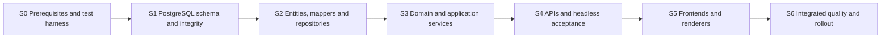

# Implementation plan

**Baseline 1.2 · October 22, 2026.** Deliver the US web experience before expanding into reseller operations, native applications, or audience sales. This plan converts the [product design](01-final-product-design.md), [architecture](02-technical-architecture.md), and [delivery/privacy specification](03-delivery-and-privacy.md) into reviewable work packages. Requirements remain traceable in [the coverage matrix](05-requirements-traceability.md).

**Current direction:** build the database, data access/models, business services and exposed APIs before product frontends. The [PostgreSQL and build-order amendment](11-postgresql-and-build-order.md) replaces ClickHouse/Redis/QStash with PostgreSQL analytics, SQL limits and measured caching. The original [AS01–AS07 approval](07-stack-and-layer-signoff.md#7-signoff-decisions) remains historical; AS02/AS07 implementation selections are amended. Separate Payload ownership, Inngest execution, consent defaults and release gates remain.

**Engineering obligations:** apply the [TDD strategy](08-test-driven-development.md), [database contract](09-database-design.md), and [coding standards](10-coding-standards.md) in each stage. All application work remains unstarted. Estimates below are a revised planning allowance, not measured throughput. Re-estimate at S0/G0 and after the S2 data-access and S4 API demonstrations.

## Development process for every work package

1. Establish readiness: requirement/UC/AT IDs, actors, acceptance examples, layer/table ownership, adverse paths, and realistic test data.
2. Write and run the smallest failing unit/application use-case tests for the next behavior. For a database or API invariant, begin with a failing real boundary test as well.
3. Implement the behavior in its owning layer, then refactor with tests passing. Browser, staff, future mobile and MCP adapters share the same application/domain implementation.
4. Complete affected functional API/UI, integration, contract, accessibility, privacy and performance verification. Record first failure and final results in the PR.
5. Update traceability, migrations, contracts and runbooks; review against the coding standards and definition of done before marking the package complete.

Testing and database design are continuous work in the feature estimates. E19 broadens integrated, recovery and release evidence after individual features already have passing tests. Exploratory spikes remain explicitly unshipped until the discovered behavior has contracts and tests.

## Staffing and estimate basis

Planning assumption: three experienced full-time engineers able to contribute to backend work (backend, data/platform, and frontend/full-stack), a half-time product designer, QA/accessibility support from the first test harness, a tire-data specialist, a content editor with 25 reviewed articles, and privacy/legal support at gates. These are role assignments, not a claim that people have been hired. The frontend engineer can help with contracts, fixtures, API tests and tooling before S5; specialist frontend availability alone does not accelerate backend gates.

The former overlapping **16-week calendar is withdrawn**. Establish a new elapsed-time forecast at S0 and refine it at S2/S4 after splitting backend/presentation effort and scheduling the dependency graph. The revised package allowances total **166–239 engineering days (about 33–48 person-weeks)**, with explicit database/data-access, PostgreSQL analytics and API acceptance work. The effort total is not a calendar: sequential ingestion → engine → report → delivery → privacy → administration dependencies limit parallel utilization, even with three engineers. External licensing, vendor access, content and specialist review can extend elapsed time; a solo builder must estimate separately. Publish a bottom-up rebaseline at S0 and update it at S2/S4; do not claim removing vendors guarantees lower total cost or an earlier launch.

## Build stages and exit gates

Stage gates S0–S6 control construction order; G0–G7 remain business, safety and release gates. Complete each stage's exit evidence before starting dependent implementation. **All R1 business services and APIs pass S4 before building any product frontend.** Existing UX documents, content writing and provider research may progress in parallel. A minimal headless framework host and disposable vendor-auth compatibility fixture are allowed at S0; they are not product UI or a design-system implementation.



| Stage | Build scope and package mapping | Required exit evidence |
| --- | --- | --- |
| S0 prerequisites | E01/E02: data rights, package/runtime compatibility, isolated DB setup, CI/TDD harness, service-port contracts, headless auth/CMS/ESP feasibility, workload and budget assumptions | G0 feasibility record, locked dependencies, reproducible test host; vendor risks assigned; no product UI |
| S1 database | E04a: application and separate CMS database ownership, all required R1 table/constraint/index migrations, runtime grants, synthetic seeds, outbox/inbox, analytics and limiter schema; create referenced foundations before dependent FKs | Empty/upgrade migration and real-role constraint tests, backup/restore/deletion replay drill; DB-level portions of DB01–DB20 proven; later-release invariants explicitly staged |
| S2 data access | E04b: typed persistence records, pure entity/value interfaces, mappers, narrow repository/query ports, transaction context and real PostgreSQL implementations | Round-trip/null/unit mapping, ownership scoping, concurrency/rollback, query plans, bounded reads and pool tests; domain/application imports contain no ORM dependency |
| S3 business services | E05/E06/E08/E10a/E11/E12a/E13a/E14/E15a/E16/E17a/E18a: ingestion, rules, reports, consent, delivery orchestration, privacy, content bridge, analytics and staff/commercial services | UC01–UC10 service scenarios with real repositories plus required adapter sandbox evidence; G1 engine evidence and backend G2 controls; deterministic rules, failure/retry/deletion tests; render ports use fixtures until S5 |
| S4 APIs | E34: expose and verify every R1 public/owner/staff/content/provider API against the same services; OpenAPI, auth/CSRF, quotas, idempotency, errors, observability and API clients | Runnable headless assessment → stored report → compare → schedule/cancel → deletion journey; denied/expired/retry paths; DB17–DB20 stress tests; API inventory and contracts complete; no mock-only backend signoff |
| S5 frontends | E03/E07/E09/E10b/E12b/E13b/E15b/E17b/E18b: public/staff/CMS experiences, accessible components, preferences/privacy controls, email/PDF templates and approved commercial surfaces | Frontends use accepted API/service contracts; real browser integration and email/PDF rendering checks; 25 reviewed articles; complete G2/G3 user-facing evidence |
| S6 release evidence | E19/E20: integrated accessibility/performance/failure/recovery, invited beta, operational handover, controlled activation | G4/G5 decision with all relevant UC/AT tests and no critical issues; measured costs, alerts, rollback and recovery ready |

Each gate produces a versioned evidence packet listing commit, migrations/contracts, test commands/results, measured budgets, unresolved external dependencies and accountable reviewer. A gate is not passed by a diagram, fixture-only demo or skipped check. S4 permits fixture renderers for interface tests, but records real email/PDF acceptance as outstanding until S5/S6. It does not authorize production delivery.

Later R2–R4 capabilities follow the same schema → repositories/models → services → API → UI sequence within their approved release. Existing validated foundations are reused. A change discovered in S5 returns to the relevant layer with a regression test and compatible migration/contract update; do not patch business rules in the UI to preserve the schedule.

## R0 and R1 work packages

E01–E33 remain stable traceability IDs. Suffixes `a` and `b` split existing packages into backend and later presentation deliverables; the row estimate covers both, not each separately. E04a/E04b split schema and data access. E34 makes API integration/acceptance explicit. A base package is complete only when all its parts pass. Effort is engineering days, not elapsed days; rows are grouped for traceability, not execution order.

| ID | Work package and accountable role | Depends on / stage | Estimate | Acceptance evidence |
| --- | --- | --- | --- | --- |
| E01 | Data/provider and business feasibility, data lead | None; S0 | 5–8 | Evaluate fitment candidates; benchmark optional/staggered/AWD/EV/LT; rights, costs, gaps and refusal path |
| E02 | Bootstrap and headless integration proofs, platform lead | E01 provider direction; S0 | 6–9 | Lock compatible packages; CI/TDD commands, strict types/import rules, real PostgreSQL test roles, protected environments, auth/CMS/CMP/ESP proofs and measured budget plan |
| E03 | Design system and accessible shell, frontend lead | S4 passed; S5 | 5–7 | Tokens/components at 320/390/768/1280px; keyboard, focus, contrast and reduced-motion checks |
| E04 | E04a schema/migrations; E04b data access/entities, backend lead | E02 → E04a S1 → E04b S2 | 12–17 | E04a 6–8 days: all R1 schema, constraints, roles, migration/restore tests. E04b 6–9: pure entity/value contracts, Drizzle records/mappers, repositories, read models, unit-of-work, concurrent rollback and query evidence |
| E05 | Catalog/fitment/climate/recall ingestion, data lead | E01,E04b; S3 | 10–14 | Provenance, coherent publish, idempotent imports, quarantine, chosen launch coverage and stale-recall gate |
| E06 | Engine and pricing/scenarios, data lead | E05; S3 | 10–15 | Deterministic pure rules, safety-before-budget, unknown evidence, property tests and reviewed golden cases |
| E07 | Assessment frontend, frontend lead | S4,E03; S5 | 6–9 | Keyboard/mobile form, size-only/wheel-package cases, lookup recovery; consumes E34 create-report API without duplicating rules |
| E08 | Report snapshots/capabilities services, backend lead | E04b,E06; S3 | 6–8 | Owner/share isolation, immutable versions, revoke/expiry, safe DTOs and private cache headers specified for E34 |
| E09 | Results/explanations frontend, frontend lead | S4,E03,E07; S5 | 7–10 | Evidence/unknowns, quantity/basis, as-of dates, corrections, exclusions and live safety overlay |
| E10 | E10a refine/compare/quote services; E10b frontend, backend/frontend leads | a: E06,E08 S3; b: S4,E03,E09 S5 | 9–13 | a: drafts/revisions, immutable comparison and quote semantics through service tests; b: autosave/conflicts, four-item compare and accessible mobile views |
| E11 | Contact/consent/suppression services, backend lead | E02,E04b; S3 | 7–10 | Independent purposes, verified changes, restrictive defaults, GPC, current-purpose checks and no forged grants |
| E12 | E12a delivery/PDF orchestration; E12b templates, backend/presentation leads | a: E08,E10a,E11,E15a S3; b: S4,E15b S5 | 10–14 | a: fixed DTO/version, durable intent, 60s cancellation, rendering ports/private assets; b: actual HTML/text/PDF, <100KB email, deterministic learning links and client/render acceptance |
| E13 | E13a events/preferences/redirect services; E13b controls, backend/frontend leads | a: E12a S3; b: S4,E03,E12b S5 | 7–10 | a: webhook verification/dedupe, uncertain sends, RFC 8058, safe redirects and bot classification; b: preferences, delivery/cancel status and retry controls |
| E14 | Privacy and retention services, backend lead | E08,E11,E13a,E16; S3 | 7–10 | Verified rights flow, complete SQL/analytics/object deletion graph, deadline policy and tombstone/backup replay; controls implemented in E13b/E17b |
| E15 | E15a CMS/content/tool services; E15b education/CMS UI/SEO, content/full-stack leads | a: E02,E04b S3; b: S4,E03 S5 | 10–14 | a: service access rules over S1 CMS collections, durable publication bridge, published DTOs and pure public-tool logic; b: 25 reviewed terms, hub/decoder/checklist/trust pages, editor UI, metadata/robots/sitemap and <60s propagation |
| E16 | PostgreSQL events/aggregates/limit/cache adapters, platform lead | E04b,E11; S3; load proof S4 | 8–12 | Allowlisted event intake, consent withdrawal/deletion, dedupe/recompute generations, SQL quotas, cleanup and no report slowdown under bounded analytic load; no cache without measured benefit |
| E17 | E17a staff queries/commands; E17b admin UI, backend/frontend leads | a: E05,E13a,E14,E15a,E16 S3; b: S4,E03 S5 | 9–13 | a: role matrix, masked DTOs/audited commands and operational queues; b: staff screens, privacy/request views and explicit inactive modules |
| E18 | E18a affiliate/ad policy services; E18b placements, platform/frontend leads | a: E08,E11,E15a,E17a S3; b: S4,E03,E09,E17b S5 | 5–7 | a: approved destinations, opaque attribution, link checks/config/blocks; b: disclosure, ads.txt/slots/house fallback, no forbidden placements and report-token isolation |
| E34 | Shared API exposure and headless acceptance, backend/QA leads | All S3 packages; S4 | 8–12 | Complete API inventory/OpenAPI/client contracts, public/owner/staff/webhook authorization, negative/retry/limit tests and realistic workload evidence before UI starts |
| E19 | Integrated hardening and beta, QA/all engineers | E03,E07–E18,E34 complete; S6 | 14–20 | Full relevant UC/E2E/accessibility/load/failure/render suites, targeted critical-rule mutation review, restore/deletion drill and beta regression/runbooks |
| E20 | Launch and observation, platform lead/owner | E19 and G0–G4; S6 | 5–7 | Permitted production smoke, alerts/support, staged activation, rollback/kill switches and G5 decision |

Content research and writing proceed throughout, but UI/template implementation starts in S5. E12a consumes the E15a published-content contract using synthetic fixtures; real reviewed content and renderer outputs are required at E12b. No dependency runs from a backend package to a product frontend. The API row is a provisional allowance for shared wiring/verification; refine it against feature-level estimates at S0 to avoid counting endpoint work twice.

## First implementation sequence

1. Confirm E01 data rights, supported configurations and evidence expectations; resolve vendor/region/cost assumptions and backend compatibility in E02.
2. Use focused `codex/` branches and PRs with stage, requirement, UC/AT and DB IDs. Pin versions, test commands and isolated environments before feature work.
3. Complete S1 schema/migration/integrity evidence for R1; leave R2–R4 migrations until their releases. Do not provision paid/public resources from this planning amendment.
4. Complete S2 entity/value interfaces, persistence models/mappers, repository contracts and real transaction/query tests. Pure ports/types may be declared before service behavior to preserve inward dependencies.
5. Complete S3 rules and services through failing-then-passing unit/use-case and real-database tests. Demonstrate UC01/UC02 without a browser, then compare, delivery/cancel, content, privacy, analytics and staff/commercial services.
6. Complete S4 exposed API contracts and headless full-journey/denial/load tests; publish the gate evidence packet. Only then start E03 and the S5 frontend/rendering parts.
7. Integrate real UI and templates with those contracts, then pass S6 quality/recovery and G5 launch gates.

## Quality strategy

The [test strategy](08-test-driven-development.md) defines the red/green/refactor cycle, unit/application use-case/functional API/UI categories, coverage policies, UC01–UC12, fixtures, and CI gates. Tests target risks and behaviors, not component implementation details. Only required checks run on each change; heavy email/device/load suites run when their affected surfaces change and before a release. Changed shared contracts, permissions, schema, and engine packages expand the dependent test selection.

| Layer | Required tests | Blocking failure |
| --- | --- | --- |
| Engine unit/property | Same normalized inputs/versions give same result; all picks satisfy fitment/climate; budget never overrides safety; rankings unchanged by monetization; money/units/range arithmetic | Any unsafe eligibility or nondeterministic ranking |
| Application use cases | Actor/precondition/action/outcome scenarios through shared use-case interfaces; normal, denied, stale, retry and recovery paths | UI/API/job adapters produce inconsistent business behavior or unauthorized side effects |
| Functional API/UI | Running contract/schema/status/pagination/CSRF tests plus focused accessible UI feature tests | Public contract, object permission or user-visible feature failure |
| Golden scenario suite | At least 50 reviewed cases with expected eligibility, exclusions and explanation codes | Unexplained difference from approved behavior |
| Database integration | Idempotent outbox/inbox, duplicate/different-body keys, version conflicts, pooled-connection tenant context, code/budget races | Duplicate external effect, lost event, cross-tenant read/write |
| Browser E2E | Form → results → refine → compare → share → email → PDF, permission denied, no results, failure recovery | Cannot complete core journey or unsafe degraded state |
| Privacy/security | GPC, denied CMP, withdrawal while queued, share edit denial, token leak checks, deletion across stores, forged webhooks, redirects/SSRF/uploads | Personal-data exposure or unauthorized processing |
| Email/PDF rendering | Gmail web/mobile, Apple Mail, Outlook classic/new, Yahoo; images blocked/dark mode/long copy; PDF page boundaries and reading order | Missing controls, clipped disclosure, wrong report version or inaccessible core facts |
| Accessibility | Automated checks plus keyboard, NVDA/VoiceOver/TalkBack as applicable, zoom/reflow, compare navigation | Critical/serious accessibility issue in required journey |
| Performance/reliability | Agreed mobile lab budget, field vitals when sufficient traffic, 10× baseline ingest, retry/backpressure, failure injection, backup restore | Safety/permission bypass under load; failed recovery objectives |

Golden scenarios should include ordinary US sedan, hot/dry climate, heavy rain, heavy snow with each seasonal choice, EV, XL, LT towing, staggered setup, optional wheel package, unsupported model/trim, known-size-only, missing load/speed, AWD partial replacement, one-tire replacement, run-flat, zero/fewer-than-five eligible products, no budget fit, missing prices, stale recalls, active/conditional recalls, unknown quote, mismatched quantity/currency/services, low tread/old DOT, winter minus-size unapproved/approved, and non-US visitor. Cover boundary values and combinations until at least 50 distinct reviewed cases exist; do not generate 50 identical-shaped snapshots.

## Acceptance scenarios that must be demonstrated

| ID | Given / when | Expected outcome |
| --- | --- | --- |
| AT01 | Driver selects an ambiguous wheel package | No verified-fit recommendation until package resolved |
| AT02 | Budget allows only below-spec products | No unsafe picks; explanation and recovery, no relaxation |
| AT03 | Offer bid, affiliate rate, or ad configuration changes | Byte-equivalent core engine result for identical versions/inputs |
| AT04 | User selects a fifth comparison item | Existing four stay intact; accessible replace/remove prompt |
| AT05 | Unknown tire is quoted with an installed total | Unverified fit and qualified price basis; no invented performance |
| AT06 | Shared recipient calls owner/edit/send endpoint | Denied, no data or side effects; can fork a new report |
| AT07 | User submits report request twice then cancels at 30 seconds | One scheduled identity, no provider send, cancelled UI |
| AT08 | Provider accepts but response times out | Same payload/key reused safely; no second code or unbounded resends |
| AT09 | Two workers claim the last unique coupon | One reservation; other chooses eligible alternative or omits offer |
| AT10 | Offers are withdrawn after scheduling | Recheck removes offers or suppresses marketing before dispatch; report-only intent preserved |
| AT11 | GPC is active and analytics/ad consent absent | Core report works; denied tags/events/sharing remain off |
| AT12 | Delayed signed webhook reports an old occurrence time | Valid delivery verified per provider; duplicate does not double count |
| AT13 | Link scanner performs HEAD/GET on all email links | No opt-in, redemption, code allocation or final feedback mutation |
| AT14 | Delete request completes, then an old batch/backup replays | Tombstone suppresses reintroduction; assets/links remain revoked |
| AT15 | Reseller A guesses Reseller B's ID through API/export/job | RLS and service checks deny all tenant data |
| AT16 | CMS editor publishes redirect/content change | Safe route validation; published version visible in <60s or explicit failed/retry status |
| AT17 | Recall pipeline has failed for 48 hours | Verified recommendation generation stops; old report shows stale safety status |
| AT18 | Four items and long labels on a 320px screen | Usable compare controls, no lost labels/focus or obstructed actions |
| AT19 | Marketing opted out but a new report explicitly requested | Only permitted report content; global hard-bounce/complaint still blocks |
| AT20 | Price assumptions, mileage or winter share are incomplete | Assumptions are explicit or comparison suppressed; no false all-in saving |

## Release gates

| Gate | Required evidence | Decision owner |
| --- | --- | --- |
| G0 Feasible foundation | S0 evidence, data rights, configuration list, reviewed scoring method, vendor/workload budget, CMP/ESP choice, headless auth/CMS proofs and revised estimates | Owner + technical/data leads |
| G1 Trustworthy engine | Coverage report, provenance, 50 scenarios, freshness, recall and partial-replacement handling, specialist review | Data lead + tire specialist |
| G2 Permission and data safety | Notices, server purpose enforcement, GPC, suppressions, token isolation, privacy deadlines, deletion/recovery, email authentication | Privacy lead + backend lead |
| G3 Complete launch experience | Core screens, 25 articles, CMS/admin, required monitoring, no critical placeholders/fake facts, explicit unavailable integration states | Product/design/content leads |
| G4 Tested operation | Acceptance suite, accessibility/performance, restore test, no critical/high security defects, on-call runbooks | QA + technical lead |
| G5 Public release | Approved policies, support mailbox/address, measured cost envelope, production smoke, rollback/kill switches, owner launch decision | Owner |
| G6 Reseller pilot | Tenant isolation, pen test, verification/moderation, code/budget races, disputes process, pilot agreements | Owner + partner/security leads |
| G7 New market/app/MCP/data product | Separate rights/privacy/provider/store/protocol checklist for the capability being activated | Relevant product lead + owner/privacy lead |

Alpha is internal with synthetic data. Beta uses invited participants with clear notices and limited coverage. Public rollout starts with core assessment and report delivery, then activates approved affiliate/ad modules only after consent/performance checks. Stop rollout on unsafe recommendations, permission leakage, repeat-send defects, or missing deletion controls. Feature kill switches should preserve education and support access.

## R2 reseller pilot

For E21–E25, split schema/repository, service/API and presentation subpackages before scheduling: organization/offer/reservation/metrics/redemption/dispute APIs pass headless acceptance before reseller dashboards or portal screens start. E26 integrates the full pilot and security/operations evidence.

Re-estimate elapsed time after R1 stability using the same database → data access → services → API → frontend gates, staffing and partner onboarding. The former 6–10 week allowance is not a commitment under the amended sequence. Suggested work packages:

| ID | Scope | Dependencies | Acceptance |
| --- | --- | --- | --- |
| E21 | Organizations, business verification, agreements, roles/MFA and RLS | E04,E11,E17 | Pending/suspended cannot serve; all tenant boundary tests pass |
| E22 | Offer versions, targeting, moderation, uploads and unique pools | E21 | Malformed CSV/unsafe URLs rejected; approved version remains stable during edits; 100k-code import stays off request path |
| E23 | Matching, atomic reservations, send integration and simulation | E12,E13,E22 | Permission recheck, max three/one per seller, frequency cap, no paid term, deterministic audit and AT09 |
| E24 | Aggregate partner dashboards, reported redemption and disputes | E16,E23 | No recipient identity; scanner clicks excluded; correction ledger; explicit pilot credit |
| E25 | Deliverability admin, consented visitor explorer and internal Tier A | E14,E16,E17 | Masked roles, purpose restrictions, anti-small-cell rules and correct freshness |
| E26 | Pen test, operations training and 5–10 reseller rollout | E21–E25 | G6 passed; real moderated pilot offers, documented support and suspension procedure |

No inferred cash charges during a free pilot. Establish CPC economics from measured eligible clicks and merchant feedback before adding the R3 ledger/billing path.

## R3 and R4 workstreams

| Workstream | Earliest trigger | Implementation order | Completion evidence |
| --- | --- | --- | --- |
| E27 Commercial operations | R2 stable and pricing approved | Ledger/reservation schema and repositories → billing/Stripe/reconciliation services → scoped reseller APIs/webhooks → billing/sponsorship screens | Charge/credit/refund tests, idempotent events, terms/approval and performance gates |
| E28 Markets and SEO | Licensed coverage and reviewed market policies | Each approved market: datasets/schema → repositories → unit/rule/retailer services and APIs → localized screens/SEO → programmatic quality gate and audits | Market-specific golden cases, consent/delivery tests and reviewed content; no translation-only market launch |
| E29 Public MCP | Web engine stable and data redistribution permitted | Versioned adapter → seven public tools → schemas/quotas → golden replay → developer page → directory applications → later OAuth/user confirmations | Protocol/client compatibility, invariant rankings, no personal-data export, realistic latency, external listing not assumed |
| E30 Expo app | Evidence of repeat-use/reminder demand, API ready | Ownership/device schema → repositories → account-merge/log/sync/reminder services → versioned API acceptance → guest garage/log/wallet UI → push and confirmed OCR/VIN → store tests | Revocation/deletion/offline conflict tests, crash/startup/accessibility targets, privacy disclosures/store review |
| E31 Lifecycle and marketing | Confirmed consents and stable deliverability | Reminder/permission schema and repositories → rules/quiet-hour/cap services → API acceptance → approved templates/admin controls → dry run → limited sends | No sends outside purpose, timezone and cap tests, pause/sunset behavior |
| E32 Tier A sales / Tier B evaluation | Demonstrated buyer demand, written approvals | Rights/contracts and aggregation review → export schema/repositories → scoped services/APIs → staff/buyer controls → clean-room evaluation and suppression/deletion acceptance | Two distinct approvals for B, current policy/contract rights, minimum-cell/differencing tests; may remain disabled |
| E33 Optional R4 capabilities | Separate business case | For each approved Tier C/onsite-offer/redemption/market/paid-API/app-ad capability: schema → repositories → services → APIs → presentation, with purpose-specific consent | Capability-specific consent, evidence, technical and commercial gates; no inherited blanket approval |

For every later workstream, implement required schema and repositories, then service behavior and exposed APIs, then its screens/adapters. Public MCP remains an API adapter over the same services. These workstreams compete for the same team. Plan one primary R3 expansion at a time unless staffing increases. The app is not promised three months after kickoff simply because it appeared in the source roadmap.

## Operating cost and procurement plan

Use actual supplier quotes at G0. Do not budget on stale affiliate commissions or ad-network traffic thresholds. Track license costs separately from infrastructure: fitment rights may dominate early costs and constrain API redistribution.

```text
monthly cost = fixed data/content licenses
             + hosting/build/compute/network
             + application and CMS database base capacity + backups
             + Inngest workflow execution
             + PostgreSQL analytics/limit/cache capacity + observability
             + email volume + rendering QA
             + identity/MFA + CMP
             + object storage/KMS
             + ongoing specialist/privacy/support work
unit cost per completed report = allocable monthly service costs / completed reports
```

Attribute analytics/limit/cache load within the PostgreSQL bill; do not count a second analytics database or separate cache subscription. Model 10k, 100k and 1m sessions/month, using measured form completion, events/session, report rate, email opt-in, average PDF size, retention and cache hit rate. Show forecast and 2×/10× stress cases. Set owner-approved service budgets, alerts at 50/80/100%, sampling for optional analytics, and explicit overage actions. No automatic shutoff may silently disable safety recalls or delete data needed for rights fulfillment. Affiliate earnings and data-sales revenue are upside scenarios, not assumptions that fund launch obligations.

## Risk register and change control

| Risk | Consequence | Mitigation / owner |
| --- | --- | --- |
| Fitment or score rights insufficient | Cannot provide claimed recommendations or MCP redistribution | E01 coverage/contract gate; data lead |
| Performance evidence sparse | False precision or misleading comparison | Suppress unknown metrics; reviewed suitability bands; tire specialist |
| Scope overwhelms team | Partial product and late launch | R1 boundaries, weekly dependency review, explicit deferred IDs; product lead |
| Source data changes/recalls missed | Outdated safety guidance | Versioned imports, freshness gates, safety overlays, incident procedure; data lead |
| Email retry/coupon race | Duplicate mail or reused discount | Durable identity, uncertain-state queue, atomic reservations; backend lead |
| Public link or telemetry leak | Private report exposure | Capability separation, no-referrer/no-store, log scrubbing, safe ad shell; security lead |
| Privacy/data monetization conflict | Trust loss, vendor/legal problems | Off-by-default programs, purposes, legal review, export-time checks; privacy lead |
| CMS/auth/migrations collide | Privilege bypass or schema damage | R0 spike, separate logical CMS database and migration ownership, Clerk bridge and real-role tests; platform lead |
| Shared database contention or cost growth | Analytics/limits/cache churn slows report transactions | Separate bounded pools/jobs, query plans, retention, admission control, report SLO tests and measured reconsideration criteria; platform lead |
| Mobile/client compatibility shifts | Delayed stores/MCP distribution | Pin and test current contracts at release; app/connector lead |

Weekly delivery review records completed acceptance evidence, blocked dependencies, spend, scope changes, and next gate. A change affecting permissions, ranking, cost claims, report identity, or release scope gets a decision entry plus updated traceability and tests. “Final design” is the stable baseline for building, not permission to ignore new evidence.

## Definition of done

An implementation work package is done when its acceptance scenario works across its declared stage boundary (schema at S1, repository at S2, service at S3, API at S4, presentation at S5); new behavior has red/green evidence or a justified proportional exception; relevant unit, functional and use-case tests pass; real database/provider boundaries are verified where affected; errors and permissions are handled; performance/accessibility budgets are checked; telemetry is redacted and useful; operations can diagnose/recover it; and documentation/traceability match the shipped behavior. Apply the detailed [definition of ready and done](08-test-driven-development.md#definition-of-ready-and-done) and [coding review rules](10-coding-standards.md#security-privacy-and-review). This repository currently completes planning and source preservation only; all application implementation packages remain unstarted.
