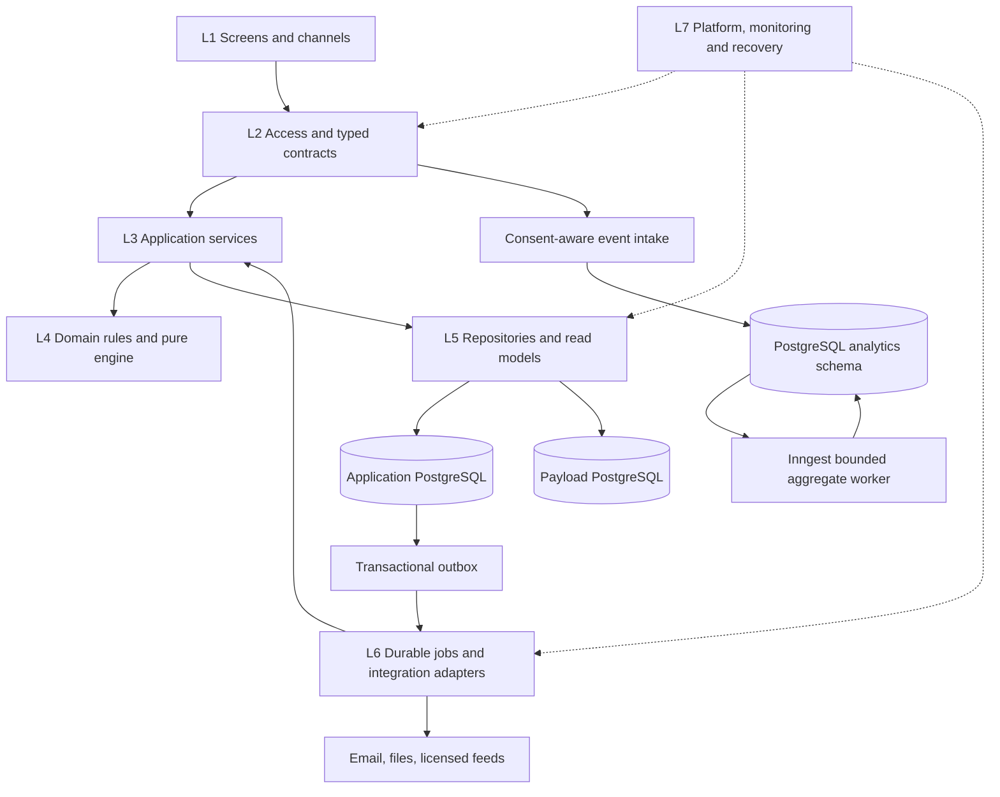

# Technology stack and application layer signoff

**Version 1.2 · October 22, 2026 · Status: original AS01–AS07 and PostgreSQL/build-order approvals retained; additional phase/domain/AI changes approved October 23, 2026.**

Build Tires & Tread as one modular TypeScript web application with a shared, deterministic tire recommendation engine. Use managed services for hosting, identity, persistence, durable jobs, email, and operational monitoring. The application owns its business rules, permissions, report history, and delivery state.

This current design defines the technology choices, functional modules, logical layers, and deployment boundaries for implementation. It elaborates the [technical architecture](02-technical-architecture.md) and [implementation plan](04-implementation-plan.md). The [approval record](#7-signoff-decisions) identifies the reviewed proposal and the user's explicit signoff. Application development has not started.

**Subsequent engineering expansion:** the user requested explicit TDD, database design, and coding principles after AS01–AS07 approval. [Test-driven development](08-test-driven-development.md), [database design](09-database-design.md), and [coding standards](10-coding-standards.md) elaborate these boundaries. The original approval record remains tied to the reviewed proposal; the additional specifications do not represent completed implementation or closed R0 gates.

**Current amendment:** [D28/D29](11-postgresql-and-build-order.md) requires database → data access/models → business services → exposed APIs → frontends, removes Redis/ClickHouse/QStash, and uses PostgreSQL events/aggregates, SQL quotas and measured caching. Sections 1–6 and 8 below describe this amended target; section 7 preserves the original reviewed decisions and identifies the changed IDs. The user approved this amendment and its merge into main on October 22, 2026; see the [amendment approval record](11-postgresql-and-build-order.md#approval-record). Integration evidence remains required.

**Approved additional amendment:** [D30–D35 and the eight-point review](12-live-product-phases-and-gap-review.md) add four usable phases, P1 domain/SEO/ad operations, P2 OpenAI inference/photo adapters and persistent PostgreSQL artifacts, and committed P3 app/MCP. These additions were [approved on October 23, 2026](12-live-product-phases-and-gap-review.md#approval-record); the historical AS01–AS07 approval below is preserved.

## 1. Review scope

The initial release remains **R1: US English web**, preceded by **R0: foundation and integration proof**. It includes assessment, recommendations, refinement, four-item comparison, quote checking, private reports, email/PDF delivery, education, staff administration, consent/privacy, and the planned analytics foundation. Affiliate and advertising capabilities activate only after their existing gates pass.

The current baseline incorporates these refinements:

- **CMS isolation:** select a separate logical PostgreSQL database for Payload from the outset, using separate credentials and migrations. This selects the isolation option already permitted by decision D22. A separate database can share a Neon project/compute if grants and recovery isolation are proven; it does not require a separate database vendor.
- **Analytics and limits:** use first-party PostgreSQL event receipt/aggregates and atomic SQL rate limits, with bounded scheduled Inngest work. Start with indexed reads/public CDN caches; add a bounded SQL computation cache only from profiling evidence. GA4/PostHog remain disabled until a named measurement need, consent mapping and cost case are approved. E16 remains in R1; analytics capability is retained.

All other product and privacy requirements continue to apply. Reseller, billing, mobile, MCP, and data-product release assignments remain unchanged. The amended choices are reconciled into the technical architecture, database design, decision register and implementation plan.

## 2. Current technology stack

### Application and developer tooling

| Area | Current selection | Purpose and constraint |
| --- | --- | --- |
| Language and runtime | TypeScript with strict checking; Node.js 24.x | One language for UI, API, engine, and jobs. Match the supported major in local development, CI, and Vercel; record actual runtime versions in release evidence. |
| Web framework | Next.js App Router + React | Public pages, private report pages, staff UI, embedded CMS, and versioned HTTP endpoints. Server Components for suitable reads; Client Components for interactive form/compare controls. |
| User interface | Tailwind CSS + Radix UI primitives + repository design tokens | A small accessible component library in `packages/ui`; verify keyboard, focus, reflow, and contrast in the composed screens. |
| Forms and validation | React Hook Form + Zod | Shared field/DTO schemas; all authoritative validation repeats on the server. Browser validation improves feedback. |
| Localization | next-intl + native Intl | US English initially; messages, units, currency, and reason-code text ready for reviewed later markets. |
| HTTP contracts | Next.js Route Handlers, `/api/v1`, Zod DTOs | REST/JSON command and query endpoints. Establish OpenAPI generation at E02 and complete the launch contract/acceptance artifact at E34/S4 before frontends. Public, owner, staff, partner, and webhook contracts have distinct access policies. |
| Workspace and quality | pnpm workspaces, ESLint, Prettier, TypeScript checks | One repository and lockfile; explicit package import boundaries. CI rejects client imports of server-only code. |
| Automated verification | Vitest; Playwright; axe-core; real PostgreSQL integration tests | Deterministic engine/property tests, transaction/race tests, browser journeys, automated accessibility, plus manual assistive-technology and email/PDF review. |
| Source and delivery | GitHub, GitHub Actions, Vercel Git previews | Small reviewed changes; protected previews; separate migration and application deployment steps. |

Next.js provides HTTP [Route Handlers](https://nextjs.org/docs/app/getting-started/route-handlers); Vercel documents [Node.js 24.x support and managed patch updates](https://vercel.com/docs/functions/runtimes/node-js/node-js-versions). [Vitest](https://vitest.dev/guide/) and [Playwright](https://playwright.dev/docs/intro) are the selected test runners. These references support the components' roles; compatibility of the complete dependency set is an R0 deliverable.

**Version policy:** choose and lock exact compatible application package versions at R0, including Next.js, React/React DOM, Payload, Drizzle, and their adapters. Pin pnpm via `packageManager`, commit the lockfile, and use frozen installs in CI. Configure the hosted Node major explicitly; Vercel controls its patch version. The signoff selects technologies and this pinning policy, not an untested combination of latest packages.

### Managed services and supporting libraries

| Area | Current selection | Release and responsibility |
| --- | --- | --- |
| Hosting and compute | Vercel, Node.js Functions, public CDN | R1. One web deployment per environment serves UI/API/CMS and authenticated job callbacks. Select a US region co-located with primary data. |
| Operational database | Neon PostgreSQL | R1. Authoritative catalog, reports, capabilities, consent, send state, outbox/inbox, and audit data. Future tenant and ledger tables stay transactional. |
| Database access | Drizzle ORM + `pg` | R1. Typed repositories and reviewed SQL migrations. Pooled runtime connections, direct restricted migration connections. |
| Content management | Embedded Payload + `@payloadcms/db-postgres` | R1. Articles, glossary, reviewed explanations, SEO, and editorial workflows. Own logical database and migration history. |
| Staff identity | Clerk | R1 staff MFA/session identity; R2 reseller organizations; R3 consumer accounts. Application services retain object-level authorization and purpose checks. |
| Background workflows | Inngest | R1. Report delivery, PDF rendering, imports, reconciliation, retention, and privacy fulfillment. Business state remains in PostgreSQL. |
| Email delivery and templates | Resend + React Email | R1. Versioned HTML/text messages, fixed send identity, signed webhooks, separate report/commercial sending configuration. |
| PDF generation | `@react-pdf/renderer` | R1. Render an immutable report DTO to private PDF bytes. Fonts, pagination, links, and reading order require acceptance testing. |
| Files and encryption | AWS S3 + AWS KMS | R1. Private reports/imports/backups; separate reviewed public media. Envelope encryption for sensitive fields, with separate purpose-specific lookup keys. |
| Cache and abuse limits | PostgreSQL rate buckets; indexed reads/public CDN; conditional SQL computation cache | R1. Atomic short-window quotas with expiry and bounded cardinality. Pure cache only after profiling; permissions and live safety checks remain authoritative. |
| Analytics receipt/storage | PostgreSQL `analytics` schema + Inngest scheduled aggregation | R1. Committed deduped events, revisioned aggregate rebuilds, privacy invalidation and bounded query views; protected report capacity. |
| Operational monitoring | Datadog + structured redacted logs | R1. Errors, latency, queue lag, delivery failures, stale datasets, privacy deadlines, and cost alarms. Separate from user-behavior analytics. |
| Public configuration | Vercel Global Config | R1. Versioned published redirect/config snapshots. Database publication history is authoritative; privacy/safety gates fail closed. |
| Bot challenge | Cloudflare Turnstile | R1. Verify response server-side alongside independent rate limits. |
| Consent interface | Certified CMP, vendor selected at G0 | R1 requirement. Must satisfy the server-readable consent contract, GPC, accessibility, vendor/purpose mapping, and form JS budget. Selection is still open. |
| Tire and market data | Licensed fitment/catalog/evidence feeds, selected at G0 | R1 requirement. Provenance, permitted display/derivation/caching, coverage, updates, and recall integration must be verified before real recommendations. |

The [Payload PostgreSQL adapter](https://payloadcms.com/docs/database/postgres) owns generated schema/migrations and documents custom schema selection as experimental. Separate database ownership avoids making that option a launch dependency. [Neon pooling](https://neon.com/docs/connect/connection-pooling) supports the selected runtime/migration connection split. Use transaction-local tenant context on the same connection/transaction as protected queries; do not carry user context through pooled session state.

Clerk identity must be bridged into Payload using a verified [custom authentication strategy](https://payloadcms.com/docs/authentication/custom-strategies) and consistent access rules. Clerk's [server authorization guidance](https://clerk.com/docs/guides/secure/basic-rbac) does not establish automatic authorization for our custom CMS or operational APIs. The bridge is an integration task, not an assumed built-in feature.

The PDF package is the [React PDF renderer](https://github.com/diegomura/react-pdf). An accessible HTML report remains available; the selected renderer must pass the specified PDF acceptance checks before the PDF feature is accepted.

### Later or conditional additions

| Technology/capability | Planned activation |
| --- | --- |
| Clerk organizations and reseller modules | R2 free-credit partner pilot, after tenant and moderation verification |
| Stripe | P4 reseller billing and payment events; no R1 checkout or consumer payment requirement |
| Expo / React Native | Committed P3 ownership app, sharing contracts and domain logic with web |
| Official MCP TypeScript SDK and current target-client packaging | Committed P3 connector, after protocol/client and data-redistribution review |
| Official OpenAI SDK / Responses API | P2 bounded analysis and photo extraction; evaluated/pinned model/prompt/schema, validated facts, privacy/cost controls and deterministic/manual fallback |
| PostgreSQL AI artifacts/reuse | Required P2 business persistence; exact source/model/parameter/scope keys, bounded refresh, invalidation and deletion; distinct from optional computation cache |
| GA4 or PostHog | Conditional integration with a named measurement purpose; no duplicate default collection or R1 session replay |
| External advertising networks | R1 capability, activated only after network approval, consent, layout/performance, and private-token isolation tests |
| Tier A/B/C data products | Optional P4/future scope and separate release gates; architecture approval does not activate exports |

The number of managed services carries an operating cost: credentials, deletion coverage, incident handling, retention, and billing need named owners. G0 must approve one consolidated vendor/region/cost register, including data licensing. No numeric monthly ceiling is set by this document. Keep adapters narrow enough to replace a provider without rewriting the tire engine or report model.

## 3. Logical application layers

A **layer** describes a technical responsibility and permitted dependencies. A **functional module** describes a business capability that uses several layers. These layers run mostly inside the same deployed application; they are not seven independently operated services.

| Layer | Responsibility and examples | Boundary and implementation location |
| --- | --- | --- |
| **L1 Presentation and channels** | Home/form, results, refine, compare, report, education, staff screens; later partner/mobile/MCP experiences | Receives safe view DTOs and submits commands. No direct database/provider credentials or final eligibility decisions. `apps/web`, `packages/ui`, `packages/i18n`; later `apps/mobile`. |
| **L2 Access and contracts** | Route handling, identity/capability verification, schema validation, CSRF/Origin checks, webhook signatures, request IDs, limits | Translates untrusted input into typed commands plus actor context. Application authorization still runs after this boundary. Next route handlers and `packages/contracts`. |
| **L3 Application services** | Create assessment, rerun report, save comparison, issue/revoke share, schedule/cancel delivery, publish content, fulfill privacy request | Owns use-case orchestration, object/purpose authorization, transaction boundaries, and durable side-effect intent. `packages/application`. |
| **L4 Domain rules and recommendation engine** | Fitment eligibility, seasonal strategy, scoring, explanations, cost scenarios, report-version rules, consent/send state transitions | Framework-independent deterministic functions. Dependencies arrive as typed data, explicit policy versions, clock values, or ports. No SQL, HTTP, React, advertising bids, or email SDK calls in ranking. `packages/engine`, `packages/domain`. |
| **L5 Persistence and read models** | Repositories, queries, transactions, immutable snapshots, outbox/inbox, optimistic concurrency, database constraints | Implements application repository ports; scopes reads to authorized objects/tenants. Separate ownership for app and CMS data. `packages/db`, `packages/content`. |
| **L6 Integrations and durable processing** | Data-feed adapters, CMS bridge, email/storage providers, PDF/email rendering, Inngest jobs/analytics sweeps, webhook adapters | Provider details stay here. Jobs call the same application services and recheck authority; retry does not imply permission to repeat an external effect. `packages/integrations`, `jobs`, `packages/email`, `packages/pdf`. |
| **L7 Platform and operations** | Deployment, secrets, observability, backup/restore, migrations, release gates, environment isolation, feature shutdown | Supports all layers. Separate runtime/migration privileges and per-environment resources. GitHub Actions, Vercel, Datadog, database/object-store configuration, runbooks. |

Security, privacy, auditability, and accessibility apply across the layers. L2 authenticates an actor; L3 decides whether that actor may perform this action on this object; L4 evaluates business policies; L5 enforces relational and tenant constraints. UI visibility alone grants no authority.

Arrows show runtime flow, including job callbacks. **Code dependencies point inward:** contracts/domain/engine do not import the web framework or provider adapters; application services depend on domain logic and port interfaces; repositories/adapters implement those ports. The composition root wires implementations into services. Enforce this with package exports and import restrictions in CI.

`packages/application` and `packages/integrations` make the original `packages/domain` responsibility more precise; this approved directory refinement keeps the same deployment boundaries. S1 builds schema, S2 storage models/mappers/repositories and pure entity/port contracts, S3 domain/application behavior, S4 exposed APIs, and S5 presentation. Construction order does not introduce outward imports in domain/application code. SQL migrations stay in `packages/db` for application tables; Payload migrations stay with its configuration. A content adapter returns published-content DTOs, never unrestricted CMS documents.

Server-rendered pages may call the same authenticated application services directly inside the server process; they need not make HTTP requests back to themselves. The same actor, object, and purpose checks apply. Browser mutations and future external clients use the versioned HTTP contracts.

## 4. Functional modules and ownership

Each module owns its commands and data writes. Other modules use its application interface or a documented read projection, rather than editing its tables directly. Transactions may span application-owned modules when a use case requires atomicity; they do not span the CMS database or external providers.

| Functional module | Responsibility and principal data | Application interface examples | Delivery mapping |
| --- | --- | --- | --- |
| Catalog and evidence | Canonical companies/brands/plants, reviewed reference mappings, staged imports, vehicles, axle fitments, SKUs, facts/provenance, price snapshots, climate/recall datasets and freshness | `ResolveFitment`, `PublishDataset`, `GetCatalogCoverage` | R1, E01/E05/E35/E36 |
| Recommendation and economics | Safety filtering, strategy eligibility, evidence-backed preference ordering, exclusions, installed costs and scenarios | `EvaluateAssessment`, `EvaluateQuote`, `CompareCosts` | R1, E06 |
| Assessment and reports | Drafts, normalized inputs, immutable report versions, pinned datasets, owner context and current safety overlay | `CreateReport`, `SaveDraft`, `CreateReportVersion` | R1, E07–E09 |
| Comparison and quote checking | Up to four selected items, saved assumptions, quantity/basis/currency comparability, private shop text | `SaveComparison`, `CheckQuote` | R1, E10 |
| Identity and access | Staff roles, anonymous owner sessions, distinct view/share/download capabilities, revocation; future tenant memberships | `AuthorizeReportAction`, `IssueShare`, `RevokeShare` | R1, E02/E08/E17; R2 E21 |
| Contact and permissions | Encrypted addresses, address verification, consent events/projections, purpose restrictions and suppressions | `RecordConsent`, `EvaluatePurpose`, `SuppressContact` | R1, E11/E13 |
| Report delivery | Scheduled sends, cancel deadline, fixed report/template version, PDF artifacts, send attempts, delivery facts and preferences | `ScheduleDelivery`, `CancelDelivery`, `DispatchSend`, `RecordProviderEvent` | R1, E12/E13 |
| Education and publishing | Glossary, articles, report learning links, metadata, redirects, editorial versions and review | `PublishContent`, `GetLearningLinks`, `PublishRedirectSnapshot` | R1, E15 |
| Privacy operations | Verified rights requests, retention, deletion graph, object/token revocation, suppression/tombstone replay | `OpenPrivacyRequest`, `FulfillDeletion`, `ApplyRetention` | R1, E14 |
| Affiliate and advertising | Approved destinations, disclosures, opaque attribution, slots, blocks, aggregate network reporting and guarded activation | `ResolveAffiliateLink`, `EvaluatePlacement` | R1 readiness, network activation gated, E18/E38 |
| Analytics and staff operations | Permitted events, deduplicated aggregates, operational queues, masked dashboards and audited staff commands | `CollectAllowedEvent`, `GetOperationalSummary`, `RetryFailedJob` | R1, E16/E17 |
| Partner offers | Verified organizations, moderated offers, code pools, targeting, reservations and aggregate pilot reporting | `ApproveOffer`, `ReserveCoupon`, `GetPartnerMetrics` | R2, E21–E26 |
| AI assistance and photo input | Versioned provider tasks, validated artifacts, exact reuse/refresh, private image extraction and confirmation | `RequestAnalysis`, `FindReusableAnalysis`, `ConfirmPhotoFields` | P2 E39–E41; P3 shared channel APIs |
| Domain imports and SEO operations | Source connectors, script/admin validation/publication, public-page registry, crawl/search metrics | `ValidateImport`, `PublishImport`, `GetSeoFindings` | P1 E35–E38; P2 CSV UI |
| Billing and expansion | Ledger/invoices, ownership records/reminders, market rules, MCP adapters and separately gated audience products | `PostBillableEvent`, `RecordTireCheck`, versioned tool commands | R3/R4, E27–E33 |

Staff administration is a set of screens and permissions over these modules, not a second implementation of their rules. Tire rankings are completed before commercial placements attach. Turning affiliate rates, offers, or advertisements on/off must leave the core engine output identical for identical inputs and versions.

## 5. Important flows across the layers

### Assessment to report

1. L1 gathers vehicle/wheel package, location, driving needs, budget basis, and preferences; email is not required.
2. L2 validates the command, owner session, challenge, and limits; L3 checks request idempotency and use-case policy.
3. L3 obtains a coherent, published catalog/fitment/safety snapshot through L5, including its version/freshness metadata. External feed ingestion happens separately.
4. L4 evaluates eligibility before preference scoring and returns up to five supported picks, exclusions, reasons, evidence limits, and cost assumptions.
5. L3/L5 atomically save the immutable report version, request outcome, and necessary outbox records. L1 receives a safe DTO; optional analytics is isolated from the response.
6. Refinement creates a new report version. Share views, comparisons, email, and PDFs reference an explicit version; the live safety overlay is identified separately.

### Report delivery and cancellation

1. An authorized owner requests delivery. L3 records the fixed report/template, purpose intent, unique send identity, `sendAfter`, and outbox intent in one transaction; the API responds `202 Scheduled`.
2. The outbox relay publishes an ID-only event to Inngest. A scheduled sweeper reclaims unsent/expired relay leases; duplicate triggers are harmless because the send identity is durable.
3. The workflow waits until `sendAfter` using durable scheduling. The owner can cancel for 60 seconds. A late-starting worker respects the stored deadline rather than starting a fresh 60-second timer.
4. At handoff, L3 rechecks suppression and allowed content, and atomically claims the send only if it is still eligible and uncancelled. L6 renders the same snapshot and submits the frozen payload with its stable provider idempotency key.
5. A verified webhook is stored in the inbox before acknowledgment. Application services deduplicate it and update delivery facts. Ambiguous sends go to reconciliation; an expired provider deduplication window does not justify a fresh send.

[Inngest durable sleep](https://www.inngest.com/docs/durable-execution/primitives/step-sleep) releases the running process during delays; its [HTTP serving model](https://www.inngest.com/docs/learn/serving-inngest-functions) fits the selected Vercel callbacks. [Resend retains idempotency keys for 24 hours](https://resend.com/docs/dashboard/emails/idempotency-keys), so our database send history and reconciliation must cover longer-lived uncertainty. Queues and workflows provide retries; the application supplies the business safeguards.

### Content publishing and deletion

Publishing commits an editorial revision in the CMS database and records durable publication work there. A retryable bridge builds the public read/config snapshot and invalidates relevant caches; failed propagation remains visible to staff. No distributed transaction is assumed between CMS, application database, and CDN.

Privacy fulfillment immediately restricts applicable processing and revokes access, then runs an idempotent deletion graph across application data, objects, email, and analytics. Each step records evidence or a permitted exception. Restores replay the suppression/deletion ledger before reopening access. Operational metrics do not become a second contact store.

### AI and photo flow from P2

L1 requests optional assistance or confirms a photo candidate. L2 validates actor/contract/quota; L3 prepares the minimal source packet and authorizes exact artifact reuse; L4 preserves deterministic decisions. L5 persists scoped requests/artifacts/leases and L6 runs sanitized-image/provider jobs through Inngest. Validated output attaches to the fixed report version; failure returns ordinary advice. Model SDKs never enter L4 and raw photos never enter public MCP or analytics. See [AI/photos](14-ai-analysis-and-photo-design.md).

## 6. Deployment and data authority

| Boundary | What lives there | Authority and failure behavior |
| --- | --- | --- |
| Vercel web deployment | APIs/provider webhooks/Inngest callbacks first; public/private pages and staff/CMS UI after S4 | Stateless compute. Core business state survives restarts/deployments. Separate credentials and event namespaces per environment. |
| Application PostgreSQL | Catalog, reports, capabilities, contact/consent, delivery state, outbox/inbox, audit; later partners/ledger | Source of truth. Runtime roles cannot migrate schema. Failure stops new persistent operations with clear retry behavior. |
| CMS PostgreSQL | Editorial content, reviews, published revisions, CMS publication work | Payload owns migrations. No SQL join or cross-database transaction with operational records; stable content IDs and revision DTOs bridge them. |
| S3 and KMS | Private report bytes, imports, backups, approved public assets, encryption keys | Objects are authorized through application state; signed URLs are short lived. A cached PDF never grants continuing access. |
| Global Config | Published public configuration snapshots | Rebuildable; authoritative SQL publication history and restrictive safety/privacy decisions remain. |
| PostgreSQL analytics and limits | Separate schema/roles for permitted events/projections; app-owned rate buckets and optional cache | Same database compute: bounded pools/work, query/lock deadlines, retention and mixed-load gates protect reports. 202 receipt only after commit; operational totals remain authoritative. |
| Inngest and Resend | Workflow execution metadata and external delivery receipts | Application send/consent state is authoritative. Restrict job payloads/logs to opaque IDs; send recipient data only at the necessary boundary. |

Use local synthetic fixtures, isolated preview resources, protected staging with an email allowlist, and production resources with independent secrets and access controls. Never branch production contact data into general previews. Database and storage region, backup retention, and incident ownership are recorded at G0. Paid plan and integration availability must be confirmed for the chosen account before provisioning.

Keep the existing measurable targets: report API p95 under 2 seconds with cached provider data; mobile p75 LCP under 2 seconds on the agreed profile; public availability 99.9%; email acceptance p95 within 60 seconds after the 60-second undo period; CMS propagation under 60 seconds. These are acceptance targets to demonstrate, not guarantees supplied by the stack. Recovery targets remain RTO 4 hours and RPO at most 24 hours, tightened to 15 minutes only after PITR coverage is proven.

## 7. Signoff decisions

**Historical approval, not a retroactive approval of edits:** the table records the original proposal below. Current section 2 replaces the affected AS02 service choices, and AS07 analytics storage/transport is superseded by [D29](11-postgresql-and-build-order.md). D28 changes build order, not inward layer dependencies. Unaffected decisions remain applicable.

**Approval record:** the requesting user approved all seven decisions on **October 22, 2026 (America/Los_Angeles)** and authorized merging this documentation into `main`.

The reviewed artifact is **proposal 1.0 at commit [8d896e7](https://github.com/xmyqyl4x/tiresandtreads/blob/8d896e7fae6780250ba51a209db3a1c9e35b2b3d/docs/07-stack-and-layer-signoff.md)**. The user's instruction was: “Approve AS01–AS07 and merge the stack and application layer sign-off documentation into main.” No additional architecture conditions were imposed; the R0 evidence requirements and existing release gates below remain in force.

The roles below identify implementation review responsibilities. This records the user's architecture approval, not completed independent reviews by those specialists.

| ID | Approved decision | Implementation reviewers | Status |
| --- | --- | --- | --- |
| AS01 | Modular TypeScript application, seven logical layers, inward dependencies, one initial web deployment per environment | Product owner + technical lead | Approved by user |
| AS02 | Technology selections in original proposal section 2, Node 24.x target, exact compatible dependency lock at R0, explicit later/conditional services | Technical lead + owner | Original approved; Redis/analytics selections amended by D29 |
| AS03 | Separate logical Payload database, one migration owner per database, stable content IDs and retryable publication bridge | Technical + data leads | Approved by user |
| AS04 | Deterministic evidence-based engine, immutable versioned reports, commercial influence excluded from tire ranking | Product owner + tire specialist + data lead | Approved by user |
| AS05 | Anonymous assessment, scoped owner/share access, Clerk staff MFA, service-level permissions, server-enforced consent and deletion | Product owner + security/privacy leads | Approved by user |
| AS06 | PostgreSQL outbox/inbox, Inngest workflows, real 60-second cancellation, durable send identities, private PDF storage | Backend + operations leads | Approved by user |
| AS07 | Original R1 first-party QStash/ClickHouse analytics; GA4/PostHog deferred until a named need is approved; existing R2–R4 scope preserved | Product owner + privacy/platform leads | Original approved; storage/transport superseded by D29 |

Future changes to these decisions require an updated decision record identifying the affected IDs, reviewed version/commit, approver, date, outcome, and any conditions.

### Evidence required across foundation and API gates

| Gate item | Owner | Required evidence |
| --- | --- | --- |
| Licensed data and launch coverage | Owner + data lead | Selected provider, rights, cost, benchmarked vehicle/axle cases, freshness policy, provenance, tire specialist acceptance |
| Dependency and deployment compatibility | Technical lead | Locked versions, reproducible CI build, protected headless host, DB/driver/auth compatibility and renderer resource spike; full headless report/API slice required at S4, actual templates at S5 |
| Clerk and Payload integration | Backend/security leads | MFA, role removal, idle/absolute expiry, direct CMS API authorization and no alternate login bypass; database grants and migration isolation |
| Consent management selection | Privacy/frontend leads | Named CMP/plan, headless signed-state/GPC/withdrawal proof and interface/bundle feasibility; composed accessible product UI and final bundle verified at S5 |
| PostgreSQL workload consolidation | Platform/data leads | Event volume/cost model, query/pool limits and capacity-test design at S0; receipt/dedupe, deletion/aggregate races, SQL quotas and mixed report/analytics load proven at S4 |
| Delivery integration | Backend lead | Allowed use, domain setup plan, webhook verification, duplicate/timeout/cancel tests and reconciliation behavior |
| Service costs and operating ownership | Owner + platform lead | Current quotes, agreed monthly ceiling, region/retention/deletion register, backups, alert routing and incident owner |

Foundation items are required at S0–S2/R0; rows explicitly identifying S4/S5 are completed at those later gates. Architecture signoff permits the agreed design to guide engineering. Vendor spending, production activation, market expansion, and data-product activation keep their existing separate release gates. If a core integration fails its proof, return the affected technology decision for revision with a concrete alternative and impact assessment.

## 8. First implementation acceptance slice

Start with S1 database migrations/constraints and S2 data-access/entity/mapping tests. S3/S4 then demonstrate the first **headless** business/API slice: **vehicle and wheel package → validated eligibility → deterministic recommendation → immutable stored report → authorized private read**. Complete all remaining launch services/APIs, including compare, delivery/cancellation, PDF orchestration, privacy, content and staff operations, before S5 product frontends/renderers. Fixture rendering at S4 is labeled and cannot satisfy final delivery/PDF acceptance.

Across these slices, identical input/dataset versions must reproduce the same result; a share token cannot edit or send; retry creates one report/send identity; private responses cannot enter public caches; cancelled delivery produces no provider handoff; and optional analytics failure does not block the report. Follow [S0–S6 gates and package splits](04-implementation-plan.md#build-stages-and-exit-gates), with E34 recording API readiness before presentation work. The broader [AT01–AT28 acceptance suite](04-implementation-plan.md#acceptance-scenarios-that-must-be-demonstrated) remains the release standard.
