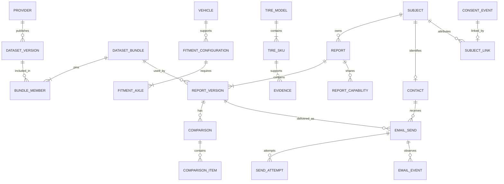
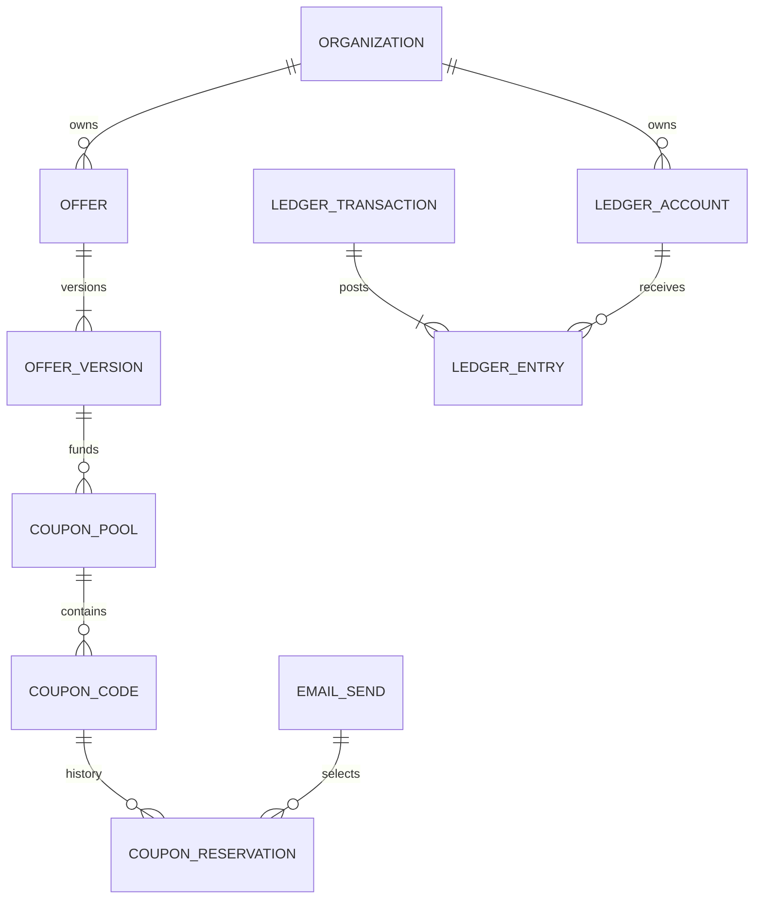

# Database design and data lifecycle

**Engineering specification 1.0 · October 22, 2026.** This is the relational design for the approved Neon PostgreSQL application database, separate Payload database, and downstream analytics/files. It expands the architecture's entity overview into typed table definitions, relationships, constraints, access paths, transactions, security, migrations, and deletion rules. It is a design specification; tables and migrations have not been created.

Implement R1 tables as their work packages begin. R2–R4 extensions are specified to preserve compatible boundaries, but are not a requirement to create unused launch tables. Exact supported PostgreSQL major, extensions, physical sizing, and generated Drizzle/Payload migrations are verified at R0. [Delivery/privacy policy](03-delivery-and-privacy.md) governs permissions and retention; [TDD](08-test-driven-development.md) defines required implementation evidence.

## 1. Data stores and ownership

| Store/schema | Authority and writer | Contents |
| --- | --- | --- |
| Application DB: `app` | Catalog, report, access, and reliability repositories | Versioned source datasets, fitment/evidence/prices, subjects/sessions, reports/compare, assets metadata, outbox/inbox and request identities |
| Application DB: `privacy` | Contact, permission, and privacy services | Encrypted contact data, consent events and erasable mappings, suppression, requests, retention/deletion evidence |
| Application DB: `email` | Delivery service and verified event consumers | Send state, frozen presentation references, attempts, provider observations, links, feedback and templates |
| Application DB: `admin` | Authorized staff use cases | Roles, audit facts/mappings, reviewed configuration, affiliates and ads operations |
| Application DB: `partners` | Tenant-scoped services from R2 | Organizations, agreements, moderated offers, coupon reservations; R3 ledger/billing |
| Application DB: `audience` | Separately authorized later services | Purpose-scoped derived profiles, buyer/export control and deletion propagation |
| Payload DB | Payload collections and migrations only | Editorial content, taxonomy, media, SEO, review/version history and durable publication work |
| ClickHouse | Consent-aware ingestion/projection jobs | Allowlisted events and aggregate metrics; no authority over consent, report existence, dispatch or balances |
| S3 | Asset/upload/backup services | Private PDF/import/backup bytes and separate reviewed public media; SQL stores metadata and authorization |
| Redis / Global Config | Cache/rate-limit services / reviewed publication | Rebuildable ephemeral data and public configuration; SQL retains authoritative publication history |

Each table has one module owner and one migration owner. Foreign keys can cross schemas inside the application database; no FK or transaction crosses into Payload, ClickHouse, or S3. Stable IDs, schema versions, outbox events, and reconciliation bridge those stores. Never let a CMS editor write consent, report, engine, or billing tables through a generic admin API.

## 2. Relational conventions

The table catalogue below is the implementation contract for core columns; module migrations may add technical columns with documented purpose. Notation: `PK` primary key, `UQ` unique, `FK` foreign key, `?` nullable, `ts` UTC `timestamptz`, `json` versioned/validated `jsonb`, `bytes` `bytea`. Unmarked columns are `NOT NULL`. Unqualified FK targets use the current schema; cross-schema targets are explicit.

- Unless a composite key is listed, each table has `id uuid PK` and `created_at ts DEFAULT now()`. Mutable records also have `updated_at ts` and `revision bigint DEFAULT 1 CHECK (revision > 0)`. Event/snapshot/version rows are append-only during their permitted lifetime; retention deletion is a separate privileged operation.
- Use lowercase plural `snake_case` names and explicit, named PK/FK/UQ/check constraints. UUIDs are generated without encoding customer identity. Timestamps are UTC; market timezones are explicit IANA strings for later scheduling.
- Money is `bigint` minor units with `currency char(3)` validated against enabled currency codes. Bounds reject negatives except signed ledger postings/refunds. Ratios/measurements use bounded `numeric`, not floating point where rounding affects decisions. Store tire dimensions and distance with explicit canonical units; keep original unit/source alongside imported facts.
- Use `text` plus named checks/reference tables for evolving status/purpose codes, so releases can expand allowed values safely. Country/market, locale, unit, and purpose are validated against their registries. No universal `status` meaning across unrelated entities.
- Relational columns own keys, ownership, money, time, permission, status, and frequently filtered facts. JSON holds validated immutable engine/presentation snapshots or versioned rules. Do not hide foreign keys, coupon uniqueness, tenant boundaries, or balances inside JSON.
- Default FKs use `ON DELETE RESTRICT`. Aggregate-owned disposable children can cascade only through an authorized purge; erasable identity links may cascade or be explicitly detached. Cross-domain deletion is an orchestrated operation, not an indiscriminate cascade.
- Index referencing FK columns when used for joins or parent deletion; PostgreSQL does not automatically create those indexes. A `CHECK` cannot enforce a cross-row total or arbitrary relationship. Use FKs/unique constraints plus locked transactions or a reviewed constraint trigger for such rules. These distinctions follow [PostgreSQL constraints](https://www.postgresql.org/docs/current/ddl-constraints.html).
- Keep credential/token digests and key versions together. Never store raw capability, verification, API, or webhook secrets in tables or logs. Envelope-encrypted fields store ciphertext, encrypted data key, algorithm/key version, and necessary nonce/authentication metadata; adapters own the concrete encoding.

**Versioned source row convention:** catalogue rows marked **V** have `dataset_version_id uuid FK app.dataset_versions`, `source_record_key text`, and `UQ(dataset_version_id, source_record_key)`. Their `id` identifies one immutable revision; provider identity plus source key identifies the source entity across revisions. Cross-revision references are explicit. Where two rows must belong to the same dataset, add `UQ(dataset_version_id,id)` and a composite FK. A published dataset is never modified in place.

## 3. Core relationships

The diagrams summarize key business relationships; the catalogue defines optional references, compound keys, and deletion rules. Report ownership and delivery recipient identity are separate. Entering an email address never grants access to another contact's reports or preferences.

## 4. R1 catalogue and evidence tables

These tables are in `app`. Licensed rows are loaded to a staging dataset, validated, then published as a complete bundle. Reports pin the bundle plus engine/rule version; live safety freshness is a separately labeled overlay.

| Table | Typed columns and relationships | Integrity and initial access path |
| --- | --- | --- |
| `data_providers` | `code text UQ`, `name text`, `status text`, `source_url text?` | Active/disabled status; catalog writer only |
| `data_licenses` | `provider_id uuid FK data_providers`, `market text`, `rights json`, `effective_at ts`, `expires_at ts?`, `reviewed_at ts`, `agreement_asset_id uuid? FK object_assets` | Rights schema names display/cache/derived/snapshot/API permissions; interval check; index provider/market |
| `dataset_versions` | `provider_id uuid FK data_providers`, `license_id uuid FK data_licenses`, `kind text`, `external_version text`, `checksum text`, `status text`, `effective_at ts`, `fetched_at ts`, `published_at ts?`, `row_count bigint` | UQ(provider,kind,external_version); staging/validated/published/rejected; nonnegative rows; provider/license consistency validated before publication |
| `dataset_bundles` | `market text`, `manifest_hash text UQ`, `status text`, `published_at ts?` | Immutable manifest after publication; required component kinds validated atomically |
| `bundle_members` | `PK(bundle_id,component_key)`, `bundle_id uuid FK dataset_bundles`, `component_key text`, `dataset_version_id uuid FK dataset_versions` | Component key distinguishes fitment/catalog/prices/climate/recall and provider where needed; version index; no silent component replacement |
| `market_dataset_heads` | `market text PK`, `bundle_id uuid FK dataset_bundles`, `revision bigint`, `updated_at ts` | Atomic compare-and-set publication pointer; no request builds a bundle from unrelated latest rows |
| `import_runs` | `provider_id uuid FK data_providers`, `dataset_version_id uuid? FK dataset_versions`, `asset_id uuid? FK object_assets`, `status text`, `checkpoint json?`, `started_at ts`, `finished_at ts?`, `accepted_count bigint`, `rejected_count bigint` | Bounded counters; index(status,started_at); retry identity UQ(provider, upstream run key) via required `upstream_run_key text` |
| `import_rejections` | `run_id uuid FK import_runs`, `record_key text`, `reason_code text`, `redacted_details json`, `expires_at ts` | UQ(run_id,record_key,reason_code); no raw PII/provider secrets; expiry index |
| `vehicles` | **V**; `market text`, `model_year smallint`, `make text`, `model text`, `trim text`, `powertrain text?` | Reviewed year bounds; picker index(dataset_version_id,market,make,model,model_year); unknown trim explicit |
| `fitment_configurations` | **V**; `vehicle_id uuid FK vehicles`, `wheel_package text`, `verification_status text`, `approved_options json` | Same fitment dataset as vehicle using composite FK; UQ(vehicle_id,wheel_package); approved options schema validates manufacturer-supported alternatives |
| `fitment_axles` | `configuration_id uuid FK fitment_configurations`, `axle text`, `quantity smallint`, `size_code text`, `width_mm numeric?`, `aspect_ratio numeric?`, `rim_inches numeric`, `construction text`, `min_load_index smallint?`, `min_speed_rank smallint?`, `load_range text?`, `xl_required boolean`, `run_flat_required boolean`, `unknown_constraints json` | UQ(configuration_id,axle); positive quantity/dimensions, valid axle; size formats support LT/flotation rather than inventing aspect ratio; null safety fields prevent verified issuance |
| `tire_models` | **V**; `brand text`, `model text`, `category text`, `seasonal_class text` | Dataset/brand/model lookup; model identity does not imply all SKU evidence is equivalent |
| `tire_skus` | **V**; `model_id uuid FK tire_models`, `manufacturer_sku text`, `size_code text`, `construction text`, `load_index smallint?`, `speed_rank smallint?`, `load_range text?`, `xl boolean`, `run_flat boolean`, `rim_inches numeric`, `status text` | Same catalog dataset as model; UQ(dataset_version_id,manufacturer_sku); index(dataset_version_id,size_code,construction); unknown safety attributes remain null |
| `market_availability` | **V**; `sku_id uuid FK tire_skus`, `market text`, `available boolean`, `observed_at ts`, `expires_at ts?` | UQ(dataset_version_id,sku_id,market); index(market,sku_id); source availability is not inventory guarantee |
| `evidence` | **V**; `sku_id uuid? FK tire_skus`, `model_id uuid? FK tire_models`, `metric_code text`, `numeric_value numeric?`, `text_value text?`, `missing_reason text?`, `unit text?`, `method text`, `source_url text`, `tested_at ts?`, `reviewed_at ts`, `confidence text`, `applicability json` | Exactly one SKU/model subject and one known numeric/text value or missing reason; index(sku_id,metric_code), index(model_id,metric_code); applicability controls any model-to-SKU inference |
| `rule_versions` | `kind text`, `version text`, `document json`, `document_hash text UQ`, `status text`, `reviewed_by uuid? FK admin.staff_identities`, `reviewed_at ts?` | UQ(kind,version); draft/reviewed/published/retired; immutable after publication; never executable user code |
| `scores` | `sku_id uuid FK tire_skus`, `evidence_bundle_id uuid FK dataset_bundles`, `rule_version_id uuid FK rule_versions`, `dimension text`, `value numeric?`, `missing_reason text?` | UQ(sku_id,evidence_bundle_id,rule_version_id,dimension); value/missing reason exclusive; bounded normalized value; derived evidence cache, not user-specific final ranking |
| `retailers` | `code text UQ`, `name text`, `market text`, `approved_origin text`, `status text` | HTTPS origin allowlist; public identity separate from affiliate configuration |
| `prices` | **V**; `sku_id uuid FK tire_skus`, `retailer_id uuid FK retailers`, `market text`, `currency char(3)`, `unit_price_minor bigint`, `quantity_basis text`, `observed_at ts`, `valid_until ts?`, `tax_included boolean?` | Nonnegative money; index(sku_id,market,observed_at DESC,id); unit basis explicit; stale policy in application |
| `price_components` | `price_id uuid FK prices`, `kind text`, `basis text`, `amount_kind text`, `low_minor bigint?`, `high_minor bigint?`, `rate numeric?`, `included boolean`, `source_note text?` | UQ(price_id,kind,basis); fixed amount requires both bounds with 0 ≤ low ≤ high and null rate; percentage requires bounded rate and null money bounds; basis declares per_tire/per_axle/per_order or the explicit taxable base |
| `climate_profiles` | **V**; `market text`, `region_key text`, `profile json`, `method text`, `reviewed_at ts` | UQ(dataset_version_id,market,region_key); versioned climate dimensions; full owner ZIP kept separately |
| `market_rules` | **V**; `market text`, `region_key text`, `rule_code text`, `guidance json`, `effective_from date`, `effective_to date?`, `reviewed_at ts` | UQ(dataset_version_id,market,region_key,rule_code); ordered validity interval; no unsupported legal inference |
| `recalls` | **V**; `authority text`, `recall_number text`, `announced_on date`, `status text`, `source_url text`, `summary text` | UQ(dataset_version_id,authority,recall_number); source-reviewed normalized facts |
| `recall_targets` | `recall_id uuid FK recalls`, `sku_id uuid? FK tire_skus`, `model_id uuid? FK tire_models`, `dot_match json`, `match_status text` | One target subject; DOT/range schema versioned; unresolved match stays conditional; subject indexes |
| `feed_health` | `provider_id uuid FK data_providers`, `kind text`, `PK(provider_id,kind)`, `last_attempt_at ts`, `last_success_at ts?`, `last_run_id uuid? FK import_runs`, `error_code text?` | Successful no-change refresh advances success timestamp; recall issuance gate uses this rather than newest changed record |

The detailed source column types and unit ranges are verified with licensed schemas in E01/E05. Report snapshots preserve permitted evidence needed to explain a historical result. Old licensed rows referenced by retained reports cannot simply be deleted; license expiry must follow reviewed storage rights and degrade public presentation as required.

## 5. R1 identity, reports, comparison and files

These tables are in `app`. Owner sessions authorize reports; recipient contacts are not owner sessions.

| Table | Typed columns and relationships | Integrity and initial access path |
| --- | --- | --- |
| `subjects` | `kind text`, `status text`, `permission_revision bigint DEFAULT 1`, `last_active_at ts`, `expires_at ts?` | guest/contact/account kinds; positive permission revision increments atomically with subject permission/suppression changes; no email or external identity embedded; expiry index |
| `owner_sessions` | `subject_id uuid FK subjects`, `token_hash bytes`, `key_version text`, `expires_at ts`, `revoked_at ts?` | UQ(key_version,token_hash); subject/expiry indexes; cookie secret never persisted |
| `reports` | `owner_subject_id uuid FK subjects`, `current_version integer?`, `market text`, `locale text`, `status text`, `last_owner_activity_at ts`, `expires_at ts` | Deferred FK(id,current_version) → report_versions(report_id,version); active report requires nonnull version; index(owner_subject_id,last_owner_activity_at DESC,id), expiry index |
| `report_versions` | `PK(report_id,version)`, `report_id uuid FK reports`, `version integer`, `base_version integer?`, `bundle_id uuid FK dataset_bundles`, `rule_version_id uuid FK rule_versions`, `engine_version text`, `schema_version integer`, `input_snapshot json`, `output_snapshot json`, `snapshot_hash text` | version >0; optional composite FK(report_id,base_version), with 0 < base_version < version; inserts only in normal operation; snapshot contains explicit quantity/units/confidence/reasons |
| `report_drafts` | `report_id uuid PK/FK reports`, `base_version integer`, `input json`, `schema_version integer`, `expires_at ts` | Composite FK(report_id,base_version); revision-based updates; 7-day activity TTL; no overwrite of a report version |
| `report_items` | `report_id uuid`, `report_version integer`, `item_key text`, `PK(report_id,report_version,item_key)`, `sku_id uuid? FK tire_skus`, `kind text`, `rank smallint?`, `snapshot json` | FK(report_id,report_version) → report_versions; picked/excluded; pick rank 1–5 and partial UQ(report_id,report_version,rank) for picks; bounded exclusion list enforced by generation transaction |
| `comparisons` | `PK(report_id,report_version,revision)`, `report_id uuid`, `report_version integer`, `revision bigint`, `scenario json`, `schema_version integer`, `snapshot_hash text` | Composite FK → report_versions; immutable revision; save command locks report and checks expected revision |
| `comparison_items` | `report_id uuid`, `report_version integer`, `comparison_revision bigint`, `slot smallint`, `PK(report_id,report_version,comparison_revision,slot)`, `source_key text`, `kind text`, `snapshot json` | FK to comparison revision; slot between 1 and 4; UQ(comparison key,source_key). Fixed four slots enforce maximum without a cross-row count check |
| `shop_quotes` | `report_id uuid FK reports`, `source_key text`, `sku_id uuid? FK tire_skus`, `currency char(3)`, `total_minor bigint`, `quantity smallint`, `basis text`, `observed_on date`, `components json`, `expires_at ts` | Positive quantity, nonnegative money; source_key stable per quote; index(report_id,created_at,id); comparison pins a sanitized quote snapshot |
| `report_capabilities` | `report_id uuid FK reports`, `report_version integer?`, `scope text`, `version_scope text`, `token_hash bytes`, `key_version text`, `expires_at ts`, `revoked_at ts?` | UQ(key_version,token_hash); fixed scope requires version, latest scope requires null version; fixed pair FK to report_versions; view-only scope; report index |
| `object_assets` | `purpose text`, `bucket text`, `object_key text`, `object_version text?`, `sha256 text?`, `size_bytes bigint?`, `mime_type text`, `state text`, `expires_at ts?`, `deleted_at ts?`, `key_version text?` | UQ(bucket,object_key); pending/ready/quarantined/deleting/deleted; no public URL grant; index(state,expires_at,id); domain attachment tables own authorization |
| `report_assets` | `asset_id uuid PK/FK object_assets`, `report_id uuid`, `report_version integer`, `comparison_revision bigint?`, `renderer_version text`, `locale text`, `view_scope text`, `render_key text UQ` | FK report version and optional comparison; render key includes all versions, comparison, locale and redaction scope; expiry never implies access |
| `download_grants` | `asset_id uuid FK object_assets`, `owner_session_id uuid? FK owner_sessions`, `share_capability_id uuid? FK report_capabilities`, `token_hash bytes`, `key_version text`, `expires_at ts`, `revoked_at ts?` | Exactly one authority parent; UQ(key_version,token_hash); recheck parent and asset/report scope on use; maximum lifetime follows 15-minute policy |
| `published_content` | `content_key text`, `cms_revision text`, `locale text`, `market text`, `public_dto json`, `content_hash text`, `published_at ts`, `valid_until ts?` | UQ(content_key,cms_revision,locale,market); CMS IDs are logical references; no cross-database FK; public query index(locale,market,content_key) |

Private owner details are isolated in `privacy.report_private_data(report_id uuid PK/FK app.reports, encrypted_fields bytes, key_version text, expires_at ts)` and `privacy.quote_private_data(quote_id uuid PK/FK app.shop_quotes, encrypted_notes bytes, key_version text, expires_at ts)`. Exact location/shop text is not copied into public/shared DTOs, analytics, or engine-cache keys. Full normalized private input remains protected where needed for owner editing; the immutable engine snapshot uses only the versioned facts required for reproducibility.

**Report pointer integrity:** create a report in draft state, insert version 1, then set current_version and active state within one transaction. The circular current-version FK is deferred until commit. Reruns lock the report, check expected base/revision, insert a new version and items, then advance the pointer. Normal roles cannot UPDATE a historical version. The privacy purge can delete the parent aggregate and its children under a dedicated procedure; immutability is not indefinite retention.

**Comparison integrity:** each save creates a new comparison revision and up to four immutable slot rows. Delivery references that revision, never a mutable "current comparison." The application validates item eligibility and source identity; the database enforces revision ownership, slots, and unique selections.

## 6. R1 contacts, consent and privacy

These tables are in `privacy` unless a target is qualified. The subject associated with a contact is separate from a guest owner's subject unless a verified account-linking action establishes a relationship.

| Table | Typed columns and relationships | Integrity and initial access path |
| --- | --- | --- |
| `contacts` | `subject_id uuid UQ/FK app.subjects`, `encrypted_email bytes`, `key_version text`, `verified_at ts?`, `status text`, `last_purpose_activity_at ts` | Encrypted original only; status does not replace scoped consent/suppression; inactivity index |
| `contact_lookups` | `PK(key_version,email_hmac)`, `key_version text`, `email_hmac bytes`, `contact_id uuid FK contacts` | UQ(contact_id,key_version); supports key rotation without duplicate contact identity; no provider-specific dot/plus stripping |
| `notices` | `purpose text`, `market_policy text`, `version text`, `content_hash text`, `published_at ts`, `content_ref text` | UQ(purpose,market_policy,version); immutable notice text/revision available for evidence |
| `consent_events` | `purpose text`, `action text`, `notice_id uuid FK notices`, `policy_version text`, `scope_key text`, `occurred_at ts`, `method text`, `evidence_digest text?` | grant/confirm/withdraw/expire distinct; append-only minimal facts; no email, IP, report token, free-text payload or subject identifier in event body |
| `subject_links` | `event_id uuid PK/FK consent_events`, `subject_id uuid FK app.subjects` | Erasable link attributes an event; index(subject_id,event_id); delete mapping under rights procedure |
| `consent_state` | `PK(subject_id,purpose,scope_key)`, `subject_id uuid FK app.subjects`, `purpose text`, `scope_key text`, `status text`, `source_event_id uuid FK consent_events`, `effective_at ts`, `expires_at ts?`, `policy_version text` | Projection updated atomically with event/link; pending/confirmed/withdrawn/expired; global scope is explicit nonnull value, not ambiguous NULL |
| `verification_challenges` | `subject_id uuid FK app.subjects`, `purpose text`, `token_hash bytes`, `key_version text`, `notice_id uuid? FK notices`, `expires_at ts`, `used_at ts?`, `invalidated_at ts?` | UQ(key_version,token_hash); consume once on POST under row lock; confirmation token 7 days; no authority from GET |
| `suppressions` | `subject_id uuid? FK app.subjects`, `scope_key text`, `reason_code text`, `effective_at ts`, `expires_at ts?`, `source_event_id uuid? FK consent_events` | subject-scoped current restrictions; index(subject_id,scope_key); all-email/all-marketing/purpose/reseller distinct |
| `suppression_tombstones` | `key_version text`, `lookup_hmac bytes`, `scope_key text`, `reason_code text`, `effective_at ts`, `review_after ts`, `expires_at ts?` | UQ(key_version,lookup_hmac,scope_key); protected minimal record survives contact deletion; no usable address/profile |
| `cookie_consents` | `subject_id uuid FK app.subjects`, `notice_id uuid FK notices`, `policy_version text`, `gpc boolean`, `allowed_purposes json`, `receipt_digest text`, `expires_at ts` | Server-issued receipt and policy validation; current revision scoped to subject; no trust in client-declared permission |
| `cookie_registry` | `vendor_code text`, `cookie_key text`, `purpose text`, `policy_version text`, `ttl_seconds integer`, `status text` | UQ(vendor_code,cookie_key,policy_version); nonnegative TTL; reviewed allowlist |
| `privacy_requests` | `subject_id uuid? FK app.subjects`, `kind text`, `jurisdiction text`, `policy_version text`, `status text`, `verified_at ts?`, `due_at ts`, `completed_at ts?`, `encrypted_reply_context bytes?`, `key_version text?` | No globally hardcoded deadline; index(status,due_at,id); anonymous opt-out can have no subject |
| `fulfillment_steps` | `request_id uuid FK privacy_requests`, `store text`, `action text`, `status text`, `attempts integer`, `next_attempt_at ts?`, `evidence_digest text?`, `last_error_code text?` | UQ(request_id,store,action); bounded retries; request completes only when required steps resolve |
| `deletion_markers` | `resource_kind text`, `resource_key_hmac bytes`, `key_version text`, `deleted_at ts`, `policy_version text`, `expires_at ts?` | UQ(resource_kind,key_version,resource_key_hmac); protects batch/backup replay without a personal profile |
| `retention_policies` | `data_class text`, `jurisdiction text`, `version text`, `rule json`, `reviewed_at ts` | UQ(data_class,jurisdiction,version); reviewed TTL/hold requirements; never arbitrary executable expressions |
| `legal_holds` | `subject_id uuid? FK app.subjects`, `resource_kind text`, `resource_id uuid?`, `reason_code text`, `approved_by uuid FK admin.staff_identities`, `review_after ts`, `released_at ts?` | Narrow scope, auditable release/review; does not blanket-disable all deletion |

Use one privacy service to append event/link and update the current projection in one transaction. On deletion, remove identifying links and current projections, purge encrypted fields, and retain only justified minimal facts/tombstones. Linkless event facts must be reviewed for reidentification risk from fine-grained metadata; deletion of a direct link alone is not proof of anonymization.

The `contact_lookups` table refines the baseline single `email_hmac` column to support rotation. During a rotation, check/write all active lookup-key versions under the same transaction and resolve unique conflicts to one contact. An erased address cannot be re-HMACed without its plaintext: retain restricted old lookup keys for still-required tombstones, or execute an approved migration before erasure. Never drop old keys while claiming old suppressions still match.

## 7. R1 delivery and reliability

| Table | Typed columns and relationships | Integrity and initial access path |
| --- | --- | --- |
| `email.template_versions` | `template_key text`, `version text`, `locale text`, `purpose text`, `renderer_hash text`, `status text`, `reviewed_at ts?` | UQ(template_key,version,locale); reviewed/published immutable template |
| `email.education_topic_map` | `rule_version_id uuid FK app.rule_versions`, `reason_code text`, `topic_key text`, `weight numeric`, `PK(rule_version_id,reason_code,topic_key)` | Nonnegative bounded weight; versioned selection inputs |
| `email.email_sends` | `kind text`, `recipient_contact_id uuid? FK privacy.contacts`, `owner_subject_id uuid? FK app.subjects`, `report_id uuid?`, `report_version integer?`, `comparison_revision bigint?`, `template_id uuid FK email.template_versions`, `dispatch_state text`, `send_after ts`, `cancel_deadline ts`, `claimed_at ts?`, `accepted_at ts?`, `payload_asset_id uuid? FK app.object_assets`, `payload_hash text?`, `provider_key text UQ`, `provider_message_id text?`, `provider text`, `expires_at ts?` | Report ID/version both present or absent; report-kind requires them until anonymized; composite FKs to exact version/comparison; state checks; partial UQ(provider,provider_message_id) where nonnull; due index(send_after,id) for scheduled |
| `email.send_attempts` | `send_id uuid FK email.email_sends`, `attempt_no integer`, `started_at ts`, `finished_at ts?`, `outcome text`, `provider_request_id text?`, `error_code text?` | UQ(send_id,attempt_no); accepted/definitive_rejection/uncertain explicit; no raw provider response |
| `email.send_receipts` | `send_id uuid PK`, `provider text`, `provider_key_digest bytes`, `payload_digest bytes?`, `outcome text`, `last_reconciled_at ts`, `retain_until ts?` | Minimal deduplication/reconciliation identity can outlive removed send linkage; UQ(provider,provider_key_digest); never used to reconstruct recipient |
| `email.email_events` | `send_id uuid? FK email.email_sends`, `provider text`, `provider_event_id text`, `type text`, `occurred_at ts`, `received_at ts`, `classification text?` | UQ(provider,provider_event_id); index(send_id,occurred_at,id); delivery/engagement facts separate from dispatch state |
| `email.email_links` | `send_id uuid FK email.email_sends`, `slot text`, `purpose text`, `approved_destination text`, `token_hash bytes`, `key_version text`, `expires_at ts`, `revoked_at ts?` | UQ(key_version,token_hash); UQ(send_id,slot); fixed HTTPS destination; no open redirect input |
| `email.email_feedback` | `send_id uuid FK email.email_sends`, `kind text`, `value text`, `submitted_at ts` | UQ(send_id,kind); authenticated/purpose-scoped POST; scanner GET cannot create record |
| `app.idempotency_requests` | `actor_scope_hash bytes`, `operation text`, `key_hash bytes`, `body_hash bytes`, `state text`, `resource_kind text?`, `resource_id uuid?`, `result_status integer?`, `safe_response json?`, `expires_at ts` | UQ(actor_scope_hash,operation,key_hash); response has no raw tokens/contact; versioned canonical digest; minimum 7-day request policy |
| `app.outbox` | `event_id uuid UQ`, `aggregate_kind text`, `aggregate_id uuid`, `event_type text`, `schema_version integer`, `payload json`, `state text`, `available_at ts`, `lease_until ts?`, `lease_owner text?`, `attempts integer`, `published_at ts?` | Commit with aggregate; partial pending/leased indexes; opaque references only; no indefinite in-memory job |
| `app.webhook_inbox` | `provider text`, `provider_event_id text`, `payload_digest bytes`, `raw_asset_id uuid? FK object_assets`, `received_at ts`, `signature_verified_at ts`, `state text`, `attempts integer`, `next_attempt_at ts?` | UQ(provider,provider_event_id); raw encrypted body 30-day TTL; mismatch duplicate digest quarantined; ack only after durable receipt |
| `app.job_runs` | `job_type text`, `business_key text`, `schema_version integer`, `state text`, `attempts integer`, `checkpoint json?`, `lease_until ts?`, `next_attempt_at ts?`, `last_error_code text?` | UQ(job_type,business_key); runnable/lease indexes; terminal error and reconciliation paths |

`email_sends` also has `anonymized_at ts?`; its report/recipient-required check explicitly allows completed privacy erasure with anonymized_at set and dispatch no longer eligible. The purge detaches comparison/report references and recipient/owner links, clears payload bytes, revokes links, and keeps only justified minimal delivery facts/receipts. It does not leave a resendable payload after deletion. Receipt retention is governed by purpose/objection policy; provider deduplication lasting 24 hours is not the application's retention policy.

Each send also records `requested_purposes json`, `notice_id uuid? FK privacy.notices`, `dispatch_policy_version text`, and `authorized_consent_revision bigint?`. These preserve requested intent and the permission decision at handoff without granting continuing permission. Dispatch states are the explicit scheduled/cancelled/suppressed/dispatching/accepted/uncertain/failed/manual_review states in the delivery specification. Deadline ordering and required state timestamps are checked; the initial report policy sets both cancel_deadline and send_after to accepted request time plus 60 seconds.

A nonnull comparison_revision requires a nonnull report_id/report_version pair. The comparison FK then proves that the selected comparison belongs to that exact report version. Clearing report references during authorized erasure also clears comparison_revision; nullable composite FKs alone do not enforce this condition.

Request idempotency must not store or replay raw owner/share secrets. A retry by the same authorized owner can recover the created resource and mint a new scoped capability when necessary; it cannot recover another caller's secret. Outbox/event logical references are intentionally not universal polymorphic FKs; owning use cases validate them, and deletion markers prevent replay from recreating deleted aggregates.

Establish the anonymous owner session before accepting an idempotent report command so concurrent retries have a stable actor scope. A lost/new browser identity does not authorize looking up another actor's idempotency record.

Do not expire an idempotency claim while its operation is unfinished or uncertain. Response bodies may expire before the minimal command/send identity. Define and publish the accepted retry lifetime; retain a protected key tombstone for that period and reject an expired completed request instead of replaying its side effect. A provider send identity cannot be replaced merely because the HTTP response cache expired. Retention of these digests is subject to the privacy policy and must not preserve recipient payloads.

## 8. Staff, commercial controls and CMS

R1 `admin` tables use staff-only service authorization and audited mutations. Audit details containing identity are separate from retained event facts.

| Table | Typed columns and relationships | Integrity and initial access path |
| --- | --- | --- |
| `staff_identities` | `provider_subject text UQ`, `status text`, `role_revision bigint`, `last_verified_at ts` | Clerk identity mapping; never a second password store |
| `roles` | `code text UQ`, `permissions json`, `policy_version text` | Reviewed permission codes, no client-writeable grants |
| `staff_role_assignments` | `PK(staff_id,role_id)`, `staff_id uuid FK staff_identities`, `role_id uuid FK roles`, `granted_at ts`, `revoked_at ts?` | Current role checks plus revocation; grant history recorded in audit |
| `audit_events` | `action text`, `resource_kind text`, `result text`, `occurred_at ts`, `change_digest text?`, `field_names json` | Append-only minimal event; no raw before/after documents |
| `audit_identity_links` | `event_id uuid PK/FK audit_events`, `actor_staff_id uuid? FK staff_identities`, `subject_id uuid? FK app.subjects`, `encrypted_context bytes?`, `key_version text?` | Separately erasable/restricted identifying context; actor/resource linkage retention reviewed |
| `configuration_versions` | `key text`, `version integer`, `value json`, `status text`, `published_at ts?`, `reviewed_by uuid? FK staff_identities` | UQ(key,version); immutable published values; policy schema and rollback history |
| `feature_states` | `key text PK`, `configuration_id uuid FK configuration_versions`, `enabled boolean`, `updated_at ts` | Explicit default-off safety/privacy/commercial switches; publication revision checked |
| `affiliate_applications` | `retailer_id uuid FK app.retailers`, `network text`, `status text`, `submitted_at ts?`, `review_after ts?`, `approved_terms_asset_id uuid? FK app.object_assets` | Staff-only workflow; no presumed agreement from an application |
| `affiliate_links` | `retailer_id uuid FK app.retailers`, `link_key text UQ`, `destination text`, `market text`, `status text`, `last_checked_at ts?` | Allowlisted destination; opaque attribution generated separately; no report token in destination |
| `affiliate_link_checks` | `link_id uuid FK affiliate_links`, `checked_at ts`, `result text`, `http_status integer?`, `expires_at ts` | Latest-by-link index and retention; safe URL-checking adapter |
| `ad_slots` | `slot_key text UQ`, `route_class text`, `configuration_id uuid FK configuration_versions`, `status text` | Route-class/placement policy validated on publication and rendering |
| `ad_brand_blocks` | `brand_key text`, `market text`, `reason text`, `PK(brand_key,market)` | Reviewed block list; no per-recipient data |

Payload owns the physical tables generated from these logical collections: **articles**, **glossary terms**, **topics/taxonomy**, **explanation templates**, **media**, **SEO metadata**, **redirects**, **editor identities**, **editorial review records**, and **publication work**. Each publishable document has a stable content key, locale/market applicability, version, draft/review/published status, source/reviewer, review/expiry dates, and a public DTO schema version. Media has object metadata, rights, alt text and approval state. Redirects have source/path pattern, approved target, priority, status and validation result.

The Payload configuration expresses these fields and relationships; only Payload generates/manages their physical schema. R0 must demonstrate a durable publication record committed with the content change, retriable application/config projection, and explicit propagation status. The application stores only published DTOs and stable CMS IDs/revisions; it does not query editorial tables using Drizzle or assume cross-database FKs. No privileged local-login bypass is introduced by editorial identities.

## 9. R2 and later extensions

The following minimum column contracts extend the same conventions. Before their release, expand provider-specific fields, generate migrations, and add the corresponding UC11/UC12 tests; they are not silently included in R1 development estimates.

### Partner offers and tenant isolation

Every partner-owned child carries `org_id uuid NOT NULL FK partners.organizations`. Define `UQ(org_id,id)` on referenced parents and composite FKs `(org_id,parent_id)` for all partner-owned relationships, including grandchildren, exports, API keys, and jobs. An ID's global uniqueness does not replace tenant constraints.

| Table in `partners` | Columns and relationships beyond common fields | Constraints |
| --- | --- | --- |
| `organizations` | `legal_name text`, `status text`, `verification_status text`, `market text`, `external_org_id text UQ` | Pending/suspended organizations cannot serve |
| `memberships` | `org_id uuid`, `provider_subject text`, `role text`, `status text` | UQ(org_id,provider_subject); actor membership checked per operation |
| `agreements` | `org_id uuid`, `version text`, `asset_id uuid FK app.object_assets`, `accepted_at ts`, `expires_at ts?` | UQ(org_id,version); signed terms retained per approved policy |
| `verification_records` | `org_id uuid`, `kind text`, `asset_id uuid FK app.object_assets`, `status text`, `reviewed_by uuid? FK admin.staff_identities` | Private quarantined evidence; expiry/review tracking |
| `locations` | `org_id uuid`, `location_key text`, `market text`, `region_key text`, `approved_address json`, `status text` | UQ(org_id,location_key); no visitor location stored here |
| `offers` | `org_id uuid`, `current_version integer?`, `status text` | Composite deferred pointer to own published offer version |
| `offer_versions` | `org_id uuid`, `offer_id uuid`, `version integer`, `terms json`, `valid_from ts`, `valid_until ts`, `status text`, `reviewed_at ts?` | PK(org_id,offer_id,version); parent tenant FK; interval ordered; published terms immutable |
| `offer_targets` | `org_id uuid`, `offer_id uuid`, `offer_version integer`, `sku_id uuid? FK app.tire_skus`, `location_id uuid?`, `strategy text`, `market text`, `rule json` | Composite offer/location FKs; exact SKU/strategy applicability; bounded validated rule |
| `coupon_pools` | `org_id uuid`, `offer_id uuid`, `offer_version integer`, `asset_id uuid? FK app.object_assets`, `status text` | Composite version FK; imports quarantined and deduplicated |
| `coupon_codes` | `org_id uuid`, `pool_id uuid`, `code_hmac bytes`, `encrypted_code bytes`, `key_version text`, `state text`, `expires_at ts` | UQ(pool_id,code_hmac); composite pool FK; available/reserved/quarantined/issued/redeemed/expired/void |
| `coupon_reservations` | `org_id uuid`, `code_id uuid`, `send_id uuid FK email.email_sends`, `offer_id uuid`, `offer_version integer`, `state text`, `reserved_at ts`, `released_at ts?` | Composite code/offer FKs; partial UQ(code_id) for live reservation; partial UQ(send_id,org_id) for selected/live offer |
| `offer_decisions` | `org_id uuid`, `send_id uuid FK email.email_sends`, `offer_id uuid`, `offer_version integer`, `policy_version text`, `outcome text`, `reason_codes json`, `expires_at ts` | Composite version FK; no tire-rank mutation; bounded audit retention |
| `frequency_guards` | `subject_id uuid FK app.subjects`, `scope_key text`, `PK(subject_id,scope_key)`, `policy_version text` | Locks serialize a subject/scope across organizations; scope identifies overall marketing or a stable offer; worker-only access |
| `frequency_reservations` | `subject_id uuid FK app.subjects`, `scope_key text`, `reserved_at ts`, `window_start ts`, `window_end ts`, `send_id uuid FK email.email_sends`, `state text` | UQ(send_id,scope_key); composite FK to guard; index(subject_id,scope_key,reserved_at); count live reservations under guard lock; privacy service controls access |
| `redemption_events` | `org_id uuid`, `reservation_id uuid`, `external_event_key text`, `kind text`, `reverses_event_id uuid?` | Tenant FKs; UQ(org_id,external_event_key); immutable correction/reversal events |
| `api_credentials` | `org_id uuid`, `key_hash bytes`, `key_version text`, `scopes json`, `expires_at ts`, `revoked_at ts?` | UQ(key_version,key_hash); server-verified scopes; no raw API key |
| `webhook_destinations` | `org_id uuid`, `url text`, `encrypted_secret bytes`, `key_version text`, `status text` | Reviewed HTTPS origins; SSRF defenses and scoped delivery logs |

The frequency tables' subject references are restricted from reseller queries: partner-facing DB roles receive no access; use dedicated worker grants. Naming them under `partners` does not grant reseller visibility. A rolling 30-day per-offer cap counts live historical reservations by reserved_at under the stable scope guard; it cannot use independent calendar buckets. The four-per-month policy must specify calendar boundary/timezone at G0, and each reservation records its evaluated window. Uncertain/issued sends consume the cap until definitively released according to policy. Three offers maximum is enforced with slots 1–3 (`slot smallint`, partial UQ(send_id,slot) for live/selected reservations), plus one per organization. Released historical reservations relinquish the live slot.

### Billing, ownership and audience extensions

| Release/domain | Tables and minimum typed contract | Invariants |
| --- | --- | --- |
| R3 billing | `partners.ledger_accounts(org_id uuid, currency char(3), kind text)`; `ledger_transactions(org_id uuid, event_key text, currency char(3), status text, reversal_of uuid?)`; `ledger_entries(org_id uuid, transaction_id uuid, account_id uuid, amount_minor bigint)` | Composite tenant FKs; unique event_key within organization; ≥2 entries and sum zero per posted transaction/currency, enforced by constrained posting procedure/deferred trigger; no UPDATE/DELETE of posted entries |
| R3 budgets | `partners.budgets(org_id uuid, offer_id uuid, currency char(3), limit_minor bigint, reserved_minor bigint, spent_minor bigint)`; `budget_reservations(org_id uuid,budget_id uuid,send_id uuid,amount_minor bigint,state text)` | Nonnegative amounts; reserved+spent ≤ limit; row lock/conditional update; currency consistent; aggregate is reconciled to ledger |
| R3 billing operations | `partners.invoices(org_id uuid,external_id text,currency char(3),total_minor bigint,status text)`; `payment_events(org_id uuid,provider_event_id text,payload_asset_id uuid?,state text)`; `billable_events(org_id uuid,event_key text,policy_version text,amount_minor bigint,currency char(3),state text)` | Global provider-event dedupe; tenant invoice/event FKs; classifier review before posting; browser redirects never credit balance |
| R3 consumer identity | `app.subject_identities(subject_id uuid,provider text,provider_subject text)`; `devices(subject_id uuid,device_key_hash bytes,encrypted_push_token bytes?,key_version text?,revoked_at ts?)` | UQ(provider,provider_subject); verified explicit guest/account merge; revoke/delete device routes |
| R3 ownership | `app.garage_vehicles(owner_subject_id uuid,vehicle_snapshot json,encrypted_vin bytes?)`; `tire_sets(owner_subject_id uuid,garage_vehicle_id uuid,fitment_snapshot json,installed_on date,odometer numeric)`; `tire_checks(owner_subject_id uuid,tire_set_id uuid,client_event_id uuid,checked_at ts,measurements json)` | Composite owner FKs; client-event dedupe; immutable checks and explicit correction records; validate unit/odometer/tread ranges |
| R3 reminders | `app.reminder_rules(subject_id uuid,tire_set_id uuid,kind text,timezone text,rule_version text,next_due_at ts,status text)`; `reminder_occurrences(rule_id uuid,due_at ts,send_id uuid?,state text)` | UQ(rule_id,due_at); permission and quiet-hour recheck at dispatch; no last-write-wins for conflicting safety history |
| R3 saved offers | `app.saved_offers(subject_id uuid,org_id uuid,offer_id uuid,offer_version integer,saved_at ts)` | Composite offer-version FK and subject ownership; saved copy never extends expiry or grants code access |
| R3 MCP/API | `app.api_clients(client_key text,protocol_version text,status text)`; `tool_versions(tool_key text,schema_version text,schema json)`; `client_grants(client_id uuid,subject_id uuid?,scope text,expires_at ts,revoked_at ts?)`; `directory_listings(client_id uuid,directory text,status text)` | Public tools expose only licensed public data; authenticated grants scope/expiry checked; UQ(tool_key,schema_version); provider-specific auth adapter remains external |
| R2 internal / R3 audiences | `audience.profiles(subject_id uuid,policy_version text,features json,expires_at ts)`; `segments(segment_key text,version text,definition json)`; `segment_memberships(subject_id uuid,segment_id uuid,consent_revision bigint,expires_at ts)` | Only permitted collected data; current suppression and provenance; subject maps erasable; internal processing is purpose-controlled |
| R3/R4 buyers and exports | `audience.buyers(buyer_key text,status text)`; `buyer_agreements(buyer_id uuid,version text,rights json,asset_id uuid)`; `products(tier text,schema_version text,policy json)`; `exports(buyer_id uuid,product_id uuid,query_hash text,consent_snapshot_hash text,asset_id uuid?,row_count bigint,state text)` | Export snapshot binds schema, buyer, purpose, allowed fields, checksum, and permission revision; current recheck invalidates stale approval |
| R3/R4 approvals and deletion | `audience.export_approvals(export_id uuid,staff_id uuid,decision text,decided_at ts)`; `export_subject_links(export_id uuid,subject_id uuid)`; `buyer_deletion_notices(export_id uuid,request_id uuid,state text,acknowledged_at ts?)` | UQ(export_id,staff_id); distinct approved reviewers required for B/C; links exist only for permitted identified tiers and are erasable; acknowledgement tracked |

Each abbreviated future table uses the common PK/timestamp convention and explicit FKs to the named parent tables; foreign IDs in this section are not free-text lookups. `api_clients`, `tool_versions`, `segments`, `buyers`, and versioned agreements/products require natural-key uniqueness as named. Final physical schemas and RLS tests are release deliverables before activation.

## 10. Transaction boundaries and concurrency

| ID | Invariant | Enforcement and failure behavior | Required test |
| --- | --- | --- | --- |
| DB01 | One command identity produces one report/send outcome | UQ actor/operation/key + body hash; claim and business records/outbox in one transaction; conflict retries read committed result after reauthorization | Parallel duplicate and changed-body requests, UC01/UC06 |
| DB02 | Report head and version belong to the same report | Composite FK, active-state check, report row lock, expected base/revision, immutable version insert | Two reruns; one stale conflict; old snapshot unchanged, UC03 |
| DB03 | Comparison has ≤4 distinct items per immutable revision | Slot check 1–4, composite PK/FKs, source UQ, atomic save | Fifth/duplicate item and concurrent save, UC04 |
| DB04 | Cancellation and dispatch cannot both win | Lock/check scheduled row, database deadline comparison and conditional state update; provider call occurs after commit | Two real connections/barrier, exact deadline and delayed worker, UC06 |
| DB05 | Retried handoff cannot create a new payload/key | Persist fixed payload digest/provider key before call; ambiguous response becomes uncertain; reconcile only with same identity | Accepted-but-timeout and crash after handoff, UC07 |
| DB06 | Provider retry is one logical event | Unique provider/event inbox, digest mismatch quarantine, normalized event UQ | Duplicate, reordered and delayed events, UC07 |
| DB07 | Permission projection matches its evidence | Lock affected subject/purpose guard; event/link/projection in one transaction; dispatch rechecks current state | Grant/withdraw and queued send race, UC08 |
| DB08 | Job publication survives crash | Aggregate/outbox atomic commit; leased relay with retry; duplicate consumer idempotency | Crash before/after publish, lease expiry, UC06/UC07 |
| DB09 | One code has one live assignment | Lock available code with SKIP LOCKED, partial unique live reservation; uncertain send quarantines assignment | Last-code race; no release on ambiguity, UC11 |
| DB10 | Offer and monthly caps cannot be exceeded concurrently | Lock stable subject/scope guards in deterministic order; evaluate rolling/calendar windows and reserve slots/cap/code together; release only on definitive non-use | Two sends across organizations at last allowed slot and across period boundaries, UC11 |
| DB11 | Budget is never overcommitted | Lock budget, conditional bounded update + reservation; later balanced ledger posting | Concurrent last-funds reservation and duplicate payment event, UC12 |
| DB12 | Tenant/owner children cannot reference another tenant/owner | Composite keys/FKs, service checks, RLS for partner tables, transaction-local actor context | Raw SQL wrong-parent insert and API/export/job cross-tenant access, UC11/UC12 |
| DB13 | Deleted data cannot be replayed into active use | Suppress/revoke first, deletion markers, idempotent fulfillment graph, restore/batch barrier | Old event and backup replay, UC09 |
| DB14 | Published catalog is coherent and immutable | Validate staged versions then atomic bundle/head publication; reports pin bundle; safety health checked separately | Failed import/no-change sync/mixed-bundle attempts, UC01 |
| DB15 | Private asset access follows current authority | Exact report/render scope, short grant, parent revocation/deletion check; no public object URL | Revoked share with cached PDF bytes, UC05 |
| DB16 | CMS publication has recoverable propagation | Durable CMS publication work, revisioned application projection, duplicate-safe cache/config publication | Partial failure and out-of-order publication, UC10 |

The 60-second window guarantees no dispatch claim before send_after. Cancellation atomically changes a still-scheduled row; if a worker is late, cancellation may still win after the displayed countdown. Once the dispatch claim wins, cancellation returns the existing 409 outcome. Test both orderings at the deadline instead of assuming that a browser timer establishes server state.

Default isolation is Read Committed with explicit unique constraints, compare-and-set updates, and row locks for known aggregates. Use Serializable only for a demonstrated multi-row invariant that simpler locking cannot protect; retry serialization failures with bounded jitter. An optimistic revision protects a specific record, not an arbitrary set-wide total. These choices follow [PostgreSQL isolation semantics](https://www.postgresql.org/docs/current/transaction-iso.html).

Acquire locks consistently (subject/purpose guards → send → partner cap/budget guards → code rows) within each workflow; review inter-workflow lock ordering to avoid cycles. Keep transactions short and do not call external providers while holding them. In `pg`, all statements in a transaction must share one checked-out client; pass that context through repositories rather than calling `pool.query` inside it. See [node-postgres transactions](https://node-postgres.com/features/transactions).

Suppression and send handoff have a defined boundary: withdrawal committed before the final dispatch authorization prevents the applicable content from dispatching. Handoff after that point may already be irreversible; record the decision/permission revision and do not promise recall. Recheck after lengthy rendering immediately before provider handoff. If permission changed before the first attempt, rebuild permitted content or suppress; once a provider attempt is uncertain, do not change its payload under the same key or issue a fresh send to bypass uncertainty.

## 11. Indexes and query design

Index catalogue entries above are initial designs, not measured performance results. Confirm plans with production-shaped synthetic/licensed test data. Use B-tree indexes for equality/range/sort patterns, narrow partial indexes for active work, and selective GIN only for a documented JSON/search query. Do not index all snapshots by default.

| Query | Index/access plan | Bound and caveat |
| --- | --- | --- |
| Picker and exact fitment | Dataset/market/make/model/year + configuration/axle keys | Bounded picker results; approved dataset head resolved once |
| Candidate SKU set | (dataset_version_id,size_code,construction), joined evidence for selected candidates | Batch evidence fetch; no N+1 query per tire/metric |
| Current price evidence | (sku_id,market,observed_at DESC,id) | Filter retailer/currency/basis, apply staleness; no unbounded history load |
| Owner report history | (owner_subject_id,last_owner_activity_at DESC,id) | Keyset cursor; default 25/max100 |
| Report details | PK(report_id,version), item and comparison composite prefixes | Explicit safe projection, no contact joins on shared read |
| Pending sends/outbox/jobs | Partial indexes on state + due time + id; separate lease-expiry index | Predicate uses stable states, not `now()`; compare time in query |
| Capability/recipient lookup | Unique (key_version,digest) | Never log digest/token values; lookup role cannot bulk reveal contacts |
| Partner dashboards | (org_id,status,created_at,id) and relevant composite parents | Tenant predicate present before pagination; aggregate outputs bounded |
| Retention/privacy queues | (expires_at,id), (status,due_at,id) | Batched keyset deletion; audit counts; avoid large blocking transactions |

Partial-index predicates and query predicates must align to be usable; parameterized statements may affect plan choices. Verify actual prepared-query plans, following [PostgreSQL partial-index guidance](https://www.postgresql.org/docs/current/indexes-partial.html). `SKIP LOCKED` is for queue/code allocation, not for silently skipping records in user-visible reads.

Record E02 budgets for pool size, statement/lock/idle transaction timeout, query count, result bytes, and per-use-case latency; tune from measurements and provider limits. Monitor slow queries, lock waits, deadlocks, bloat, pool wait, import duration, storage growth, outbox lag, and replication/backup health. Prefer one bounded fetch/read projection over loading an ORM relationship graph. Analytics and large exports run asynchronously and do not contend with report request pools without explicit limits.

Partition only when volume, retention removal, or query plans justify it. Candidate high-volume tables are raw events/inbox/attempts; monthly partitioning changes uniqueness constraints and must preserve global provider-event dedupe via an unpartitioned identity registry or equivalent proven design. Small R1 tables remain unpartitioned.

## 12. Roles and row security

| Role | Allowed | Denied |
| --- | --- | --- |
| Migration owner | Reviewed DDL for its database; controlled backfill | General web runtime use |
| Public report runtime | Published catalogue reads, authorized report/application operations | Schema changes, staff/CMS credentials, raw contact export |
| Delivery/privacy worker | Narrow contact decrypt/permission/send/fulfillment procedures | General editor access or unrestricted partner export |
| Partner runtime from R2 | Own-organization rows under RLS plus approved aggregate views | BYPASSRLS, table ownership, contact/frequency identity tables |
| Staff runtime | Module-specific approved operations with role checks and audit | Automatic unrestricted access because user is staff |
| Analytics writer/reader | Allowlisted event/projection operations | Operational consent, send-state or ledger writes |
| CMS runtime/migrator | Its separate database/approved public storage | Application DB ownership or contacts |

A single deployment may compose adapters using different restricted credentials; do not expose one superuser pool as a universal repository. R1 report-owner authorization is enforced in application services and repository scoping; report-owner RLS may add defense in depth but is not claimed to exist without implementation/tests. Partner RLS is mandatory for R2 and must include `USING` and `WITH CHECK` policies as appropriate.

Set organization context transaction-locally from a verified actor; missing/empty context denies access. All tenant queries share that transaction connection. Use a runtime role that neither owns tables nor has BYPASSRLS; consider FORCE RLS for owner-executed maintenance where appropriate, without assuming it restricts superusers. PostgreSQL documents these [RLS bypass rules](https://www.postgresql.org/docs/current/ddl-rowsecurity.html). Restrict function execution grants and pin safe search paths for any security-definer procedure; avoid dynamic SQL in privileged functions.

## 13. Retention, purge and recovery

| Data group | Baseline retention and action |
| --- | --- |
| Drafts | 7 days after activity; delete draft and temporary authority |
| Anonymous report aggregate | 180 days after owner activity, capped at 12 months from creation without renewal; revoke shares/downloads, delete private inputs/quotes/compare/snapshots/assets |
| Unsaved quote private notes | 30 days; deliberately saved notes follow report retention |
| PDF bytes | 30 days from generation, earlier on deletion; metadata tombstone records object purge |
| Pending offers confirmation | Token 7 days; pending subscription 30 days |
| Contacts | At most 24 months inactivity while purpose continues; erase lookups/ciphertext/links; retain only justified suppressions |
| Email events | 24 months; remove identifying links on deletion sooner; minimal receipt retention reviewed by purpose |
| Raw webhook/security data | 30 days baseline; encrypted/restricted; documented incident exceptions |
| Consented analytics | 13 months raw data; subject deletion propagates sooner; only reviewed deidentified aggregates may persist |
| Consent/audit evidence | Active reliance plus reviewed limitation period; erasable identity mappings and minimal event facts |
| Suppression/deletion markers | Necessary enforcement/replay period, reviewed annually; protected pseudonymous records |
| Catalog/licensed data, financial/legal records | Retention follows license/financial/legal policy set at the relevant gate; no invented universal TTL |

On deletion: (1) verify scope, suppress and revoke; (2) enumerate affected resources and create idempotent fulfillment steps; (3) remove private artifacts and erase/detach identifying SQL data under controlled transactions; (4) request provider/analytics deletion and record acknowledgement; (5) enforce markers on imports/outbox replay; (6) close only when required steps or documented exceptions are resolved. Detached events/sends cannot remain eligible for processing. Report deletion removes snapshots despite their normal immutability; do not keep copies in JSON audit or cached payloads.

S3 object keys are random resource IDs, not emails/report capabilities. Purge object versions and derived exports under the selected bucket versioning/lifecycle policy; a delete marker alone may not remove old bytes. Daily backup/PITR scope and inaccessible backup expiry follow the reviewed recovery plan. After restore, replay current suppression/deletion records before opening application access; prove RPO/RTO through a drill. Deletion of identifiers is not equivalent to permission to retain every derived feature.

## 14. Migration and implementation sequence

1. **E02/E04 foundation:** fix production database major/driver versions, roles, schemas, test database provisioning, migration ownership, backup/restore, and database invariant test harness. Validate the separate Payload DB and Clerk bridge.
2. **E05/E06 catalogue:** providers/licenses, object/import metadata, staging versions, typed facts, coherent bundles and publication pointers. Seed synthetic fixtures; prove unsafe/null data fails appropriately before engine integration.
3. **E08/E10 reports:** subjects/session authority, immutable versions/current pointer, comparisons, private quote data and capabilities. Prove composite FKs, revisions, purge and privacy-safe DTOs.
4. **E11–E14 privacy/delivery:** contact lookups, permissions, outbox/inbox, send/attempt/event tables, assets, retention and deletion graph. Race tests precede dispatch and reconciliation implementation.
5. **E15–E18 operations:** CMS publication bridge, staff/audit/config, first-party analytics and conditional commercial controls. No raw contact duplication in dashboards.
6. **R2/R3/R4:** migrate tenant/offer, billing, ownership/client, and audience extensions only with their release tests and gates.

Use reviewed versioned migrations with checksums and one deployment executor per database. Apply expand → compatible app deployment → resumable backfill → verified contract cleanup in a later release. Test both an empty database and upgrades from the last released schema with representative rows. Indexes created concurrently need a migration step outside a transaction; validate failed/invalid indexes and clean recovery. Add large-table constraints with a safe validation plan. Review locking and query effects before production.

Schema push is development-only. CI must prove least-privilege runtime behavior after migration, app/CMS ownership separation, all DB01–DB16 invariants when their modules activate, and backup/restore plus deletion replay. Reference SQL/examples and diagrams are not executable verification. E04 is complete only with committed migrations and actual PostgreSQL integration evidence.
