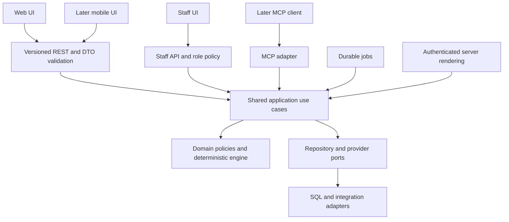

# Coding standards and maintainable application design

**Engineering specification 1.2 (capability amendment approved October 23, 2026) · October 22, 2026.** Apply these standards to implementation of the approved stack and [seven logical layers](07-stack-and-layer-signoff.md#3-logical-application-layers). This is a coding contract and review guide, not a claim that application packages or CI already exist. The [TDD strategy](08-test-driven-development.md) and [database design](09-database-design.md) are companion specifications.

**Status:** specification 1.0 was approved on October 22, 2026 in the [engineering approval record](00-source-review.md#engineering-approval-record). Version 1.1 incorporated the subsequent [PostgreSQL/build-order amendment](11-postgresql-and-build-order.md); P1-PR-002 now implements the initial workspace/type/import enforcement; product layers remain at their planned gates.

Version 1.2 incorporates the [four-phase/domain/AI extension](12-live-product-phases-and-gap-review.md), approved October 23, 2026; earlier approvals remain tied to their reviewed versions.

## Design principles

1. **Give each module a clear business responsibility.** Reports, delivery, permissions, catalog, and commerce own their rules and writes. Split by behavior and change ownership, not by an arbitrary file-size target.
2. **Keep business decisions independent of channels and vendors.** Web, mobile, staff screens, and MCP use the same application services and domain engine. SDKs and HTTP details live in adapters.
3. **Use composition and explicit dependencies.** Supply narrow repository/provider/clock ports through constructors or function factories at a server composition root. Avoid global service locators, deep inheritance, hidden database access, or a dependency-injection framework without a demonstrated need.
4. **Represent invalid and unknown states deliberately.** Unknown evidence is not zero; incomplete fitment is not verified; provider acceptance is not recipient delivery. Use discriminated unions and validated values to make these differences visible.
5. **Prefer small cohesive functions and immutable domain values.** Mutate only where ownership and state transitions are explicit. Avoid shared mutable singletons, speculative object pools, and factories that hide network or disk work.
6. **Centralize real invariants, not coincidentally similar code.** Reuse money/unit rules and permission checks. Two screens with similar markup may still deserve separate composition. A generic framework is not required to remove a few repeated lines.
7. **Make failures and resource use bounded.** Set deadlines, pagination, payload limits, retry budgets, and concurrency limits. Surface meaningful errors and measurable operational state.
8. **Optimize from profiles and representative workloads.** Start with appropriate algorithms, indexed access, and small payloads; measure before adding caches, parallelism, or denormalized projections.

These apply single-responsibility and dependency-inversion principles without requiring class-heavy domain modeling. Functions, immutable records, and a few well-defined stateful aggregates are the default.

## Package dependency contract

| Package/surface | May depend on | Must not depend on |
| --- | --- | --- |
| `packages/domain` | Pure value types and policies; small deterministic utilities | Next.js/React, SQL/ORM, provider SDKs, environment variables, implicit clock/random/network |
| `packages/engine` | Tire/money/unit value submodules and explicit versioned inputs | Consent, advertising/affiliate/offer decisions, presentation, database, provider calls |
| `packages/contracts` | Zod and explicit wire schemas/types | ORM entities, server credentials, application-service implementations |
| `packages/application` | Domain/engine and locally defined port interfaces | Concrete repositories, Next request/response objects, provider SDKs, UI |
| `packages/db` | Application persistence ports, domain value mappers, Drizzle/`pg` | UI, email SDK, arbitrary cross-module business decisions |
| `packages/integrations` | Application ports, approved SDKs, contracts and mappers | UI state or independent copies of ranking/permission rules |
| `packages/content` | Published-content port/DTO, Payload adapter on its server-only subpath | Broad operational contact access or public exposure of drafts |
| `packages/email`, `packages/pdf` | Versioned presentation DTOs, templates, locale formatting | Direct database queries, permission grants, ranking recomputation |
| Web/server adapters and jobs | Contracts, application services, composition root | Direct business writes that bypass the owning use case |
| Browser UI | Public contract types, `packages/ui`, locale/messages | `db`, server composition, secret/config readers, provider admin SDKs |

Enforce package exports, server-only entry points, cycle detection, and import restrictions in E02 CI. Do not export the whole domain through one barrel that accidentally couples the tire engine to consent or commerce. Type-only imports must still respect architectural boundaries. Framework wiring is assembled at entry points; application services must be executable in tests without booting Next.js.

An aggregate is the smallest group that must preserve an invariant atomically: a report/version change, a send and its dispatch state, or a budget reservation. It is not an in-memory object graph of every related table. Load only the fields needed for the command; represent broader screens with explicit read models.

## Entities, models and the data access layer

Build these contracts and implementations at S2 after the S1 schema gate; add domain behavior at S3, API handlers at S4 and frontends at S5. Database-first construction establishes integrity and query evidence without making the ORM the application's object model.

| Representation / location | Responsibility | Rule |
| --- | --- | --- |
| Relational schema and migrations / `packages/db/schema`, `migrations` | Columns, indexes, keys, constraints and grants | Reviewed SQL is authoritative for storage integrity; no product screen imports it |
| Persistence models / `packages/db/models` | Typed selected/insertable rows, including nullable columns and SQL representations | Drizzle inferred types stay inside the persistence boundary; no Active Record methods or lazy relationship loading |
| Entity and value contracts / `packages/domain/entities`, `values` | Report identity/revision, tire configuration, money/units and explicit state variants | Pure types/validated values; no ORM decorators or network/SQL getters; behavior grows with S3 tests |
| Repository/query ports / `packages/application/ports` | Narrow reads/writes required by named use cases | Declare interfaces at S2 without implementing services prematurely; avoid generic CRUD/repository-of-everything interfaces |
| Mappers / `packages/db/mappers` | Translate validated rows to domain/read models and back | Explicit null, timezone, bigint, unit and enum handling; malformed stored data is an integrity failure, never an invented default |
| Repositories and unit of work / `packages/db/repositories`, `transactions` | Implement ports using one scoped transaction client and bounded SQL | No provider calls or independent business decisions; atomic operations return typed outcomes |
| Read projections / `packages/db/queries` | Efficient safe shapes for reports, public content and aggregates | Select explicit columns, keyset pages and authorized scope; avoid loading large object graphs |
| Wire DTOs / `packages/contracts` | Stable versioned public/owner/staff inputs and outputs | Explicit allowlists and mapping; neither row models nor full domain aggregates are serialized directly |

For example, `report_versions` maps to an immutable domain report-version value. `CreateReport` coordinates eligibility, ownership, the version/current-pointer transaction and outbox intent through repository ports. `GET /api/v1/reports/{id}` returns an allowlisted view DTO after service authorization; web/mobile/MCP consume the same business outcome. A shared recipient never receives private columns just because the repository selected them elsewhere.

S2 acceptance includes row/value round-trips, null/unknown distinctions, money/unit conversion, wrong-owner reads, stale writes, multi-repository rollback, real concurrent transactions, keyset ordering and representative query plans. Constructor validation and port signatures can exist before S3 rule implementations; fake business decisions cannot stand in for a completed layer. Use reviewed constraint functions only for genuine relational/concurrency invariants; keep eligibility, pricing and permission orchestration in their owning services.

## Shared APIs and the business logic layer

The **business logic layer** consists of application orchestration plus domain rules. Application services decide what action an actor may perform, obtain the necessary versioned data, coordinate transactions, and record effects. Domain functions decide eligibility, ranking, cost, and valid state transitions. Repositories persist those decisions; presentation renders the safe result.

Use explicit commands such as `CreateReport`, `SaveComparison`, `ScheduleDelivery`, and `CancelDelivery`, with one public service method per meaningful action. Read queries such as `GetReportView` may use optimized DTO projections; they still enforce the same object/purpose policy. This is a light command/query separation, with one transactional system of record, not a mandate for event sourcing or separate read infrastructure.

An HTTP adapter performs: **parse → authenticate → construct actor/context → validate DTO → call use case → map result**. The use case rechecks object authority and current permissions. A mobile or MCP adapter calls that same use case; it does not copy the calculation into its own controller. Server Components may call the authenticated service directly without an HTTP loopback. A UI-specific response composition layer may arrange existing queries, but cannot invent a second business rule.

Complete the E34/S4 API inventory, OpenAPI/client artifacts and real headless acceptance before product frontend implementation. All later channels reuse the accepted services; neither a mock API nor a generated schema alone closes this gate.

Common API behavior belongs in small shared adapters: request IDs, error envelopes, schema validation, actor resolution, idempotency handling, rate limits, pagination, and response cache headers. Endpoint-specific authorization remains explicit. Avoid a configurable "universal endpoint" that obscures which checks run.

### HTTP and DTO conventions

- Retain `/api/v1`; generate OpenAPI from reviewed wire schemas and check contract diffs. Additive optional fields must preserve existing defaults/meaning. Removing/renaming fields or changing units/enums/semantics requires a compatible transition or a new API version.
- Separate input DTOs, output DTOs, domain values, and persistence records. Allowlist output fields; never serialize an ORM row, contact object, or provider payload directly.
- Parse external values as `unknown`; validate before constructing domain values. Prevent mass assignment by selecting writable fields explicitly. Reject unsupported fields on sensitive mutations; document behavior for ordinary extensible read clients.
- Use opaque IDs, ISO timestamps, explicit locale/market, unit-bearing quantities, and currency-bearing money. Serialize `bigint` monetary totals as decimal strings when they could exceed safe JSON integers; choose one documented wire representation per field and convert explicitly.
- Use 201 for creation, 202 for scheduled work, 204 for successful empty results, 409 for idempotency/revision/state conflicts, 422 for validated business input failures, 429 for limits, and 503 for a required unavailable dependency. Authentication uses 401; access denial uses the documented 403 or generic 404 policy to avoid object enumeration.
- Use the existing structured error envelope (`code`, `messageKey`, safe `fieldErrors`, `retryable`, `requestId`). Expected domain failures are typed results; unexpected infrastructure failures are logged once with a redacted cause and safe public response. Never return stack traces.
- Scope idempotency by actor/owner session, operation, and key; bind it to a canonical request-body digest. Same key with a changed command is 409. Persist the operation result with its business transaction. Retries must reauthenticate; a key never bypasses revoked access.
- Use revision/ETag preconditions for edits. Missing required preconditions are rejected consistently; stale revisions return 409 under the existing contract. Immutable report creation and snapshot selection stay separate from draft edits.
- Default list pages to 25 and cap at 100 unless an endpoint explicitly requires a smaller limit. Use stable keyset cursors with a unique tie-breaker; bound filters/sorts. Keep the existing event batch cap of 50/64KB. Large imports use authorized direct object uploads and background processing.
- GET/HEAD must not grant consent, allocate coupons, redeem offers, or finalize feedback. Webhooks verify raw-body signatures before inbox writes. Errors and redirects must preserve private cache/referrer controls.

## Patterns to use deliberately

| Pattern | Apply where | Guardrail |
| --- | --- | --- |
| Ports and adapters | SQL, CMS, identity, email, storage, event transport | Port describes the business need, not every provider SDK method |
| Repository and unit of work | Report/version, send/outbox, consent projection, coupon/budget transactions | Narrow aggregate repositories; one explicit transaction context; avoid a generic CRUD base class |
| Strategy/policy functions | Seasonal eligibility, market rules, price basis, template selection | Versioned, reviewed inputs; deterministic output; no arbitrary runtime code from staff settings |
| State machine | Send, privacy fulfillment, offer approval, coupon reservation | Enumerate states/transitions and forbidden edges; persist atomically and test races |
| Transactional outbox/inbox | Reliable work triggers and webhooks | Durable IDs, deduplication, leases and reconciliation; no exactly-once claim across vendors |
| Value objects | Money, distance, tire size/configuration, version IDs, permission scope | Validate at construction; explicit units and equality; no hidden I/O |
| Read model/projection | Report views, dashboards, public content | Source/version and freshness visible; never treat an analytics projection as consent or billing authority |
| Anti-corruption adapter | Licensed feeds and vendor event models | Normalize once; preserve provenance; quarantine malformed data instead of leaking vendor fields into domain code |
| Cache-aside | Public lookups and pure engine results | Versioned keys, bounded TTL, no authorization bypass; cache correctness tested |

Use these patterns when their problem exists. Avoid deep inheritance trees, singleton mutable user context, full event sourcing, universal factories, and microservices introduced only to match a diagram.

## TypeScript and code organization

Use `strict`, `noUncheckedIndexedAccess`, and `exactOptionalPropertyTypes`; resolve compatibility in R0 rather than scattering assertions. [TypeScript strict mode](https://www.typescriptlang.org/tsconfig/strict.html) strengthens type checks but does not validate external data. Use discriminated unions for variants and exhaustive switches for policies/states. Permit `any`, non-null assertions, or lint suppressions only at a narrow documented integration boundary with validation and a test.

Prefer descriptive business names, named exports, explicit return types at public package boundaries, and `readonly` input records. Keep constants for true shared rules; thresholds that change by market/data version belong in versioned policy. Avoid magic booleans and long positional argument lists; use named command records. Comments explain a business constraint or non-obvious tradeoff; they should not restate syntax.

Do not attach SQL methods, network getters, or mutable caches to a tire/report DTO. Keep compact records for scoring, pre-index candidates by validated fitment keys when profiling justifies it, and sort a bounded candidate set with a documented stable tie-breaker. Avoid repeated JSON deep cloning and quadratic nested scans of growing catalogs. Maintain precision for money and measurements; no locale-formatted strings in calculations.

Environment variables are validated in server configuration. Initialize pools/SDK clients lazily and reuse safe clients per process; do not create a pool per request or wrap adapters in opaque `Proxy` objects. Mutable actor, transaction, and permission context is per invocation. Time, randomness, and side-effect adapters are explicit dependencies in testable code.

Frontend components own rendering and interaction state. Form drafts, server snapshots, and derived display state are distinct. Do not duplicate server rankings in a hook. Prefer server rendering for content/read composition and small client islands for forms/compare. Effects synchronize with external systems; derived values should ordinarily be computed from props/state. Memoize only measured expensive work or required identity stability. Avoid a global state store until a concrete cross-route state need justifies it.

## Transactions, asynchronous work and reliability

The application service owns the unit of work. Pass a transaction-scoped repository context to all writes; never mix a transaction client with independent pool queries. [node-postgres transactions](https://node-postgres.com/features/transactions) require one client for the transaction. Release connections in `finally`; parameterize SQL and allowlist dynamic sort/identifier choices.

Do not hold a SQL transaction while calling Resend, S3, the CMS database, or another external service. Commit state/outbox intent, then execute a bounded job. Lock aggregates in a consistent order. Retry serialization/deadlock failures with bounded jitter only for a transaction whose local work can safely repeat; never blindly replay a completed external effect.

Every job specifies its unique business key, input schema/version, maximum attempts, timeout, backoff, lease/recovery path, terminal state, and reauthorization policy. Event payloads contain opaque references and permitted minimum fields. Job versions must handle already-queued payloads through a documented compatibility period. A worker crash is not proof that a provider did nothing.

Treat optional analytics failure separately from required persistence or safety-feed failure. Use bounded concurrency and provider timeouts; never unbounded `Promise.all` over an import or user-supplied list. HTTP cancellation may stop safe reads but must not abandon a committed business intent; the durable job owns subsequent completion.

## Performance and resource budgets

| Surface | Target or bound | Evidence and optimization approach |
| --- | --- | --- |
| Public form | Existing p75 LCP <2s, initial JS <120KB gzip including CMP/event SDK; CLS ≤0.1 and INP ≤200ms | Bundle report and agreed mobile/network profile; defer optional scripts, reserve layout space, minimize client rendering |
| Report API | Existing p95 <2s with cached provider datasets | Trace validation, data reads, engine, transaction, serialization separately; no live feed request in the critical path |
| Queries and lists | Bounded projection/page size; no query-per-item pattern | Representative plans and query counts at small/launch/10× volumes; batched joins/lookups, covering indexes only when useful |
| Engine | Deterministic bounded candidate evaluation | Benchmark realistic SKU/axle/evidence distributions, allocations and hot paths; preserve golden results after optimization |
| Jobs/imports | Bounded batches, memory, concurrency and retry attempts | Load/restart tests; checkpoint progress and stream large files; never read an entire large CSV into memory by default |
| Database | Bounded pool and statement/lock/idle transaction deadlines | Size pool against instance concurrency and database capacity at R0; track wait time and slow queries, not only connection count |
| Delivery/CMS | Existing cancellation-adjusted email target and <60s content propagation | Queue/relay lag plus provider time measured separately; failures visible and recoverable |

At E02, record provisional query-count, engine CPU/memory, payload, pool, timeout and worker-concurrency budgets from workload assumptions and isolated probes. Measure/refine them at S2 data-access and S3/S4 headless use-case/API gates, then verify representative production-sized data and peak/10× load at E19. Until measured, these budgets are open engineering values, not invented guarantees. A PR that changes a hot path provides before/after evidence; a regression requires a documented tradeoff.

Cache keys include all relevant engine/data/policy versions and normalized inputs. Private outputs remain private/no-store; separate reusable non-identifying calculations from contact/authorization views. Never cache a positive consent or tenant decision beyond its revocation requirements. Use indexed reads/public CDN caches first; a shared PostgreSQL computation cache requires measured benefit, read-time expiry, row/byte caps and bounded cleanup. A cache failure must not grant permission; use a bounded source calculation or explicit overload response. Explicitly invalidate public content on publication and distinguish immutable historical data from a live safety overlay.

Use `EXPLAIN (ANALYZE, BUFFERS)` on safe representative nonproduction reads when evaluating an index. Measure write overhead and query selectivity. Do not add an index to every column, partition small tables prematurely, or retain denormalized copies without an owner, version, rebuild strategy, and deletion path.

## Security, privacy and review

All entry points enforce identity/capability, object authority, purpose, and tenant scope. Internal jobs have explicit narrow service actors. Database RLS is defense in depth and must be tested with real runtime roles. Secrets, tokens, full query strings, raw emails, full ZIPs, and free text stay out of traces and analytics. Audit privileged changes using minimal facts and separately erasable identity mappings.

Review uploads/redirects/webhooks for their existing limits, validation, and quarantine requirements. Keep sensitive information out of snapshot tests, exception messages, and PR logs. Dependencies are pinned, upgrades reviewed, and generated/provider code isolated from business code. License review applies to copied components and datasets.

Every behavioral PR links the requirement and use case, shows relevant red/green evidence, names affected layers/tables/contracts, explains the failure path, and records appropriate validation. Reviewers reject duplicated rules across channels, unauthorized repository access, unbounded resource use, mutation of historical results, or tests coupled only to implementation details. Use the [repository contribution guide](../CONTRIBUTING.md) and PR template; update an architecture decision when changing a signed-off boundary.

## Domain imports and AI boundaries

All source fetchers, CLI imports, scheduled refreshes and admin CSV screens invoke the same L3 ingestion use cases. Separate parser/normalizer, validation, source matching and publication responsibilities. Use typed source adapters and deterministic canonicalization; isolate raw/staging rows from published reads. No generic table-editing API or executable user mapping scripts. Bounded streaming, checkpointing and head compare-and-set protect memory and concurrent publication.

AI provider SDKs stay in `packages/integrations`; application services own request policy, evidence packets, exact reuse keys and validation, while repositories own PostgreSQL persistence/leases. Prompts/configuration are versioned code artifacts with evaluation evidence. No model result is an entity until decoded and validated; never trust schema conformance as factual truth. Plain output DTOs carry supported claim IDs, provenance, expiry and limitations. Photo extraction is a suggestion until an authorized confirmation command succeeds.

Keep deterministic domain rules independent from inference, ads and client type. No prompt may ask a model to recompute eligibility, ranking or price truth. Do not call providers inside transactions, cache authorization decisions, reuse private results across owners, or mutate frozen reports/sends. Use deadline/cost bounds, lease fencing, minimal redacted logs, scoped deletion and finite retries. Shared generic AI artifacts require an approved nonpersonal scope; optional computation caching remains subject to profiling. See [AI/photos](14-ai-analysis-and-photo-design.md) for concrete invariants.

For each live phase, evolve contracts and schemas with expand/contract migrations and maintain the previous product's working journeys. Version external protocols and test both old and new clients; frontends cannot solve backend incompatibility by duplicating business logic. Optimize from measured report latency, source query plans, provider cost/reuse and frontend script/layout budgets.

**S2 foundation implementation:** [P1-PR-009](implementation/P1-PR-009-entities-transactions.md) implements explicit value/entity/port subpaths, safe selected-row mappers, versioned wire shapes and bounded PostgreSQL transaction contexts. Engine imports are limited to domain values, including type-only imports. Complete repositories, business locking/retry policies and API decoders remain the owning later cards.

**S2 catalog repository implementation:** [P1-PR-010](implementation/P1-PR-010-catalog-ingestion.md) refines the unused catalog/import prototype ports into paged catalog, ingestion and publication contracts. Fixed typed fact descriptors own SQL column/codec mappings; callers cannot supply identifiers. Repository mutations poison the transaction on failure even when a caller catches the exception. Published reads expose an allowlist through a dedicated database role, and reverse invalidation uses a separate privileged role. Parameterized keysets, byte/row limits, exact numeric strings and measured plans are mandatory. Service policy, runtime source decoders and API DTOs remain separate layers.

**Implemented S2 storage rule:** [P1-PR-013](implementation/P1-PR-013-s2-data-access-gate.md) supplies complete generated application Drizzle column models and a live PostgreSQL drift check. Regenerate through `pnpm db:models` after an intentional reviewed SQL change. Do not use these column-only declarations to generate migrations or bypass runtime grants; constraints, indexes, triggers and ownership remain SQL-authoritative. Raw `pg` bigint strings and Drizzle bigint values are distinct representations, explicitly tested at the persistence boundary.

**Implemented S3 privacy boundary:** [P1-PR-025](implementation/P1-PR-025-privacy-retention-recovery.md) keeps request clocks/proof policy in application/domain code, SQL graph mutations in a dedicated repository/role, and cryptography/storage/provider acknowledgments in explicit adapters. External I/O never holds a database transaction. Late writes require reserved identities and serialized tombstones; unknown downstream outcomes remain incomplete rather than successful. Reviewed fixed policy data cannot execute SQL.

[P1-PR-026](implementation/P1-PR-026-staff-commerce-revenue.md) applies ports/services/adapters, current permission locks, reviewed CAS publication, input allowlists, bigint financial ratios, common bounded I/O and indexed masked pagination. Commercial policy cannot change tire engine inputs or ranks; actual evaluation parity is regression-tested.

[P1-PR-027](implementation/P1-PR-027-s3-validation-gate.md) preserves layer direction and existing effects through typed maintenance bindings. Selection never grants authority; existing lease fences remain. Fixed action names, disabled defaults, dry-run retention, bounded candidate work, redacted failures, independent actions and explicit gate evidence prevent inspection or CI success becoming accidental activation.

**October 26 local service-host continuation:** The [local composition root](implementation/P1-PR-027-local-service-host.md) owns pool/client/lifetime resources explicitly. Reusable service/import/durable factories receive owned scopes and cannot hide additional allocations. Connection maxima are validated for the whole shared PostgreSQL cluster, including CMS and named external processes; guarded services stop new admission before drain.
