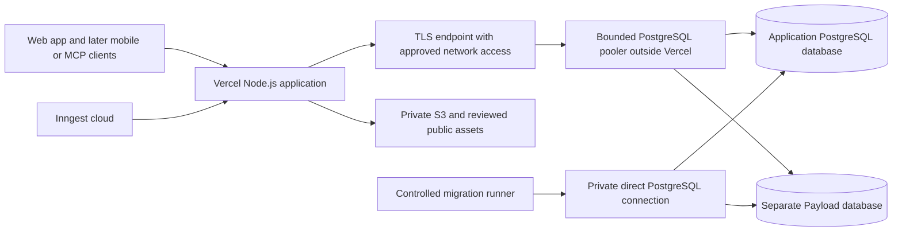

# Deployment and local-environment plan

**Proposal 1.0 · October 23, 2026 · For review.** Prepared against approved main commit `58ddb7d36915827cd67efac4b037b7b0c422c259`. This plan answers the hosting and local-validation questions before Phase 1. The approved production baseline remains Vercel + Neon until a hosting choice is accepted. Local infrastructure, the application and deployment pipelines described here are planned work; the readiness checks below do not constitute a deployment.

## Recommendation and direct answers

**Yes: the Vercel application can use self-hosted PostgreSQL.** The database must run on durable infrastructure outside the application's ordinary Vercel Functions: for example, a cloud VM or a dedicated database server. The application can remain on Vercel. Its Node.js services connect using the existing Drizzle/`pg` adapter over an authenticated, encrypted, reachable PostgreSQL endpoint. Neon and a Vercel Marketplace purchase are not technical prerequisites. [Vercel's relational connection guidance](https://vercel.com/kb/guide/connection-pooling-with-functions) supports standard PostgreSQL drivers and pooling.

Buying managed PostgreSQL directly from a provider is a third choice: it avoids Marketplace procurement without taking on database administration. “Outside Vercel” and “self-hosted” are different decisions.

**Yes: develop, build and run isolated dev and staging environments on this machine before pushing application changes to GitHub.** Use Docker Linux containers, real PostgreSQL, deterministic fixtures and local provider substitutes. Local Git branches/commits remain useful; a local commit does not upload code. GitHub CI independently verifies the pushed commit, and a hosted preproduction check proves deployment-specific behavior before release. A local staging pass cannot prove Vercel networking or real email/auth/provider behavior.

Recommended direction: adopt local-first development and local staging; retain portable PostgreSQL and Node.js boundaries; prefer Vercel with managed PostgreSQL for initial production unless database control or measured total cost justifies operating it ourselves. Keep the self-hosted and full-container paths concrete and costed before P1-PR-003 closes. No Kubernetes, Redis, ClickHouse or replacement workflow platform is introduced.

## Production hosting options

| Option | Application | PostgreSQL | Operational consequence | Recommendation |
| --- | --- | --- | --- | --- |
| A: managed baseline | Vercel Node.js Functions/CDN | Neon, purchased directly or through Marketplace; another compatible managed PostgreSQL provider is possible after approval | Provider operates DB infrastructure; we still own access, migrations, restore evidence, retention and capacity | Lowest operational burden; approved Neon baseline remains the fallback |
| B: Vercel + self-hosted DB | Same Vercel application, APIs, embedded Payload and job callbacks | Linux database VM/server outside Vercel, durable volumes, normally a PgBouncer endpoint | We own patching, TLS, connection admission, backups, PITR, monitoring and recovery; cross-provider network cost/latency | Technically viable when control and an assigned DB operator justify it |
| C: app + DB outside Vercel | Linux Node.js/Docker application behind a reverse proxy/load balancer/CDN | Managed PostgreSQL or our own PostgreSQL, preferably on a separate host in the same private network | We also own app rollout, TLS, routing, availability, capacity and cache behavior | Strongest infrastructure control; evaluate if Vercel networking costs dominate |
| D: production depends on this workstation | Public cloud app calling the local PC, or public app and DB on the PC | Existing Windows PostgreSQL/Docker | Sleep, power, residential connectivity, maintenance and a shared failure domain become production dependencies | Use the workstation for dev/stage; it is not the proposed live-product host |

Next.js can run outside Vercel, and Payload can run wherever Next.js runs. Hosting changes do not require rewriting the domain, service or API layers. Platform adapters and operational behavior still need verification. [Next.js self-hosting](https://nextjs.org/docs/app/guides/self-hosting), [Payload deployment](https://payloadcms.com/docs/production/deployment).



This diagram describes option B. Two logical databases may share a properly isolated cluster, but they have different credentials and migration owners. Sharing a cluster also shares compute, failure and physical-recovery boundaries. Production and nonproduction use separate instances/clusters; a distinct database name alone is not a production security boundary.

## Implications of Vercel with self-hosted PostgreSQL

### Network reachability and geography

A Vercel function cannot reach this machine's `localhost`, Docker service names or private LAN address. Production needs either an approved reachable TLS endpoint or configured private connectivity. Place the primary database and database-using Node.js functions in nearby regions; choose the region using audience, source restrictions and measured round-trip latency. The public CDN can remain global. Do not deploy database-heavy handlers across many regions while retaining one distant primary.

Vercel's normal outbound addresses are dynamic. For a restricted public database endpoint, its Static IPs option currently costs **$100 per project/month on Pro, plus regional Private Data Transfer**. It applies across that project's environments, uses shared egress addresses and needs a separate build-traffic setting. IP allowlisting supplements database authentication; it does not identify our project by itself. Routing Middleware is excluded. Recheck price, runtime compatibility and assigned IPs before purchase. [Static IPs documentation](https://vercel.com/docs/networking/static-ips).

For a database with no public endpoint, Vercel's Secure Compute supports private connectivity on Enterprise, with pricing and network setup to confirm. A private VM address does not become reachable simply by setting `DATABASE_URL`. [Secure Compute](https://vercel.com/docs/networking/secure-compute).

Proposed option-B network contract: verified server certificate/hostname, restricted endpoint, SCRAM credentials or an approved provider authentication method, separate app/CMS roles, rotated secrets and a documented operator access path. PostgreSQL itself stays behind the pooler/private network where possible; administer and migrate through a restricted runner or VPN. Never resolve a connection failure by opening the database to every address or disabling certificate verification. Browser code receives no DB credentials.

Configure and verify both client-to-pooler and pooler-to-database transport when they cross hosts. Test certificate renewal, password rotation, reconnect behavior and loss of the network path before accepting the topology.

Builds, migrations and runtime functions are three different network clients. Prefer builds that use versioned synthetic/public content snapshots and do not mutate a live database. If Payload initialization or public prerendering needs database reads, prove that need in S0, give the builder read-only nonpersonal access, and configure its network path explicitly. A GitHub-hosted runner does not inherit Vercel's egress IPs; a self-hosted migration runner belongs in the database network and accepts trusted release jobs only.

### Connections and correctness

Use the existing `pg` protocol path, not a Neon-specific HTTP driver in domain/repository contracts. Keep runtime pools bounded, initialized once per process/isolate, with checkout/statement/lock/idle-transaction timeouts. The Vercel adapter can attach pools using `attachDatabasePool`; a normal container adapter manages lifecycle and graceful shutdown. Neither local pooling nor this helper imposes a global database connection limit across all instances.

For option B, budget PgBouncer as infrastructure unless load evidence establishes an adequate alternative. Transaction pooling must preserve same-client transactions and transaction-local verified actor context. Do not depend on persistent session state, session advisory locks, temporary session objects or LISTEN across pooled transactions. Verify prepared-statement support with the pinned pooler/driver configuration; migrations and tools needing session behavior use the direct endpoint. [PgBouncer feature compatibility](https://www.pgbouncer.org/features.html).

Calculate capacity before enabling autoscaling:

```text
without a global pooler:
  sum(max app instances × per-instance pools across every runtime role)
  + workers + CMS + operators + migration/recovery reserve
  <= approved PostgreSQL connection budget

with a pooler:
  sum(server pool limits for every database/role pair)
  + direct workers/tools + recovery reserve
  <= approved PostgreSQL connection budget
```

Client queues must also be bounded. Backpressure, request limits and Inngest concurrency protect the shared DB; raising `max_connections` alone is not capacity planning. Test report traffic mixed with imports, analytics, rate limits, CMS publication and later AI refresh. Measure pool wait, p95 query/report latency, locks, CPU, I/O, WAL growth and storage headroom. Preserve existing report and availability targets.

### What we would operate ourselves

| Area | Required work and evidence | Accountable role |
| --- | --- | --- |
| Host and PostgreSQL lifecycle | Reviewed Linux/PostgreSQL versions, security updates, certificate renewal, disk expansion, controlled major upgrades and rollback drill | Platform/DB operator |
| Backup and recovery | Encrypted off-host backups, scheduled validation, WAL/PITR when selected, restore to an isolated target, app/CMS reconciliation and deletion replay | DB operator + privacy owner |
| Availability | Health alerts, documented restart/recovery, capacity reserve and a failover design appropriate to the 99.9% target | Platform lead |
| Access and secrets | Restricted networks, roles, audit, credential rotation, separate runtime/migrator identities and emergency access | Platform/security |
| Database maintenance | Vacuum/bloat, index health, slow query review, import/analytics quotas and backup storage expiry | DB operator |
| Incident response | Named primary/backup operator, alerts that reach them, outage and data-loss runbooks, restoration evidence | Product/platform |

Keep approved recovery objectives: **RTO 4 hours; RPO no more than 24 hours, tightened to 15 minutes only after PITR coverage is proven**. A backup timestamp is not a restore test. A replica is not a backup, and a single VM does not provide automatic high availability. Physical PITR covers the cluster; plan the separate app/CMS publication reconciliation accordingly. PostgreSQL documents the base-backup/WAL requirements for [PITR](https://www.postgresql.org/docs/current/continuous-archiving.html).

### What we lose or replace when leaving Neon

Provider-managed patching, managed storage/availability options, convenient database branches, managed pooling and provider recovery tooling need explicit replacements where used. Our application SQL schema does not depend on Neon branching. Create disposable test databases/clusters from migrations and synthetic seeds; use controlled sanitized snapshots only where rights and privacy permit. Test roles/extensions/collation/timezone against the chosen production version.

The relational schema, PostgreSQL analytics/limits/AI persistence, separate CMS ownership and seven application layers remain. Neon-specific environment injection, branch creation and recovery scripts become provider adapters. Do not migrate any live data merely to adopt this proposal; the repository has no application database yet.

## Hosting the entire application outside Vercel

For option C, deploy the same Next.js/embedded-Payload application as a pinned Linux container. Run PostgreSQL separately from the app container; use a private network and persistent data volumes. A single VM running all containers is an economical test or explicitly accepted small deployment, but a shared app/DB host is one failure domain and does not prove the availability target.

The implementation scope includes a reverse proxy with TLS/body limits, health/readiness checks, graceful drain, immutable image digests, rollback, retained static assets during version changes and public CDN configuration. Start with one proven deployment topology; test multi-instance cache invalidation, compatible build identifiers and publication propagation before scaling replicas. Private responses remain uncacheable. Use the existing PostgreSQL/S3/publication design or disable optional shared caches until measured; do not silently add Redis. These responsibilities follow the [Next.js hosting guidance](https://nextjs.org/docs/app/guides/self-hosting).

Inngest cloud, Clerk, S3/KMS, Resend and later model APIs can remain external services even when the app and DB are self-hosted. Inngest HTTP callbacks still require authenticated reachable endpoints, bounded steps and deployment compatibility. Hosting the app elsewhere does not mean self-hosting every provider.

Vercel-specific pool cleanup, deployment metadata and Global Config access stay behind platform/integration ports. If leaving Vercel, implement a reviewed published-config adapter with versioned snapshots, cache limits, invalidation and the existing propagation target. Prove behavioral parity before switching; do not make raw CMS queries from middleware. These are extra option-C tasks, not features already implemented.

## Local machine readiness

Read-only checks performed October 23, 2026:

| Resource | Observation | Implication |
| --- | --- | --- |
| Docker | Client and engine 29.1.3; Linux engine reachable with host permission | Docker Compose development is feasible; no new containers/images were started/downloaded |
| Docker allocation | 8 CPUs, approximately 15.4 GiB memory available to the engine | Suitable starting capacity to trial a bounded local stack; actual mixed-load capacity remains unmeasured |
| Native PostgreSQL | `postgresql-x64-18` service Running; `127.0.0.1:5432` accepts connections; `psql` client 18.1 | Server authentication, patch version, databases, roles and extensions were not inspected |
| Default Node.js | 20.19.6 | Does not match the approved Node 24 target; use a project-scoped runtime or pinned Node 24 container |
| pnpm / Git | pnpm 11.25.0 and Git on PATH | Pin a compatible pnpm version during bootstrap rather than assuming the installed one |
| Vercel CLI | No executable found on PATH | Optional later installation; local app development does not require a Vercel account or CLI |

Initial sandbox checks could not access the Docker pipe/service manager and reported no DB response. Host-permitted read-only checks confirmed the running services. The Windows Docker service status alone did not establish engine state. No existing databases, credentials, Windows services, global runtimes or firewall rules were modified.

Use project-scoped installations and containers for additional tools. Pin image digests and dependency versions at P1-PR-002; do not encode `latest` in the accepted runtime. Retain Node 24 across dev, local stage, CI and hosted runtime; Vercel manages its Node patch releases, so record the actual version in hosted evidence. [Supported Vercel Node versions](https://vercel.com/docs/functions/runtimes/node-js/node-js-versions).

## Environment topology and local resources

| Environment | Compute and state | Identity / side effects | Purpose |
| --- | --- | --- | --- |
| `dev-local` | Hot-reload Node 24 app; dedicated local app/CMS databases; local workflow/storage fixtures | Synthetic users/data; local provider fixtures by default; Clerk dev instance only in connected mode | Fast TDD and interactive development |
| `test-local` | Disposable PostgreSQL instances or per-worker databases/roles; isolated fixture namespaces | Deterministic clocks/data and denied unexpected outbound calls | Unit, use-case, real SQL, contract and concurrency suites |
| `stage-local` | Optimized Linux production-mode build; separate PostgreSQL cluster/roles/volumes; local proxy and provider services | Synthetic records; no real sends, ads, billing or live model requests by default | Pre-push migration, API/UI, startup/restart and recovery rehearsal |
| `preview` | Hosted candidate only after passing local checks; isolated nonproduction DB/storage/jobs | Protected access; test identities and provider keys | Verify actual Vercel/container-host runtime, TLS/network paths and callbacks |
| `stage-hosted` | A protected, long-lived nonproduction deployment on the chosen production topology | Independent auth/provider instances or namespaces; tightly allowlisted sandbox activity | Provider acceptance and release rehearsal, provisioned when needed |
| `production` | Accepted production topology with monitored durable data | Production identities/providers, explicit release and activation gates | One usable live product at the end of each phase |

Local staging and hosted staging are distinct. A release candidate built with production credentials is a **production deployment awaiting traffic**, not a safe nonproduction sandbox.

Use an explicit application environment such as `APP_ENV=stage-local` independently of `NODE_ENV=production`. A production-mode build must not load live credentials merely because it is optimized. Validate the environment/endpoint/credential combination at startup and use isolated ignored configuration files. For browser sessions, distinct ports on localhost do not isolate cookies: use verified loopback hostnames such as `dev.tt.localhost` and `stage.tt.localhost`, host-only cookies and separate auth instances/namespaces. Confirm DNS, HTTPS trust and provider callback origins during setup before changing host configuration.

### Proposed Docker layout

Use two separate Compose project names: `tt-dev` and `tt-stage`; tests use unique `tt-test-<run>` names. Each gets its own network, volumes, credentials, app/CMS databases, workflow namespace and fixtures. Docker documents project names as an [isolation mechanism](https://docs.docker.com/compose/how-tos/project-name/). Avoid fixed `container_name` values, external/shared volumes or a shared host directory that defeats this separation.

Proposed host ports below are reservations to check during setup, not listeners created by this plan. Bind published local ports to `127.0.0.1`.

| Service | Dev proposal | Local stage proposal | Notes |
| --- | --- | --- | --- |
| App/API/Payload host | 3000 | 3100 behind local proxy; optional local HTTPS 3443 | No product screens until P1-PR-031 accepts S4 |
| PostgreSQL | 55432 | 55433 | Two independent Docker instances; each owns `tt_app` and `tt_cms`; leave native port 5432 alone |
| PgBouncer, if option B or pooled production | 56432 | 56433 | Match production pooling mode; migrations use direct DB endpoint |
| Inngest Dev Server | 8288 | 8289 | Explicit app registration and environment URL; isolate discovery and stored execution state |
| Moto S3/KMS fixture server | 5000 | 5001 | Dummy credentials; resettable synthetic fixtures; cloud security parity is not implied |
| Provider HTTP fixture/capture service | 9090 | 9091 | Deterministic email/webhook/source/model responses and call assertions |
| Test browser / reports | Ephemeral runner | Ephemeral runner | Redacted results outside tracked source; no session/secret artifacts in commits |

Keep service addresses explicit: containers reach `postgres:5432` or `app:3000` on their own network; host tools reach published loopback ports. A container's `localhost` is the container itself. Host-run app mode may need Docker Desktop's host bridge for workflow callbacks; verify that path rather than mixing endpoint conventions.

Initially run dev and stage separately to limit memory contention. Set resource caps and lower fixture concurrency, then measure; the machine inventory is not a capacity guarantee. Local state should use project-specific named volumes, not arbitrary existing PostgreSQL data directories. Healthchecks and a bounded readiness wait precede migrations; start order alone is insufficient.

The installed native PostgreSQL is also usable for dev, with newly allocated app/CMS databases and scoped roles after explicit target checks. Docker remains the recommended reproducible stage/test path. If native and production PostgreSQL majors differ, run authoritative compatibility tests in the target-major container. Never upgrade or reset the existing server as part of project bootstrap.

### What can run locally, and what still needs a real service check

| Capability | Local execution | Required external evidence |
| --- | --- | --- |
| App/domain/services/APIs/Payload | Real Node.js application and real PostgreSQL migrations/roles | Hosted startup, runtime constraints, external networking and auth bridge |
| PostgreSQL / pooler | Real engines, transactions, limits, concurrency, backup/restore fixtures | Actual production disks, recovery permissions, capacity, TLS and provider/network outage behavior |
| Inngest | Local Dev Server for steps, delays, retries and event inspection; explicitly force local mode even with `NODE_ENV=production` | Cloud signing, callback reachability, retries/concurrency and deployment-version behavior |
| S3 / KMS | Moto-backed AWS SDK contract fixtures and synthetic files; regenerate ephemeral state when required | Real IAM, encryption/key grants, presigned URLs, lifecycle/version deletion and recovery |
| Resend / email | HTTP adapter fixtures/capture, HTML/PDF rendering, frozen payload/idempotency tests | Allowlisted sandbox email, actual signatures, bounce/suppression, deliverability/client rendering |
| Clerk | Test-only injected actors in automated harnesses; connected interactive staff/consumer flows use an isolated Clerk development instance | Real tokens, MFA/session/role changes, callback/origin handling and CMS identity bridge |
| Turnstile / CMP / ads | Fixtures and provider-supported test modes; visible house/empty placeholders | Actual allowed-domain integration, consent enforcement, inventory eligibility and provider approval |
| Domain imports | Script execution against synthetic/licensed fixtures and recorded contracts | Authorized source access, pagination/completeness, refresh and production data rights |
| AI / photos, from P2 | Recorded nonpersonal cases and local fixtures; same persistence/invalidation/confirmation logic | Approved real-model evaluation, cost, privacy settings and image quality evidence |
| Observability / Global Config | Structured local logs and published-config fixtures/adapter | Remote ingestion, redaction, alerts, propagation and operations access |
| Native app / MCP, from P3 | Local Android/device and protocol fixtures against local APIs | Real AI-client authentication/distribution; iOS release/device work needs macOS or an approved remote build service |

The [Inngest local server](https://www.inngest.com/docs/local-development) provides workflow test execution; it is not our production orchestrator. [Moto server mode](https://docs.getmoto.org/en/latest/docs/server_mode.html) supports AWS SDK test endpoints, not proof of AWS IAM or durability. [Clerk environments](https://clerk.com/docs/guides/development/managing-environments) distinguish development and production behavior.

Fully offline core tests are feasible once dependencies/images/fixtures are cached. Fully faithful interactive Clerk sign-in and live providers require network access. Fixture identity injection belongs in a separate test composition; it must not create a production login bypass. Normal stage builds exercise real auth when connected. `APP_ENV=production` startup rejects fixture auth, dummy keys or test endpoints, regardless of build mode.

Local email capture is not a successful Resend send. Dummy KMS is not validated managed encryption. No live ad clicks or real charges are part of automated tests. Cloud webhook providers cannot call loopback; replay signed fixtures locally and use a protected sandbox endpoint for real callbacks. An explicitly scoped, temporary local HTTPS tunnel is optional for a targeted integration test, not a production database bridge.

## Local validation before GitHub

This is the proposed working cycle for every implementation card:

1. Select an eligible backlog card and create a local branch. Write failing examples for the active layer; make changes locally with synthetic data.
2. Run formatting/lint/type/import checks and affected unit/use-case suites. Exercise real PostgreSQL roles, migrations, transaction races and API contracts when that layer exists.
3. Start an isolated local stage from the source under review, with an optimized Linux production-mode build, frozen lockfile, migrations and fixed seeds. No dev hot reload or source mount in this stage.
4. Verify active-layer smoke and failure/restart paths. At S1 this means schema/restore tests; S2 repositories; S3 services; S4 running APIs; S5 adds browser/accessibility/email/PDF tests. A missing future UI is not an excuse to build ahead of the gate.
5. Record source/lockfile/image/migration/fixture hashes, commands/results and evidence. Make a local commit; run the required final checks against that exact clean commit before push. Any content-changing amendment/rebase invalidates the affected results. Local hooks assist but are not the enforcement boundary.
6. Push the tested branch to GitHub, open the real PR, and attach the evidence/backlog ID. GitHub CI repeats the required suites in a clean Linux environment; it must not trust a developer's pass flag.
7. After trusted CI and protected preview checks pass, review/merge and follow the separate deployment/release gates. Merge-to-main must not automatically release unaccepted phase work to public users.

This satisfies testing before GitHub check-in/push while retaining source history and independent review. No need to upload code merely to start the local app. Documentation-only PRs continue to use documentation checks, not application builds.

### Planned repository tooling contract

These are deliverables for P1-PR-002 and later cards, **not files or runnable commands created by this proposal**.

| Deliverable | Responsibility |
| --- | --- |
| `infra/local/compose.yaml`, dev/stage overlays and version manifest | Independent services/volumes, pinned images, loopback ports, healthchecks, resource limits and explicit modes |
| `infra/local/.env.example` and setup instructions | Names and placeholders only; generated local values stored in ignored files; no production secrets pulled for local stage |
| `scripts/dev/*` | PowerShell-friendly doctor/up/down/status/logs/seed commands; discover host vs container endpoints explicitly |
| `scripts/verify/*` | One documented fast local gate and a stage-specific pre-push gate using the same underlying commands as CI |
| `scripts/db/*` | Explicit target/role checks, app/CMS migration paths, disposable test allocation, backup/restore and deletion-replay rehearsal |
| Container build recipe and ignore rules | Node 24, frozen dependencies, minimal runtime, no credentials/source mounts in stage, content-addressed image evidence |
| Provider fixture harness | Deny unexpected outbound requests, deterministic source/email/model/webhook behaviors and scoped test actors |
| CI/deployment workflows | Exact-commit checks, untrusted-PR isolation, controlled migrator and staged production promotion |

The doctor command should report versions, engine access, available ports, disk/memory, endpoint reachability and target names without printing secrets. “Down” preserves volumes by default. Reset/delete requires an explicit disposable project target and ownership/path checks; never run global Docker prune or delete the native PostgreSQL data directory. Ignore database dumps, local fixtures containing identities, TLS keys and rendered/session artifacts. A setup dry run must show resource names before creating them.

## Hosted verification and production release

### Preview and nonproduction controls

Use a dedicated nonproduction Vercel project and production project if independent credentials and production controls are easier to audit; account for additional per-project networking charges in option B. Alternatively, choose a single project with demonstrably isolated environment credentials and endpoints at S0. The hosting decision must name the exact model; do not assume a preview automatically creates an isolated external database.

Create preview databases/roles from migrations and synthetic seeds, with a unique run/PR identifier, quotas and cleanup expiry. Never give untrusted fork builds production, staging-admin or provider credentials. Authenticated access plus noindex protects hosted previews; separate cookies, callback URLs, signing keys and workflow app IDs prevent cross-environment traffic. Nonproduction ads, billing and sends remain disabled or explicitly sandboxed.

Keep hosted staging available when real-provider or deployment checks are needed. Running local stage for daily work can reduce its usage, but a public P1 launch still needs evidence on the chosen host. Budget a dedicated environment where callback URLs and identity tests need stable addresses.

### Migration and release order

1. Select the exact reviewed commit, compatible runtime, configuration version and environment. Verify successful CI, required local evidence, selected host readiness and a known-good rollback artifact.
2. Rehearse an empty install and previous-release upgrade in disposable local/hosted nonproduction databases. Test app/CMS grants, direct/pooled paths, existing client contracts and deletion replay.
3. Confirm fresh recoverable backups and a maintenance/incident owner. Apply **expand-only** app and Payload migrations with their separate migration credentials through one serialized executor per database. No startup auto-migration on every function/replica; no runtime superuser; no schema push in staging or production.
4. Build against compatible nonpersonal inputs; when the build requires DB reads, migrate its build target first and use the previously approved read-only access path. Keep live migrations in a controlled deployment step, not an unguarded `next build` script. Payload's migration lifecycle requires particular care here. [Payload migrations](https://payloadcms.com/docs/database/migrations).
5. Stage the production-configured application without assigning public production domains/traffic. Protect its URL. It has production authority already: use dedicated synthetic smoke records, non-destructive checks and carefully gated job activation. Nonproduction tests must never run against it.
6. Confirm database access, essential routes, auth, provider callback/version compatibility, logging and asset behavior; promote this exact production artifact. Do not claim a preview build is the same released binary if promotion rebuilds it.
7. Observe live phase journeys, alerts, errors, latency, pool use, event lag and costs. Start bounded/resumable backfills; validate them before later contract migrations remove old fields.
8. On failure, stop unsafe activation and roll back the application to a compatible artifact. Database restoration follows an incident procedure with write fencing, provider reconciliation, suppression/deletion replay and controlled reopening; a casual down migration is not the rollback plan.

Vercel distinguishes rebuilt preview promotion from promotion of a staged production build. Its CLI supports staged production deployment and explicit promotion; configure production auto-assignment so a Git push cannot bypass the release gate. [Vercel promotion behavior](https://vercel.com/docs/deployments/promoting-a-deployment). CLI paths, team/project IDs and exact flags are verified when the pipeline is implemented. Use protected deployment access instead of removing protection to run tests.

Vercel deployment uses the approved native Node.js Functions target; local Docker images are the reproducible test/container-host artifact, not a promise to deploy Vercel's container-image beta. Verify networking-feature compatibility before changing that runtime target. A local Linux test still needs the actual Vercel build/deployment check.

That check includes bundle/fonts/PDF rendering, function memory and time limits, request/upload limits, background-step boundaries and direct signed object upload/download paths. Local unrestricted Node processes do not demonstrate that these fit the chosen hosted limits; keep long imports/rendering in bounded Inngest steps and durable object storage.

For container hosting, build on a trusted Linux runner, push an immutable image digest, migrate separately, deploy behind readiness checks, drain the old version and retain it for rollback. Environment-specific `NEXT_PUBLIC_*` values and prerendered content can be baked into builds; changing runtime environment variables alone does not prove a local image is the production artifact. Record each build's provenance and test the actual release candidate.

### Jobs and repeated releases

Inngest runs can outlive an app deployment. Version job contracts, preserve frozen delivery/render inputs and test old events against new code. Pause dispatch only where the approved procedure calls for it; do not silently discard work. A production candidate and the active deployment must not both register competing schedulers or trigger duplicate effects. Test idempotency, cancellation and late-worker fencing at each rollout.

Each of P1–P4 repeats this release procedure and proves the previous live product still works. P2 includes AI/image limits and invalidation; P3 includes old mobile/MCP contract compatibility; P4 includes financial/lifecycle reconciliation and operating handover. Local app startup is never a substitute for the phase's live acceptance card.

## Cost comparison and decision inputs

Do not compare only the database subscription. Prepare low/base/high workloads and a monthly total including:

| Cost category | A: Vercel + managed PG | B: Vercel + self-hosted PG | C: app + PG elsewhere |
| --- | --- | --- | --- |
| App hosting | Commercial Vercel plan + measured usage | Same | VM/container hosting, proxy/CDN and traffic |
| Database | Managed compute/storage/pooling/recovery tier | VM, durable disk/IO, pooler, backups/WAL, optional standby | Managed DB fee or the same self-hosted DB costs |
| Networking | Provider egress/connectivity where applicable | Static/private connectivity, cross-provider transfer, operator/runner access | Private-network/egress/CDN charges |
| Operations | Our application/data responsibilities plus provider oversight | Add DB patching, incidents, maintenance and restore labor | Add app-platform operations and deployment ownership |
| Nonproduction | Local capacity plus isolated hosted checks | Same, with DB/test resource management | Same, plus extra instances as needed |
| Shared providers | Clerk, Inngest, S3/KMS, email, monitoring and later AI | Same unless separately changed | Same unless separately changed |

This commercial advertising site needs a commercial Vercel plan; Hobby is documented for personal noncommercial use. [Vercel Hobby scope](https://vercel.com/docs/plans/hobby). Current Static IP pricing is an input above, not a full hosting quote. Obtain actual regional plans, limits, storage/backup retention and required user seats during S0. Exclude speculative ad income from the funding assumption.

A cheap single database VM can cost more overall once secure connectivity, backups and operator time are counted. Conversely, a well-operated colocated app/DB deployment may be economical at predictable load. These are planning judgments to validate with workload measurements and a named operator, not universal price claims.

Before production topology selection, record region, data location, operator/backup owner, expected traffic/concurrency, storage growth, recovery tier, monthly budget and outage tolerance. If no operator accepts database recovery responsibilities, choose managed PostgreSQL. If self-hosting is required but Vercel networking is uneconomic, evaluate option C using the same product acceptance targets.

## Integration with the working PR task list

The approved backlog stays at **119 core PRs plus 10 parked options**. The following is a proposed execution supplement for existing cards, not extra completed work or a new live phase. The original task-list approval remains tied to `c984bcf`; acceptance of this deployment proposal does not choose option B/C unless recorded explicitly.

| Backlog card | Deployment tasks to include | Evidence required |
| --- | --- | --- |
| [P1-PR-001](tasks/phase-1-prs.md#p1-pr-001) | Select A/B/C and region; cost/operator/recovery matrix; resolve data-location and commercial constraints | Hosting decision and budget/owner register |
| [P1-PR-002](tasks/phase-1-prs.md#p1-pr-002) | Node 24/Compose doctor; isolated dev/test/stage; fixture harness; local pre-push and clean CI commands | Cold local setup, environment isolation and intentional failing-check proof |
| [P1-PR-003](tasks/phase-1-prs.md#p1-pr-003) | Headless target-host DB/pooler/auth/Payload/worker proofs; migration/build networking; release controls | Actual chosen-host evidence; decision closed before S1 |
| [P1-PR-004](tasks/phase-1-prs.md#p1-pr-004)–[008](tasks/phase-1-prs.md#p1-pr-008) | Separate app/CMS databases/roles; local and hosted migrations; synthetic seeds; backup/restore/deletion replay | Schema/role/recovery gate on the target PostgreSQL version |
| [P1-PR-012](tasks/phase-1-prs.md#p1-pr-012), [014](tasks/phase-1-prs.md#p1-pr-014), [024](tasks/phase-1-prs.md#p1-pr-024) | Runtime pool adapters, private assets/jobs, config publication, monitoring and bounded work | Failure, isolation and mixed-load evidence |
| [P1-PR-031](tasks/phase-1-prs.md#p1-pr-031) | Local-stage complete API suite plus chosen-host smoke; no product UI yet | S4 acceptance, auth/TLS/callback and pool capacity evidence |
| [P1-PR-041](tasks/phase-1-prs.md#p1-pr-041)–[043](tasks/phase-1-prs.md#p1-pr-043) | Full local/hosted journeys, recovery/performance drill, staged release, live observations | Existing G/release evidence plus deployment manifest/runbook |
| [P2-PR-026](tasks/phase-2-prs.md#p2-pr-026)–[027](tasks/phase-2-prs.md#p2-pr-027) | Repeat pipeline with image/AI evaluation and provider cost/limit controls | P2 real-provider and live-product evidence |
| [P3-PR-023](tasks/phase-3-prs.md#p3-pr-023)–[025](tasks/phase-3-prs.md#p3-pr-025) | Device/client matrix, host callbacks, store/MCP distribution and compatibility | Both live channels, not only local emulators |
| [P4-PR-022](tasks/phase-4-prs.md#p4-pr-022)–[024](tasks/phase-4-prs.md#p4-pr-024) | Four-phase load/recovery regression, financial job compatibility and operational handover | Complete committed scope and named operating owners |

Large option-C infrastructure work must be split using the existing child-card convention if selected; update dependencies and estimates before implementation. No old effort subtotal covers this choice automatically. S0 may create empty infrastructure/headless fixtures; S1–S4 still precede product UI/templates.

## Proposed decisions for signoff

| ID | Proposed decision | Status / effect |
| --- | --- | --- |
| DP01 | Adopt isolated Docker local dev, test and optimized local stage with checks before GitHub push | Proposed; implementation in P1-PR-002 |
| DP02 | Keep standard PostgreSQL + Drizzle/`pg` and separate Payload ownership; allow externally hosted databases through verified adapters | Proposed portability clarification; no new data store |
| DP03 | Prefer Vercel + managed PostgreSQL initially; keep B/C available after costs, operator and network proofs | Proposed; Neon remains approved default; B/C selection must be explicit |
| DP04 | Use PostgreSQL/Node version parity, pinned tooling, reproducible fixtures and safe target-checked local operations | Proposed; no global workstation upgrade required |
| DP05 | Keep test doubles separate from real-provider acceptance; hosted preproduction proves production-topology behavior | Proposed; no relaxation of existing quality gates |
| DP06 | Require serialized migrations, protected candidate deployment and explicit promotion of tested production artifacts | Proposed; Git push/merge alone is not a public release |
| DP07 | Retain existing availability/recovery targets, off-host backups, restore/deletion evidence and named operational ownership | Proposed operational elaboration |
| DP08 | Fold deployment work into the current backlog and retain S0–S6 order within each live phase | Proposed; 119 core IDs and ten parked options preserved |

The architecture's AS02 hosting/database selection is affected only if a different production option is approved. AS01 layer boundaries, AS03–AS07 as previously amended, D28/D29 PostgreSQL consolidation, D30–D35 phase/capability scope and the historical approval records remain. This proposal has not provisioned any cloud resources, connected the application to the native database or started Phase 1 implementation.
