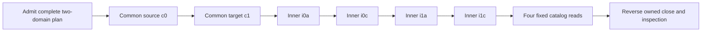

# P1-PR-027 — multi-target coordination proof design review

**October 30, 2026 (Pacific). Proposed local test-support design only; no implementation, fixture execution, SQL, or case/gate closure.** Owner-approved [PR #58](https://github.com/xmyqyl4x/tiresandtreads/pull/58) merged at `4c4311b55fe94e0705393e62a158158e91f40758`, retaining tested tree `f272070a4bf5e0fc37f63eaab3b42a5d3c11d041`. Its [dedicated TLS/admission proof](P1-PR-027-fixture-tls-admission-preflight.md) passed 80 executions locally and in [dedicated CI](https://github.com/xmyqyl4x/tiresandtreads/actions/runs/41154860341); separate full regression passed 1,993 executions locally and in [full CI](https://github.com/xmyqyl4x/tiresandtreads/actions/runs/41154860259). These are **historical results, zero re-executions in this review**. The owner authorized this review only under PJ13/BLC-T13 and P1-PR-027/S3-service-host. HS01–HS08 proposed; operators/coverage/rates unconfirmed; all six S3 gates open; specialist/licensed work pending; APIs/frontends held. Production bootstrap/CLI/preflight/policy unchanged. No provisioning, purchases or actual recipient notifications.

[Proposed contract, inventories and controls](evidence/P1/p1-pr-027-multitarget-proof-design-review.json), [exact sources and primary references](evidence/P1/p1-pr-027-multitarget-proof-design-sources.json), [static validation record](evidence/P1/p1-pr-027-multitarget-proof-design-validation.md).

## Findings and recommended scope

PR58 supplies verified fixed endpoint access, foundation metadata parity, same-run resource/material checks and driver-observed closure. Its observer opens, reads and closes each endpoint sequentially; its successful receipt retains no session or allocation. Its Docker custodian observes resources and material, not PostgreSQL lock ownership or backend death. It cannot be called once and used as continuing permission for a coordinator. The PR56 reducer supplies order invariants with synthetic outcomes only. PR54 supplies actual one-cluster contention/loss evidence on different database names; its blocking transaction-level inner lock differs from the proposed session-level try-lock. None implements actual two-domain allocation. Source anchors below preserve these distinctions.

Recommend a **separate future disposable coordination proof** using the four reviewed foundation endpoints. Keep every existing source/fixture/workflow unchanged. A future standalone fixture wrapper may reuse fixed certificate/initializer components after separate authorization; invoking the existing TLS runner would execute its profiles/restart controls, while the full recovery runner would migrate/seed/restore. Neither is the proposed initializer. The future proof adds only cooperative advisory allocation, fixed metadata reads, actual contention/loss controls and exact owned cleanup. It adds no production coordinator, dispatcher, project-role exception, migration, seeded business data, journal backend or archive integration.

The original PJ13 requires source preservation during restore-related coordination and BLC-T13 requires lifecycle serialization. A foundation-only read rehearsal cannot establish surviving authority during a DB rebuild, populated-data/ledger preservation, restore composition or participation by unrelated admin/migration paths. Original 18 journal scenarios, 22 lifecycle cases, MT01–MT16 and TA01–TA20 stay open/frozen. MC01–MC20 below are proposed local observation references, not new core task cards or accepted tests.

## Fixed admission and six owned channels

Retain the exact five-field public plan (`version`, `scope`, `project`, `fixtureGeneration`, `domains`), 4096-byte UTF-8 bound, version 1/scope `disposable-readonly-multitarget-plan`, generated `tt-test-` plus 16 hex project, 32-hex generation and two fixed source/target slots. Both input permutations canonicalize identically. No caller URI/CA/role/credential/SQL/PID/key/timeout/program/callback/archive/journal/receipt is accepted. Preserve private bounded same-run material/resource binding and every current TLS/session check. Any new private client factory needs its own representative TLS/identity negatives; inherited PR58 success does not validate different future code automatically.

| Channel | Domain / hostname | Database / owner | Fixed two-int key | Purpose |
| --- | --- | --- | --- | --- |
| c0 | 0/source, `postgres.preflight.test` | `tt_app_recovery` / `tt_app_migrator` | `7724054,1` | Common source |
| c1 | 1/target, `recovery-postgres.preflight.test` | Same app pair on target | `7724054,1` | Common target |
| i0a | 0/source | App pair | `7724004,1` | Source app inner/read |
| i0c | 0/source | `tt_cms_recovery` / `tt_cms_migrator` | `7724004,1` | Source CMS inner/read |
| i1a | 1/target | App pair | `7724004,1` | Target app inner/read |
| i1c | 1/target | CMS pair | `7724004,1` | Target CMS inner/read |

Use **six distinct physical clients**: common and app-inner handles must differ even on the same endpoint, so a lost common can coexist with an independent read. Identical numeric keys on different databases do not create common exclusion. The fixed per-database negative control may demonstrate that fact but cannot become the main admission path. The application recovery DB is only a fixture coordination endpoint; no production maintenance DB, durable authority, key namespace or provider choice is selected. [Database-local key semantics](https://www.postgresql.org/docs/18/view-pg-locks.html).

The proposed private channel identity binds slot, DB/owner, exact backend PID plus `backend_start`, backend type, same-run resource incarnation and a full application token under PostgreSQL's 63-byte name limit. Suggested fixed shape: `tt-mt:<run16>:<participant16>:<c0|c1|i0a|i0c|i1a|i1c>`. Exact tokens/handles are minted and retained by the harness; none is caller authority or an independently authenticated instance identity. Private PIDs, credentials, cert/key material and raw catalog rows never enter published receipts.

The private case table can label app/CMS initiation for competing participants; it adds no public origin option and does not prove participation by actual business service entry points. Both participants still use the same complete fixed plan and canonical endpoints.

## Allocation, query windows and time budget

Proposed private phases are fresh → common channels admitted → common0 held → both commons held → inner prefix → ready → reading → closing → closed. Refusal/loss is terminal for new work; cleanup and original in-flight disposition may still complete. During allocation, validate exactly the acquired prefix; only the complete six-handle state admits catalog work. An unknown grant acknowledgement counts as potentially held until exact cleanup, never as a reason to repeat acquisition.

Guard sampling wraps candidate admission/allocation/work commands and their acknowledgements. A custody sample is itself one bounded observation, not recursively wrapped in more custody samples. Each sample must cover the expected prefix and current mapping; an unavailable sample refuses. The only query forms are fixed identity/GUC facts, the two literal advisory try-lock statements, the existing bounded foundation snapshot, the fixed slow-read control and transaction control; no general query method is exposed.

1. Start one real monotonic attempt before admission/connections. Resolve both fixed domains and current private binding; connect/verify c0 and c1 before allocation. Reject reused/unclean participants or inner-held/partially extended plans. A complete domain plan is known before any lock, although inner clients open later.
2. Acquire c0 then c1 using a single fixed `SELECT pg_try_advisory_lock(7724054,1)` per channel. Require an observed true acknowledgement, current binding and exact owned lock row. False/unknown/late is terminal. Do not poll, retry, stack reentrant acquisitions, upgrade shared locks, switch endpoints or fall back to root. Acquisition of two servers is sequential and non-atomic.
3. Only after both common grants, open/verify/acquire i0a, i0c, i1a, i1c in that order, once each with fixed `SELECT pg_try_advisory_lock(7724004,1)`. The first false/unknown result stops later allocation and all catalog work. No call to migration helpers/CLI/status is permitted. The existing PR54 blocking transaction lock remains unchanged; this is a proposed new test-only session-lock contract, not inherited behavior.
4. After all six grants, run the four reviewed bounded foundation catalog observations in the same endpoint order. Re-admit environment/material/resources and sample both common plus acquired inner ownership before/after every awaited command/result. Do not re-run a try-lock as a liveness check: same-session reacquisition can stack. Use exact sampled `pg_locks` rows and channel identity/error state. Discard every provisional result if any common, identity, mapping, clock or inspection becomes uncertain. [Session lock semantics](https://www.postgresql.org/docs/18/explicit-locking.html#ADVISORY-LOCKS), [fixed advisory functions](https://www.postgresql.org/docs/18/functions-admin.html#FUNCTIONS-ADVISORY-LOCKS).
5. End bounded work, then close the acquired inner prefix in reverse order followed by c1/c0; close opened-but-ungranted clients as owned handles too. Rollback alone never represents session-lock release. No fresh participant proceeds until old in-flight disposition and exact owned cleanup have been observed, or the whole disposable fixture is abandoned and torn down without a clean proof claim.

**Proposed transaction clarification:** use short explicit read-only repeatable-read transactions for each fixed admission/acquisition/inspection/read command group, then rollback. Session locks persist between groups; no transaction is kept idle while other channels connect or a human waits. This distinguishes lock lifetime from MVCC snapshot lifetime and avoids depending on a long idle transaction. Keep the inherited idle/transaction guards enabled, with no heartbeat, renewal, guard relaxation or global snapshot claim. If a group cannot finish within its limits, refuse. This is unimplemented test design, not a production helper/policy change.

The candidate keeps the **4000ms whole-attempt** cap, connections/queries at remaining time and ≤1500ms, statement/idle transaction ≤1000ms, lock ≤250ms and transaction ≤5000ms. Inspect/admit work awaited by the candidate consumes that same budget, including controller/barrier responses; there is no per-domain or read reset. Try-lock contention returns immediately; it does not demonstrate a measured 250ms blocking-lock wait. Earlier grants remain cooperative session allocations during later short query windows. Six channels and extra observations have **not been timed here**; failure to fit must refuse, not raise limits. [Distinct server timeout settings](https://www.postgresql.org/docs/18/runtime-config-client.html).

Propose one candidate with at most six clients, one competing attempt with at most two common clients before refusal, two privileged read-only inspection clients, one fixed blocker and one unrelated owned witness: **12 simultaneous clients total, at most seven on either domain**. Serialize cases and do not let the contender open inner clients after common refusal. Negative controls use only their fixed reduced channel set. Driver-end observation stays ≤750ms per client; one whole post-close backend/lock inspection window is ≤2000ms with remaining call caps. Cleanup is outside the 4000ms admission result and may be unknown. A 15000ms case envelope includes owned blocker/fault readiness and cleanup, excluding separately bounded 120s synthetic setup/teardown. These are unmeasured fixture limits, not a production pool/budget change.

## Inspection, fault custody and loss observations

Future roles remain separate. The candidate gets fixed owner configs/public trust and bounded read-only custody responses, no root environment, Docker socket or server keys. The existing Docker custodian stays unchanged, trusted and daemon-authoritative despite its read-only socket mount. A separate proposed privileged SQL inspector uses only fixed TLS/read-only queries to corroborate private backend identities and lock rows on each domain; no new role memberships or `pg_read_all_stats` grants are introduced. It reads exact owned candidates/witnesses, not arbitrary unbounded process rows.

Each backend sample must use a **fresh short inspection transaction**, avoiding cached activity snapshots across a long transaction. Match `pid`, `backend_start`, database/role/application token/type against the private registry and current resource incarnation. Lock rows must match advisory type, correct domain/database OID, granted `ExclusiveLock`, `classid` equal to the fixed first key, `objid=1` and **`objsubid=2`** for the two-int form. No OID/PID alone establishes ownership. These samples are not an atomic multi-server snapshot or continuous exclusion guarantee; check/use races and uncooperative admins remain outside the claim. [Statistics freshness and backend identity](https://www.postgresql.org/docs/18/monitoring-stats.html#MONITORING-STATS).

Lost-session controls require **separate future authorization** for a parent-owned synthetic fault controller. It accepts only fixed `lose-common0`/`lose-common1` case selections from trusted test setup, never caller SQL or PID. Immediately before signalling, independently match the exact registry identity/resource/token against `pg_stat_activity`; mismatch, absence, duplicates or unavailable inspection means no signal. Use one fixed predicate with bound private fields, never name-prefix sweeping or arbitrary termination. The candidate has no fault-controller capability. This is a disclosed administrative test effect, distinct from read-only observations and zero lifecycle/provider dispatch.

For each common slot, first observe an independent opposite-domain inner read actually active in fixed `pg_sleep(0.65)` within the 1000ms statement cap. Then signal only the owned common backend. The default termination acknowledgement means signal delivery, **not observed backend death**; inspect exact backend/lock absence separately. Await the original read: if it completes after loss/deadline, record completion and discard its result; stop all new candidate work. No promise is described as cancelled or fenced. An unrelated same-project synthetic witness must survive exact cleanup. No real foreign/native/dev/stage backend is touched. [Backend signalling semantics](https://www.postgresql.org/docs/18/functions-admin.html#FUNCTIONS-ADMIN-SIGNAL).

Preserve the private `backend_start` value as server-returned text under fixed UTC/ISO session formatting, including microseconds, and compare that exact text in the inspector/fault predicate. Do not round-trip it through JavaScript `Date`, whose conversion can lose precision. These are fixed future fixture connection/identity settings, not caller options or production GUC changes. [Driver type/precision behavior](https://node-postgres.com/features/types).

## Preservation, cleanup and receipt contract

Retain the dedicated foundation-only baseline: four recovery DBs, 17 app/two CMS scoped roles, zero scoped memberships, unchanged role capabilities/settings/ownership/ACL/default ACL/catalog and all nonowner runtime CONNECT denied in both domains. Prepare via separately authorized owned synthetic setup that exits before candidate observation; no migration, populated source seed, restore, archive/journal import, provider/app/worker or runtime opening. Capture private baseline after setup, compare fixed observations under the sampled cooperative window and compare fresh post-cleanup samples. Histories/user objects are absent: this proves no nonempty-data/history preservation. Session/statistics and ephemeral advisory-lock changes are disclosed.

A proposed bounded immutable receipt separates candidate outcome, provisional observations discarded, work started/completed/late/unknown, expected vs observed acquired prefix, driver-end state, per-domain backend absence, lock absence, baseline parity, quarantine state, clock and effect counts. Trace ≤64 fixed transition events and receipt ≤16384 UTF-8 bytes; overflow refuses. No reflected rejected strings, URLs, passwords, PEM, raw rows, PIDs or executable handles. Digests compare metadata only; no bearer authority, independent checkpoint or authenticated journal.

Driver end, root signal acknowledgement and resource teardown are different facts. A clean local disposition needs observed candidate work completion, exact owned driver ends **and** fresh backend/lock absence on both domains, unchanged semantic baselines and observed quarantine. Unavailable end/inspection remains cleanup unknown; no clean receipt or new candidate. Destroying an owned fixture later does not retroactively prove prior lock absence or old-work quiescence. Cleanup closes exact handles, never a broad unlock/kill; parent teardown removes only the generated project/material and inspects absence. Neither source preservation at sampled boundaries nor sampled ownership makes a cross-domain atomic snapshot, surviving production authority, fencing or independent durability claim.

## Proposed observation matrix

All entries are unimplemented and unexecuted. Both common contention positions, all four inner positions and both lost-common slots must be distinct measured cases. Unit tests later establish raw/state/order/deadline/refusal invariants first; functional tests later use real pinned PostgreSQL for locks/TLS/backend identity and catalog comparisons; use-case tests later combine success, each contention/loss/late path and exact cleanup. TDD red/green receipts and actual counts belong to that separately authorized implementation; none is fabricated here.

| Control | Existing mapping | Required later observation | Status |
| --- | --- | --- | --- |
| MC01 — Exact raw admission | MT01/MT02/TA01/TA02 | Malformed/duplicate/oversize/extra or retained inputs refuse before handles; fixed source/target slots and no caller key/SQL/PID/URI. | Proposed; not executed |
| MC02 — Verified current channels | MT07/TA03–TA11 | Every new channel verifies TLS/session/resource/material generation; representative factory-specific negatives refuse, remaining TA faults remain open. | Proposed; not executed |
| MC03 — Permutation invariant | MT03 | Both public input enumerations produce common0/common1 then inner0app/0cms/1app/1cms; no inverted acquisition to provoke a deadlock. | Proposed; not executed |
| MC04 — Actual six-lock journey | MT09 | One bounded attempt observes six exact distinct channels, canonical grants and four catalog reads with pre/post ownership samples, then reverse cleanup. | Proposed; not executed |
| MC05 — First common busy | MT05/PJ08 | Two opposite work origins share source-app common endpoint; loser makes one try, opens no inner channels and performs zero catalog work reads. | Proposed; not executed |
| MC06 — Second common busy | MT06/PJ13 | Fixed target-common blocker leaves source common as owned prefix; refuse before all inner work, observe complete owned cleanup. | Proposed; not executed |
| MC07 — Each inner busy | MT08/PJ09 | Block each of four inner keys in turn; both commons precede inner attempts, no later acquisition/work after first false/unknown outcome. | Proposed; not executed |
| MC08 — Separate-database negative | PJ08/MT02 | Fixed negative mode gets equal numeric common key in source app and CMS DBs; both grants demonstrate absent shared exclusion, never an admitted main-path result. | Proposed; not executed |
| MC09 — Invalid order and reuse | MT04/MT15 | Early work, partial extension, reentrant allocation, shared/upgrade mode, duplicate/out-of-order acknowledgement or terminal reuse refuses. | Proposed; not executed |
| MC10 — Lost source coordinator | MT10/MT11/PJ10 | After all six grants, an opposite-domain fixed slow read is actually active; separate exact-owned fault signals common0, result completes but is discarded and new work stops. | Proposed; not executed |
| MC11 — Lost target coordinator | MT10/MT11/PJ10 | Repeat exact-owned fault for common1 with source-domain slow read; either common loss invalidates whole attempt, no fencing claim. | Proposed; not executed |
| MC12 — Unknown grant acknowledgement | MT12/BLC-T22 | Lost/late successful grant acknowledgement quarantines exact owned handle as potentially held; no automatic repeat/unlock of an unowned PID. | Proposed; not executed |
| MC13 — Whole deadline and late result | MT11/MT12/TA12 | One real monotonic 4000ms attempt; forced late completion refused, in-flight disposition recorded, cleanup bounded separately and never assumed completed at timeout. | Proposed; not executed |
| MC14 — Mapping drift in flight | MT07/MT12/TA04/TA16 | Fixed owned incarnation/material or supervisor-availability change at awaited boundary discards provisional observations; no rebind or automatic repair. | Proposed; not executed |
| MC15 — Observed owned cleanup | MT14/TA17/TA19 | Reverse close exact inner prefix then common1/common0; driver end plus fresh exact backend/lock absence in both domains; unrelated owned witness survives. | Proposed; not executed |
| MC16 — Unavailable cleanup inspection | MT14/TA17/TA19 | Lost inspection or unobserved client end yields cleanup unknown; no clean receipt or fresh participant even if root teardown later removes resources. | Proposed; not executed |
| MC17 — Foundation preservation | MT13/PJ13/TA14/TA18 | Before/after scoped role/member/ACL/GUC/catalog baselines match and nonowner runtime CONNECT denied on both domains; no populated history/data preservation credit. | Proposed; not executed |
| MC18 — Context after awaits | MT12/TA16 | Raw environment and private mapping re-admitted before dispatch and after every await; SQL success alone cannot admit stale evidence. | Proposed; not executed |
| MC19 — Fresh after known cleanup | MT15 | Only fresh nonce/channels after observed old-work completion and owned session/lock absence; no old receipt or new-holder authority over unknown prior work. | Proposed; not executed |
| MC20 — Receipt and effects boundary | MT16/TA20 | Bounded redacted immutable facts distinguish lock effects, read completion, rejection and privileged test fault; no lifecycle/provider dispatch, case/gate closure or production acceptance. | Proposed; not executed |

Remaining TA negatives (root validity, extra/missing/key-pair material, live routing/resource collision, forced end hang and drift at every await) are not accepted merely because this design references them. Actual restore/journal/current-index continuity, retained data, production authority surviving project DB rebuild, RPO/RTO/PITR, specialist/provider/operator/privacy acceptance and all original case/gate requirements remain separate unresolved work.

## Static evidence and publication

This review changes documentation only: **110 unchanged source pins**, **134 frozen historical evidence files**, 31 exact source anchors, eight refreshed official references and the 23 SP08 receipt/index/baseline pins. Two registers append four local review references only. Preserve all null actual selections, eight proposed HS decisions, six pending S3 gates/empty actual records, false acceptance/endpoint/public flags, 119 core cards/dependencies, 137 FR rows, 75 checked/282 unchecked tasks and three parent completion boxes.

No Docker/Compose/fixture, SQL/TLS, unit/use-case/functional or full verification command runs for this new review. Both full and dedicated CI workflows execute fixtures, so docs publication uses `[skip ci]` after static allowlist/hash/anchor/link/JSON/encoding/table/task audits, with a command-scoped override of the optional local stamp hook for this one docs push. No old stamp validates the new review commit, no fabricated passing full/CI claim, no persistent hook/workflow/policy change and no branch-protection weakening. Skipped required checks remain **pending, not passed**. Existing automatic main regression triggered by merging the already approved PR58 is distinct approved-merge work, not execution/acceptance of this review. Later implementation needs fresh exact-commit normal verification and independent CI. [GitHub skip semantics](https://docs.github.com/en/actions/how-tos/manage-workflow-runs/skip-workflow-runs).

HS01–HS08 proposed; operators/coverage/rates unconfirmed; all six S3 gates open; specialist/licensed work pending; APIs/frontends held. Production bootstrap/CLI/preflight/policy unchanged. No provisioning, purchases or actual recipient notifications. Four usable live phases, option C app + DB outside Vercel, PostgreSQL consolidation and platform-agnostic database → repositories → services → APIs → frontends remain unchanged. No production authority selection or independent durability/authentication/fencing claim.

## Inspected source anchors

- [raw-plan](../../tests/fixtures/tls-admission/contract.ts#L48) — Exact fixed envelope/owner mapping; no caller URI/SQL/key option.
- [budget](../../tests/fixtures/tls-admission/contract.ts#L129) — Monotonic 4000ms attempt, remaining call cap at 1500ms.
- [facts](../../tests/fixtures/tls-admission/contract.ts#L139) — Exact role/database/owner/version/TLS/read-only state.
- [client](../../tests/fixtures/tls-admission/observer.ts#L69) — Private verified fixed-field client; not an exported persistent coordination handle.
- [close](../../tests/fixtures/tls-admission/observer.ts#L95) — Driver end observed separately; not backend/lock absence.
- [sequential](../../tests/fixtures/tls-admission/observer.ts#L127) — Current observer connects/reads/closes endpoints sequentially, no retained allocation.
- [read-guard](../../tests/fixtures/tls-admission/observer.ts#L132) — Current live mapping before/after fixed reads; no lock ownership check.
- [snapshot](../../tests/fixtures/tls-admission/snapshot.ts#L17) — Bounded semantic foundation catalog; no seeded rows/ledger preservation.
- [setup](../../tests/fixtures/tls-admission/setup.ts#L54) — Privileged synthetic setup is mutable and stays outside observer.
- [quarantine](../../tests/fixtures/tls-admission/setup.ts#L69) — All nonowner runtime CONNECT revoked in dedicated foundation profile.
- [material](../../tests/fixtures/tls-admission/material.ts#L7) — Private material comparison is trusted same-run custody, not authentication.
- [resource](../../tests/fixtures/tls-admission/resources.ts#L22) — Actual generated-project resource/healthy incarnation binding.
- [supervisor](../../tests/fixtures/tls-admission/supervisor.ts#L44) — Fresh Docker/material observations; no SQL backend/lock observer.
- [docker-get](../../tests/fixtures/tls-admission/supervisor.ts#L14) — Fixed GET implementation retains trusted daemon authority.
- [custodian-cap](../../tests/fixtures/tls-admission/compose.yaml#L98) — Custodian alone has synthetic key-read capability; observer remains unprivileged.
- [observer-command](../../tests/fixtures/tls-admission/compose.yaml#L123) — Current observer command runs TLS tests, not a new coordinator.
- [runner](../../tests/fixtures/tls-admission/run.mjs#L21) — Existing runner executes six TLS profiles/restart/faults; do not invoke to initialize a new narrow proof.
- [model-order](../../tests/fixtures/multitarget-plan/model.ts#L5) — Canonical six-descriptor sequence exists only as a synthetic reducer.
- [model-flags](../../tests/fixtures/multitarget-plan/model.ts#L46) — Synthetic reducer claims zero actual SQL and no independent authority.
- [old-common](../../tests/fixtures/readonly-coordination/proof.ts#L8) — PR54 common key is session-level, one cluster only.
- [old-inner](../../tests/fixtures/readonly-coordination/proof.ts#L9) — PR54 inner control is transaction-level blocking; do not silently inherit it as a session try-lock.
- [old-cleanup](../../tests/database/readonly-coordination.test.ts#L47) — Old parent root inspects owned PID/session/lock absence on one cluster.
- [old-kill](../../tests/database/readonly-coordination.test.ts#L199) — Old narrowly scoped privileged test fault is not a new observer capability.
- [migration](../../scripts/database/migrate.ts#L10) — Production helper can create metadata; never call it for a lock-only proof.
- [cms-migration](../../scripts/database/cms.ts#L10) — CMS migrator remains outside new proof.
- [full-fixtures](../../scripts/verify/local.mjs#L15) — Full gate runs mutable fixtures; not authorized for this review.
- [full-workflow](../../.github/workflows/ci.yml#L3) — Automatic full workflow must be skipped for the docs-only review commit.
- [tls-workflow](../../.github/workflows/fixture-tls-admission.yml#L21) — Dedicated workflow also executes fixtures; skip for docs-only review.
- [stamp-hook](../../scripts/verify/pre-push.mjs#L4) — No fake/reused full verification stamp; docs-only publication override is command-scoped.
- [hook](../../.githooks/pre-push#L2) — Persistent hook remains unchanged.
- [cleanup](../../scripts/verify/disposable-cleanup.mjs#L4) — Exact generated-project resource inspection; no foreign prune/reset.

## Proposed next-step prompt

> Approve the multi-target coordination proof design review PR and merge it into main. Start the local-only multi-target read-only coordination proof in disposable test support using the reviewed four-endpoint foundation fixture. Explicitly allow bounded owned synthetic setup/teardown, fixed cooperative lock/read observations, read-only privileged inspection and narrowly identity-checked termination of owned synthetic coordinator backends for lost-session controls. Keep the observer free of root credentials, caller SQL/PIDs/keys and provider/lifecycle dispatch; keep existing fixtures, production bootstrap/CLI/preflight/policy unchanged. Run required full regression separately with fresh exact-commit and independent CI evidence. Close no original case or gate and make no independent durability/authentication/fencing claim. Keep HS01–HS08 proposed, operators/coverage/rates unconfirmed, all six S3 gates open, specialist/licensed work pending and APIs/frontends held. No provisioning, purchases or actual recipient notifications. Generate the next step prompt when done.

Merging this review accepts documentation only. The future proof, privileged synthetic setup/faults/teardown and regression require the separate authorization above; none starts here.
