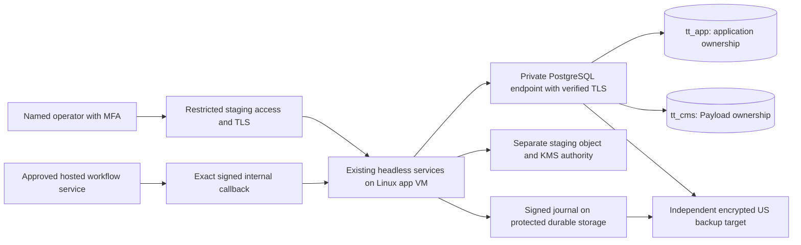

# P1-PR-027 — private hosted staging decision packet

**October 27, 2026 · Planning packet approved and merged as [PR #33](https://github.com/xmyqyl4x/tiresandtreads/pull/33), `7d0849b7`; no infrastructure authorization.** Baseline is owner-approved [PR #32](https://github.com/xmyqyl4x/tiresandtreads/pull/32), merged at `7f2476e62864a671d437f932d8879f57d2de129d`. The owner accepted the final local S3 reconciliation and authorized this private hosted staging decision packet only. **No provisioning, purchases, account creation, cloud authentication, DNS changes or remote deployment are authorized.** Specialist review and licensed adapters remain pending; product APIs and frontends remain held. All six [S3 acceptance gates](P1-PR-027-s3-gate-review.md) remain open.

This is a continuation of task P1-PR-027 under `S3-service-host`, not a new core card or the similarly numbered frontend task. The [accepted local review](P1-PR-027-final-local-readiness.md), immutable historical receipts and existing local dev/stage environments remain intact. This packet is a proposal for later selection and implementation; it supplies no hosted test result or actual provider acceptance record. [Decision/cost data](evidence/P1/p1-pr-027-staging-decision.json), [public research sources](evidence/P1/p1-pr-027-staging-sources.json), [validation procedure](evidence/P1/p1-pr-027-staging-validation.md).

## Recommendation and alternatives

Evaluate **S2: a DigitalOcean Linux application VM plus managed PostgreSQL in NYC3** first. This is a conditional recommendation for staging, not vendor selection or final production architecture. Managed database maintenance reduces the work we would otherwise own. It does not remove our responsibility for schema/roles, privacy, independent recovery, monitoring or incident response. A named primary and backup operator are required in either model.

| Candidate | Proposed initial topology | Published app/DB monthly subtotal, USD | Main tradeoff / selection condition |
| --- | --- | --- | --- |
| S1 — self-operated PostgreSQL | Two separate DigitalOcean Basic Regular VMs, each 2 vCPU / 4 GiB / 80 GiB: app and DB; one US region/private network | **$48.00**: $24 + $24; backup, access, provider and operator costs extra | Highest control over pinned PostgreSQL and roles; we own DB patches, encrypted disks, backups/WAL, certificates and recovery. Select only with actual DB operational ownership |
| S2 — managed PostgreSQL, preferred for evaluation | Same $24 app VM; Standard managed PostgreSQL 2 vCPU / 4 GiB, listed minimum 60 GiB configuration; same region | **$84.90**: $24 + $60.90; ancillary services extra | Conditional on exact engine/minor availability, ownership/role/restore compatibility, effective capacity and acceptable growth path. No standby/HA claim for this staging tier |
| S3 — AWS alternative | Linux EC2 app and private RDS PostgreSQL, same US region; S3/KMS integration within AWS | **Quote required**, not ranked on assumed price | Evaluate if owner prefers AWS/account alignment or S2 preflight fails. Itemize instance/CPU credits, DB storage/backups, IPv4, endpoints/NAT, cross-AZ transfer, monitoring and access; no account access performed |

Prices are public-page observations on October 27, not regional checkout quotes or spend approval. [Droplet catalog](https://www.digitalocean.com/pricing/droplets) lists the $24 configuration; [managed PostgreSQL catalog](https://www.digitalocean.com/pricing/managed-databases) lists $60.90 for the minimum 4 GiB configuration and adjustable storage. Reconfirm edition, disk selection, currency, regional stock and taxes before approval. Do not add the included minimum storage twice. The [AWS pricing page](https://aws.amazon.com/rds/postgresql/pricing/) requires configuration-specific costing; stopping RDS compute still leaves storage/backup charges.

NYC3 is the proposed first region; SFO3 is a US fallback needing review. DigitalOcean's [regional matrix](https://docs.digitalocean.com/platform/regional-availability/) lists app VMs and PostgreSQL in both. Actual stock, engine patch and account eligibility remain unverified. App and DB must share a region/private network; do not depend on cross-region VPC reachability. Backup/journal secondary location and every external service's data location need separate confirmation. Production and staging use distinct clusters, identities, keys and storage. Choosing staging does not select a production vendor or prove production availability.

DigitalOcean currently lists 22 / 47 / 97 available backend connections at 1 / 2 / 4 GiB. The proposed 45-slot budget below excludes 1 GiB; 2 GiB has little margin and is not recommended. Its [limits](https://docs.digitalocean.com/products/databases/postgresql/details/limits/) also announce that new Standard clusters for new accounts from October 15, and all accounts from November 30, cannot exceed 4 GiB or add standby/read-only nodes. PostgreSQL 18 is listed, but exact 18.6 availability is unproven. An Advanced-edition or different-provider production path needs a fresh quote and compatibility review. No local database version is changed to fit a catalog.

## Decisions for owner review

**All HS decisions below are proposed, with no approved value.** Packet merge accepts the research/planning artifact only. Provider, budget or policy decisions need explicit values and accountable approvers; none independently authorizes provisioning. These are decision IDs under existing DD03–DD06, not new task IDs or acceptance gates.

| ID | Proposal / decision needed | Existing trigger and accountable role |
| --- | --- | --- |
| HS01 — host/region | Evaluate DigitalOcean NYC3; SFO3 fallback; AWS alternative requires quote. Confirm account owner, US data locations, registry and exact available plans | DD03, owner + platform reviewer, before host-specific implementation assumptions or provisioning |
| HS02 — DB operation | Evaluate S2 managed 4 GiB first, conditional on SP01/SP02 below; S1 fallback requires a named DB operator and independent backup plan. Keep separate `tt_app`/`tt_cms` ownership and standard PostgreSQL | DD03/DD05, platform/DB reviewer; no version downgrade, elevated runtime role or automatic fallback |
| HS03 — access | Owned staging subdomain, TLS, named MFA-protected operator access via reviewed VPN/tunnel or authenticated proxy; DB private path and trusted-source restrictions; exact signed workflow callback exception only when authorized | DD03/DD05, owner + security/platform reviewer; domain/access method still undecided |
| HS04 — spending | Review the [expanded budget](P1-PR-027-staging-operations-budget.md): proposed USD 350/month recurring infrastructure and separate USD 100/event and month temporary envelope, plus unresolved actual labor/tax/support/local/setup costs. Historical USD 175 is insufficient for this model; no budget is approved | DD04, repository owner; taxes, operator labor and data licenses listed separately; no paid action yet |
| HS05 — operators | Review the [role/response matrix](../operations/staging-operator-responsibilities.md); actual primary/backup, DB/key/review owners, accepted coverage, rates and destinations remain unconfirmed | DD05, owner; roles are currently unstaffed and Codex is not an on-call operator |
| HS06 — provider scope | Assess actual AWS S3/KMS and existing Inngest/email service boundaries using separate staging authority; confirm nonproduction terms, region, signing and sandbox/no-send behavior | DD05, platform/privacy reviewer; provider accounts, credentials and external effects remain unapproved |
| HS07 — custody/policy | Proposed encrypted daily off-host backups, signed nonempty journal recovery, retained key versions and controlled deletion replay. Draft synthetic retention: 7+ day PITR where supported, 30-day daily backups, 14-day masked logs; applicable policy must be reviewed | DD06/G2 privacy reviewer, unassigned; these windows are engineering proposals, not legal policy or accepted retention authority |
| HS08 — execution sequence | Review packet → approve concrete choices → implement/test hosted configuration locally → approve exact scoped provisioning change → private hosted proofs → separate gate review. Product APIs remain held throughout | Owner + backend/platform reviewer; all six gate states and records remain unchanged |

Budget approval needs the cost model, billing account/currency, monthly ceiling, short-lived-resource allowance and operator labor arrangement. A name in a role column is not evidence that someone accepted the responsibility. Reconfirm provider limits/prices whenever the choice, edition, region or material workload changes, and immediately before any eventual purchase.

## Staging boundary and intended topology

This is the desired future arrangement, not a deployed diagram. Initial scope is the existing headless service host and internal workflow transport; no product UI, staff portal or public/owner/staff/provider product API implementation is included. The web health container may be omitted; if run it has zero DB pools and product routes remain absent. The Payload database remains separate even while its UI is held. A single app VM and single DB primary are staging failure domains, not evidence of the 99.9% production target.

“Private staging” requires enforced access boundaries. `noindex`, a secret hostname or a login screen alone is not sufficient. DB traffic uses private routing, strict trusted-source rules and verified server identity. Managed DB public reachability must be tested denied from an unrelated source; DigitalOcean documents [public defaults](https://docs.digitalocean.com/products/databases/postgresql/how-to/manage-users-and-databases/) and [trusted sources / TLS](https://docs.digitalocean.com/products/databases/postgresql/how-to/secure/). No DB or worker port is opened indiscriminately. A later machine-to-machine workflow callback must have a path/method-specific access rule, SDK signature verification, replay/adverse tests and no human-login redirect. Health and other operator routes remain restricted; product URLs remain denied/404.

Administration/migrations use an approved tunnel or private runner. The developer workstation is an operator client, not a database/server dependency. A trusted Linux CI builder produces immutable image digests without staging secrets. A protected deployment job, with short-lived/scoped authority and recorded approval, performs migration and rollout later. No untrusted fork receives credentials. Secrets live in restricted platform/file mounts, never Git, images, logs, plan output or public snapshots. No existing `.local` credential/settings/provider manifest, fixture key or local database dump is uploaded. Only newly generated staging authority and synthetic fixtures may enter the future environment.

Only explicitly approved synthetic maintenance lanes may run; begin with quota cleanup. Report issuance, real mail, destructive privacy fulfillment, live imports, product analytics, ads and AI remain inactive. A no-send adapter is the initial mail boundary; any actual sandbox call or test-recipient send requires its own scoped authorization and provider contract. Moto and the Inngest development server are local fixtures; neither is promoted as actual provider acceptance.

## Complete proposed connection budget

Keep one headless service-host replica with the current 17 owned lane maxima of one: 16 application lanes and one CMS lane. Application/CMS logical databases share one physical server capacity. The future hosted allocation below is a proposal distinct from the accepted **42/100 retained-local** and **65/100 isolated-harness** budgets.

| Connection consumer | App maximum | CMS maximum | Control |
| --- | --- | --- | --- |
| One headless host, all owned lanes | 16 | 1 | Explicit max per lane; bounded queues/timeouts/drain |
| Human operators | 2 | 1 | Includes manual inspection; no undeclared concurrent SQL consoles |
| Migration/bootstrap executor | 1 | 1 | One serialized executor per DB; bootstrap shares this allocation |
| Backup/recovery verification | 1 | 1 | Serialized controlled target; separate restored cluster budget recorded independently |
| Restricted observer | 1 | 0 | Read-only actor and masked output; no migration authority |
| Recovery/maintenance reserve | — | — | 20 physical server slots, in addition to provider-reserved capacity |
| **Total** | **21** | **4** | **25 active maxima + reserve 20 = 45 usable backend slots required** |

Effective capacity means server capacity after vendor-reserved/unavailable slots. Local `max_connections=100` is not a promise about a managed endpoint. Query the actual server and reconcile provider limits before admitting work; account for backups, replication and monitoring already operated by the vendor without double-counting vendor reservations. With a second overlapping host replica, require **62 usable slots** (34 owned + eight external + 20 reserve). Run at most one maintenance scheduler during overlap; promote/drain without duplicate effects. Autoscaling stays disabled until the complete new plan is reviewed. Do not count idle sockets as configured maxima.

Direct bounded `pg` pools are the first proposal. PgBouncer is conditional on measured need and compatible transaction-local permissions; it is not a new dependency here. Migrations/restore use a reviewed direct path. Additional web/Payload UI processes, API transports, workers, replicas, test runners or proxies with SQL connections must be budgeted before activation. A restored DB has separate physical capacity and credentials; it must never run a competing live scheduler or send external effects.

## Cost model and operating assumptions

**Historical October 27 model retained below.** The later [HS04/HS05 supplement](P1-PR-027-staging-operations-budget.md) expands the category inventory and corrects paid-workflow sizing. Its proposed USD 350 recurring infrastructure plus separate USD 100 temporary envelope does not include unresolved actual labor/tax/support/local/setup amounts. No historical model or new envelope is approved. Use the expanded supplement for current review; preserve the figures below as the original planning record.

The [machine-readable model](evidence/P1/p1-pr-027-staging-decision.json) distinguishes published app/DB prices from unsourced **planning allowances**, contains no approved budget and can be recalculated without a cloud account. Use published full-month caps for DigitalOcean's selected configurations, not an invented 730-hour conversion. USD, on-demand, one staging environment, no credits/discounts or speculative advertising income. Production, licensed data, tax and human operations are separate line items with unknown amounts, not zero-cost assumptions.

| Monthly category | Low: occasional smoke | Base: repeated validation | High: repeated recovery / larger app |
| --- | --- | --- | --- |
| S2 app VM (published) | $24.00 | $24.00 | $48.00, 8 GiB catalog option |
| S2 managed DB minimum (published) | $60.90 | $60.90 | $60.90 |
| Independent DB/journal backup storage, versions and requests (allowance) | $8.00 | $15.00 | $30.00 |
| KMS/secrets and requests, retained versions (allowance) | $4.00 | $6.00 | $10.00 |
| Access, registry, logs, alerts and DNS allocation (allowance) | $8.00 | $15.00 | $25.00 |
| Hosted workflow/email service minimums (allowance; quote required) | $3.00 | $9.00 | $20.00 |
| Egress, cross-provider transfer, excess disk and retrieval (allowance) | $2.00 | $5.00 | $15.00 |
| Subtotal | **$109.90** | **$134.90** | **$208.90** |
| Planning contingency, 20% | $21.98 | $26.98 | $41.78 |
| **Proposed envelope** | **$131.88** | **$161.88** | **$250.68** |

Allowances are neither supplier quotes nor proof that a required paid service tier fits. Requote actual workflow/email/access/registry/monitoring subscriptions; a higher mandatory minimum invalidates the envelope and requires revised owner review. Base fits the proposed $175 ceiling with $13.12 remaining; high does not. Temporary duplicate DBs/VMs during restore/rollout, standby/Advanced edition, load balancer/NAT and paid support require separate quotes and inclusion before authorization. No NAT gateway or paid load balancer is assumed in the DigitalOcean example. Provider snapshot charges are additional if selected: DigitalOcean [basic backups](https://docs.digitalocean.com/products/backups/details/pricing/) add 20% weekly or 30% daily to VM cost; these are not substitutes for independently restored database/journal backups.

S1 base comparison is $48 app/DB + the same $50 ancillary allowances = $98, plus 20% contingency = **$117.60/month before additional DB backup tooling/VM snapshot costs and operator labor**. DB ownership adds real maintenance/recovery effort; obtain operator hours × agreed rate rather than treating them as free. S3 remains unquoted. [S3 charges](https://aws.amazon.com/s3/pricing/) depend on stored versions, requests, retrieval/replication and transfer; [KMS](https://aws.amazon.com/kms/pricing/) lists $1 per customer-created key/month plus usage and applicable rotation storage. The KMS row is an allowance for the whole proposed design, not a claim that all key material is one billed key.

Future budget alerts at 50/80/100% route to the actual owner/operator; billing alerts do not enforce a hard spending cap. At 80%, review anomalies and suspend optional test generation. At the approved ceiling, block new optional resources and escalate; preserve required recovery, security and privacy obligations. Stopping a process does not remove ongoing resource/storage charges. No budget monitor, schedule or billing change is created by this packet.

## Hosted-readiness preflight work and evidence

The current code is intentionally local-only. These are **work packages SP01–SP08 under existing P1-PR-027**, not new core cards or accepted hosted results. The owner approved [SP01/SP02 local-only preflight](P1-PR-027-local-hosted-preflight.md) in merged PR #34 (`1f1db236`) and [SP03 local provider preflight](P1-PR-027-local-provider-preflight.md) in merged PR #35 (`9529a3f8`). The owner approved [SP04 local custody/recovery preflight](P1-PR-027-local-custody-preflight.md) in merged PR #36 (`0e521439`) and subsequently approved [SP05 local deployment/access/rollback preflight](P1-PR-027-local-deployment-preflight.md) in merged PR #37 (`3e86d3e5`). The owner approved [SP06 local capacity/lifecycle preflight](P1-PR-027-local-capacity-preflight.md) in merged PR #38 (`fa25c6b7`) and approved [SP07 local observation/response preflight](P1-PR-027-local-observation-preflight.md) approved in merged PR #39 (`9d314d00`); [SP08 local evidence handoff](P1-PR-027-local-evidence-handoff.md) accepted in merged PR #40 (`8965bd72`). Actual hosted proofs remain pending. This is not authorization to implement everything now. Code changes need TDD with adverse-path proofs; actual provider behavior still needs later hosted evidence. Keep domain/repository/service business rules shared.

| Work item | Repository finding / required future change | Required proof before hosted acceptance |
| --- | --- | --- |
| SP01 — endpoint/TLS configuration | [Host plan](../../packages/config/src/service-host-plan.ts) only accepts local hostnames, refuses URL query options and assumes a shared server. [Pool factory](../../packages/db/src/runtime-pool.ts) has no explicit hosted CA/verification input. Add a separate reviewed hosted configuration/composition path; retain strict local guards | Local TLS server: accepted CA/hostname succeeds; wrong CA/name, expired certificate, plaintext and disabled verification refuse. Actual selected endpoint/CA rotation and both app/CMS lanes then proved; no arbitrary URL flag bypass |
| SP02 — roles/version/bootstrap | [Bootstrap](../../scripts/database/bootstrap.ts) checks database owner `local_harness` or exact migrator, forbids unexpected memberships, applies explicit role capabilities and owns app/CMS schemas separately. Provider defaults are not assumed compatible | Exact PostgreSQL minor, extensions/collation/timezone, create/alter ownership, ACLs, default privileges, RLS, all 19 scoped roles, migrations/replay and dump/restore on disposable provider DBs. Never grant runtime superuser/provider-admin or weaken checks to fit a provider |
| SP03 — actual provider composition | [Current host](../../packages/integrations/src/service-host.ts) is explicitly `createLocalServiceHost`, uses fixture S3 credentials/sender; [runtime](../../packages/config/src/runtime.ts) requires fixtures; [CLI](../../scripts/runtime/service-host.ts) accepts only local callback origins | Hosted factory binds actual scoped S3/KMS/workflow/no-send ports with explicit environment/region. Local-mode refusal remains. Wrong account, region, key authority, signature, network and unknown external effects refuse/reconcile; no `.test` origin or emulator presented as hosted acceptance |
| SP04 — custody/recovery | Local private files and empty retained journals are not independent backup evidence | New staging keys and nonempty signed synthetic journal; encrypted off-host DB/CMS/object/journal recovery, key-version continuity, deletion/tombstone replay and isolated quarantine. Measure RTO ≤4h and RPO ≤24h; claim ≤15min only after PITR continuity/restore is proved. Retain 7+ days PITR where supported; applicable retention still requires G2 review |
| SP05 — deployment/access | No selected-host release/ingress manifest has been accepted | Reviewed account/region/resource plan, registry digest/provenance, environment isolation, restricted access/TLS, signed callback route, denied product routes, serialized expand-only migrations, current/previous image rollback and fail-closed readiness. No startup schema push or merge-to-public-traffic activation |
| SP06 — capacity/lifecycle | Local physical pool evidence does not accept hosted usable capacity | Enumerate every process/replica/pool/provider reservation; show 45-slot single-host or revised plan; admission/backpressure under synthetic mixed load, DB outage/reconnect, disk headroom, connection drain and shutdown. Hosted limits include journal/object I/O, not only SQL |
| SP07 — observation/response | Existing local JSONL alarms are invocation-local with no actual destination/responder | Masked hosted metrics/log retention, queue/dependency/schedule/capacity alerts, explicit freshness/failure behavior, actual recipient acknowledgement/escalation and timed response drill. Prove failure to notify is visible. No actual recipient notification without explicit authorization |
| SP08 — acceptance handoff | `S3-service-host`, provider and privacy gates remain pending | Commit/image/config/migration/region/version, timestamped actual results and limits, named reviewer/operator, actual provider/G2 cross-references and remaining gate list. Review/accept individual scopes; strict full S3 acceptance stays refused while any gate is pending |

Managed database caveat is documented by [DigitalOcean's user/DB administration](https://docs.digitalocean.com/products/databases/postgresql/how-to/manage-users-and-databases/) and [RDS's restricted administrator role](https://docs.aws.amazon.com/AmazonRDS/latest/UserGuide/Appendix.PostgreSQL.CommonDBATasks.Roles.rds_superuser.html). Managed service compatibility is an experiment to perform later, not a property inferred from PostgreSQL branding. RDS [CA verification](https://docs.aws.amazon.com/AmazonRDS/latest/UserGuide/UsingWithRDS.SSL.html) also requires actual server identity verification. DigitalOcean [backup/maintenance features](https://docs.digitalocean.com/products/databases/postgresql/details/features/) describe capability, not project recovery acceptance.

## Review and next action

This packet is complete when its sources/cost arithmetic, constraints, decision values, code findings, ownership and acceptance sequence are reviewable. Its review does not close `S3-service-host` or any other gate. No cloud CLI login/API request, infrastructure plan/apply, signup, spending, DNS edit, deployment, notification or external test was performed. Public vendor documentation and GitHub repository workflows are the only external research/publication in this task. Existing Docker/native PostgreSQL, keys, fixtures and manifests are untouched by packet preparation; mandatory verification uses only its isolated disposable projects.

The owner approved/merged this packet and authorized **SP01/SP02 local-only preflight implementation**, approved and merged as PR #34 (`1f1db236`), with no actual hosted connection or activation. The owner approved SP01–SP07 local-only proofs through merged PR #39 (`9d314d00`) and authorized [SP08 local-only evidence handoff/readiness review](P1-PR-027-local-evidence-handoff.md) accepted in merged PR #40 (`8965bd72`). HS01–HS08 remain proposed. The local inspector and TLS fixtures do not enable hosted runtime URLs. Obtain actual HS01–HS08 decisions before host-specific commitments or remote work. Later provisioning must be a separate concrete reviewed change with account/region/cost/resource inventory, operator access, rollback/cleanup and explicit owner authorization. Document preparation or selection approval alone is not permission to apply it.

All 119 original task cards/dependencies, 137 FR rows, source archives, historical approvals and three unchecked P1-PR-027 completion boxes remain. Four live phases, PostgreSQL consolidation, option C, database → repositories → services → APIs → UI, specialist/licensed deferrals and the API hold are unchanged.

The owner accepted SP08 local reconciliation in merged PR #40 (`8965bd72`) and authorized the proposed [HS05/HS04 definitions](P1-PR-027-staging-operations-budget.md), now in review. Actual assignments, budget, provider/region and all acceptance values remain unapproved; no infrastructure execution or notifications are authorized.

**October 28 HS01/HS02 review:** Owner-approved [PR #41](https://github.com/xmyqyl4x/tiresandtreads/pull/41) merged at `e37617ca`; HS04/HS05 definitions/calculations are accepted only. The [host/region and database review](P1-PR-027-host-database-review.md) retains managed PostgreSQL as a conditional research candidate, with exact patch handling, restricted-admin ownership/membership replay and Advanced-edition role names/growth unresolved. Next bounded proposal is a local-only restricted-admin contract investigation, not provisioning. All HS01–HS08 remain proposed, operators/coverage/rates unconfirmed, six actual S3 gates pending, specialist/licensed work pending and APIs/frontends held. No provisioning, purchases or notifications.

**October 28 restricted-admin local investigation:** Owner-approved [PR #42](https://github.com/xmyqyl4x/tiresandtreads/pull/42) merged at `ad9c55a0`, accepting HS01/HS02 analysis only. The [local bootstrap/replay investigation](P1-PR-027-restricted-admin-investigation.md) adds 13 real PostgreSQL 18.6 cases: ordinary restricted creator bootstrap/replay is refused, privileged local control can establish/replay 19 clean roles, and runtime/default-ACL/RLS/cross-DB denials remain intact. It adds a disposable-only diagnostic, not a hosted adapter or production policy change. A bootstrap/provisioning lifecycle contract review is the next proposal, not automatically authorized. HS01–HS08 remain proposed; all operator/coverage/rate, six actual S3, specialist/licensed and API/frontend holds remain. No provisioning, purchases or notifications.

**October 29 lifecycle contract design review:** Owner-approved [PR #43](https://github.com/xmyqyl4x/tiresandtreads/pull/43) merged at `f878e8fd`, accepting the restricted-admin local investigation only. The [bootstrap/provisioning lifecycle proposal](P1-PR-027-bootstrap-lifecycle-contract.md) separates privileged setup, read-only validation, owner migrations, runtime admission, rotation and quarantined recovery, with 22 prospective test cases. Current production code and policy are unchanged. Next proposed work is a disposable-only phase-aware read-only validation proof, not automatically authorized. HS01–HS08 remain proposed; operators/coverage/rates unconfirmed; six actual S3 gates pending, specialist/licensed work pending and APIs/frontends held. No provisioning, purchases or notifications.

**October 29 disposable lifecycle validation proof:** Approved [PR #44](https://github.com/xmyqyl4x/tiresandtreads/pull/44) merged at `d407a86c`, accepting lifecycle design analysis only. The [phase-aware read-only proof](P1-PR-027-lifecycle-validation-proof.md) adds 22 unit and 40 real PostgreSQL cases for foundation, migrated and synthetic quarantined-recovery profiles, strict target/TLS/role/history/ACL checks, unchanged-state/error controls and runtime CONNECT denial. All six new code files are test support; production bootstrap/CLI/preflight/policy, dependencies and CI remain unchanged. Paired validation/receipt handoff is the next proposal only. HS01–HS08 proposed; operators/coverage/rates unconfirmed; six actual S3 gates pending, specialist/licensed work pending and APIs/frontends held. No provisioning, purchases or notifications.

**October 29 disposable paired-lifecycle proof:** Approved [PR #45](https://github.com/xmyqyl4x/tiresandtreads/pull/45) merged at `25b06379`, accepting the phase-aware local proof only. The [paired validation and receipt/handoff proof](P1-PR-027-paired-lifecycle-handoff-proof.md) adds 56 local cases for exact both-DB evidence, fresh handoff reads, stale/partial/unavailable pair refusal, actual one-sided migration commits and cooperative lock/loss controls. All seven new code files are test support; production bootstrap/CLI/preflight/policy and prior reader/fixture remain unchanged. Receipts grant no runtime or hosted authority. HS01–HS08 proposed; operators/coverage/rates unconfirmed; six actual S3 gates open; specialist/licensed work pending; APIs/frontends held. No provisioning, purchases or notifications.

**October 29 disposable executor interruption/restart proof:** Approved [PR #46](https://github.com/xmyqyl4x/tiresandtreads/pull/46) merged at `b7e15907`, accepting the paired local proof only. The [interrupted-executor and cold-restart proof](P1-PR-027-interrupted-executor-cold-restart-proof.md) adds 50 local cases: 15 real SIGKILL checkpoints across three profiles, fresh-process old-receipt refusal, both-DB revalidation, resume/orphan controls and post-crash drift refusal. All six new code files are test support; production bootstrap/CLI/preflight/policy and prior proofs unchanged. No runtime authority. HS01–HS08 proposed; operators/coverage/rates unconfirmed; six actual S3 gates open; specialist/licensed work pending; APIs/frontends held. No provisioning, purchases or notifications.

**October 29 lifecycle evidence reconciliation (review only):** Approved [PR #47](https://github.com/xmyqyl4x/tiresandtreads/pull/47) merged at `a4221e63`, accepting the interrupted-executor local proof only. The [22-case reconciliation and remaining-gap review](P1-PR-027-lifecycle-evidence-reconciliation.md) maps phase-aware, paired, process-restart and earlier recovery/custody evidence, identifies unmet lifecycle/coverage/operating requirements and proposes a bounded T07–T09 catalog adverse-case proof next. No implementation, full-case acceptance or gate closure. Production bootstrap/CLI/preflight/policy unchanged. HS01–HS08 proposed; operators/coverage/rates unconfirmed; six actual S3 gates open; specialist/licensed work pending; APIs/frontends held. No provisioning, purchases or notifications.
