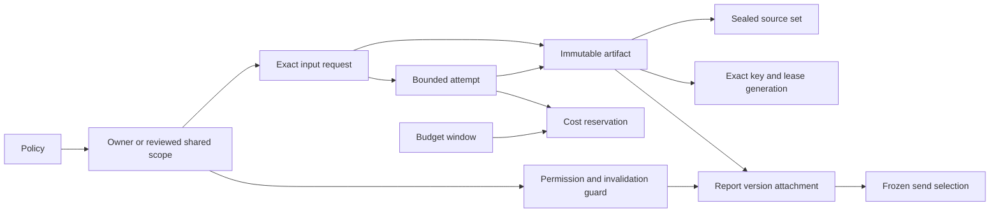

# P2-PR-003 — Local AI policy, artifact, reuse and budget schemas

The owner selected the next implementation card after completed [PR #90](https://github.com/xmyqyl4x/tiresandtreads/pull/90). The [continuation record](evidence/P2/p2-pr-003-local-authorization.json) extends early local work to this card only. Actual P1 release, P2 feasibility/S1, source/provider/model/budget/privacy/specialist and deployment acceptance remain open.

**Trace:** CAP-05/CAP-06, UC14/UC15 and storage portions of DB23–DB25; E39/E40. [AI/photo specification](../14-ai-analysis-and-photo-design.md), [TDD](../08-test-driven-development.md) and [coding standards](../10-coding-standards.md) still govern the later layers. No provider SDK, model selection, external call, repository/service/API/UI or automatic refresh worker is added.

## Storage and migration boundary

Three [opt-in migrations](../../infra/database/phase-2-local/ai/README.md) add twelve forced-RLS tables and two guarded views. The manifest pins the unchanged 33-entry P1 app manifest and unchanged three-entry partner extension. The existing migration runner appends three AI entries to the populated local history, bringing it to 39; it retains its transaction, checksum and migration-lock behavior. Production bootstrap/CLI/preflight, P1 entities/models, role inventory, dependencies and default runtime remain unchanged. The extended disposable database is not admitted by the unchanged production preflight.

| Area | Tables and enforced storage relationships |
| --- | --- |
| Policy and scope | `ai_policy_versions`, `ai_reuse_scopes`: immutable evaluated configuration and owner/shared identity, reviewed shared allowlist, compound scope/policy keys |
| Permission and requests | `ai_scope_guards`, `ai_analysis_requests`: explicit processing choice/revisions, existing owner privacy-request link, terminal deleting state, exact immutable input/replay identity and a bounded request deadline |
| Attempts | `ai_attempts`: same request/scope/policy parent, at most three attempts, explicit unknown cost, fixed currency, no state rewind and a required cost hold before start |
| Artifacts and sources | `ai_artifacts`, `ai_artifact_sources`: accepted request/attempt binding, bounded immutable JSON and output digest, validator/revision pins, complete sealed typed source set and rights/retention bounds |
| Exact reuse | `ai_reuse_entries`: scope/key primary key, compound artifact/scope/policy/input FK, current permission/invalidation revisions, bounded lease and increasing generation |
| Presentation | `report_analysis_attachments`, `email.analysis_selections`: immutable report/version/revision and send/owner/report references; explicit artifact or no-AI selection before delivery bytes are frozen |
| Budget | `ai_budget_windows`, `ai_budget_reservations`: same policy/currency/attempt, nonnegative exact minor units, conserved reserved/spent totals and evidence-linked uncertainty reconciliation |

The fixture compares all 164 prior table entries: 163 complete data-table snapshots and the original 36-entry migration-history prefix. A real synthetic owner report and retained partner organization/membership are present. Existing relation owners/ACLs/RLS flags and function owners/ACLs/security/search paths are compared separately. The three new history rows are expected growth. One additive send/owner/report/version unique key supplies a compound frozen-selection FK; no original row or migration checksum is rewritten.

## Exact identity, publication and reads

The local storage digest includes scope ID, immutable policy ID, canonicalization version and supplied normalized JSON manifest. JSON object order is canonicalized by the pinned PostgreSQL representation; array order and explicit unknowns are preserved. Semantic normalization of units, domain parameters, authoritative hashes and real provider configuration remains a later S2/S3 obligation. A new evaluated policy has a distinct identity and cannot silently reuse an old configuration's output.

Owner requests must match their scope owner, policy and current choice/subject/invalidation revisions. Shared scopes require a reviewed generic template with a fixed nonpersonal parameter allowlist and coded values; owner-null is not an automatic fallback. Photo tasks stay private and require a sanitized-image digest. Real source-to-AI rights, template review and account/provider processing controls remain acceptance inputs; synthetic active policies are not approvals to process real data.

A common captured-request guard rechecks those original revisions at attempt creation/start, budget admission and accepted-artifact insertion. Supplying newer revision values cannot revive old work; the artifact/request FK also binds the captured permission and invalidation revisions. Known provider IDs, completion times, usage counts and reconciled cost are immutable. Source eligibility requires current AI-processing, cache, derived-output and snapshot rights, not an AI flag alone.

Fixed database claim/publication functions lock current subject/policy/permission state and one exact key. A captured unexpired holder/generation is required to publish; lease takeover rejects old workers. Permission or policy changes serialize with publication and hide accepted output afterward. `ai_current_reuse` and the owner-filtered `ai_report_analysis` view recheck current policy/permission, source rights, complete source count and read-time expiry. A delayed invalidation job cannot make revoked source rights acceptable.

Artifact insertion requires accepted request, successful attempt, matching manifest/digest/validator and current revisions. Source rows must belong to the artifact's creation transaction; a deferred count check prevents incomplete publication. A partial privileged source purge hides the artifact. The proposed storage limits are 64 KiB output, reuse validity at most seven days and local artifact retention at most thirty days, shortened by source rights. Actual image retention/ownership references are deferred to P2-PR-004; retention policy acceptance remains open.

Owner attachments bind the authoritative report hash/bundle and current report version. Shared attachments require explicit shared selection plus a separate owner authorization scope. Cross-owner, expired, withdrawn, changed-report and photo-output attachment bypasses fail. Frozen selection records choose one immutable attachment revision or a specific no-AI reason and cannot be added after a payload/delivery snapshot is frozen. Existing renderers/retries are not changed; P2-PR-015 must integrate those records into actual frozen bytes and dispatch checks.

## Cost, deletion and later obligations

Reservation accounting locks one configured budget window, adds held minor units atomically, and refuses overcommit or foreign policy/currency. Starting an attempt requires a current hold. Known outcomes settle once; uncertain charges retain funds until settlement or evidence-backed confirmed noncharge. Terminal states cannot rewind. Accounting can reconcile a prior charge after processing withdrawal without reopening processing. Actual monetary caps, provider prices, admission policy and spend authority remain unconfirmed; no external billing exactly-once guarantee is inferred.

The owner guard links deletion to an existing same-owner delete request. Withdrawal/deleting state and subject revision changes prevent new requests, lease publication and readable output; deleting is terminal. Controlled privileged purging remains possible despite normal immutability. Restrictive FKs expose the new dependency graph for later cancellation, permitted audit retention, object/provider deletion and restore replay. Existing P1 privacy/recovery workflows are not claimed to purge this graph. P2-PR-015/P2-PR-005 retain those acceptance requirements before real data or promotion.

Server-only roles split owner projections, private worker commands and reviewed configuration. They have no ownership, superuser, inheritance or RLS bypass. Existing P1/partner runtime roles gain no AI access. Transaction-local owner context must be derived from verified application authority; these tests do not establish external authentication, independent worker identity or fencing of provider effects.

## TDD and validation evidence

The first native test failed on the absent policy relation. Expanded cases reproduced missing photo-hash enforcement, budget admission after request expiry and readable output after partial source deletion. Those checks were corrected. Separate fixture issues were fixed without weakening assertions: forced-RLS snapshots require a full read-only observer; independent duplicate-reservation checks need unused capacity; report send/cancel timestamps must honor the P1 contract; SQL parameter types and request-key types must be explicit.

The focused suite covers native ownership/RLS/column denials, typed parents and immutable state, real last-funds/key races, actual lease expiry, concurrent publication versus withdrawal/policy block/report revocation, source rights and partial purge, shared owner authorization, frozen selections, cost reconciliation and a bounded indexed 10,000-row maintenance query. The [source-bound record](evidence/P2/p2-pr-003-local-proof.json) records the final passing run and exact code hashes. Run `node tests/fixtures/phase2/ai-run.mjs`; full exact-commit build/regression and all required PR/main checks remain necessary before completion.

Manual review added nine failing native regressions for stale captured requests at attempt/cost/publication boundaries, replacing known provider provenance and missing persistence-right checks. The shared guard, compound captured-revision FK, immutable provenance and rights checks corrected them. The final **65 native cases and type checking pass**, with owned disposable containers, volumes and networks removed. No actual model evaluation or original acceptance case is counted as passed.

Automatic review reproduced eleven further failures across skipped/upsert/concurrent reservation retries, untyped shared metadata, owner packet identity leakage and future-created requests. Accounting now runs only after successful row insertion/update, so conflicts cannot strand counter increments. Optional metadata uses UUID version identities and exact digests; shared requests exclude owner report bundle/hash fields. Request creation and expiry are bounded by the database admission clock. Compound parent FKs now fail before accounting, and their exact `23503` denials remain asserted. All **65 native cases**, type checking and owned cleanup pass; the proof records all 24 intended red regressions.

All six S3 gates remain pending, HS01–HS08 proposed, operators/coverage/rates and provider/model/budgets unconfirmed, specialist/licensed work pending, and all actual acceptance/deployment restrictions retained. No provisioning, purchases, actual notifications, actual model evaluation, case closure or gate closure occurs.
